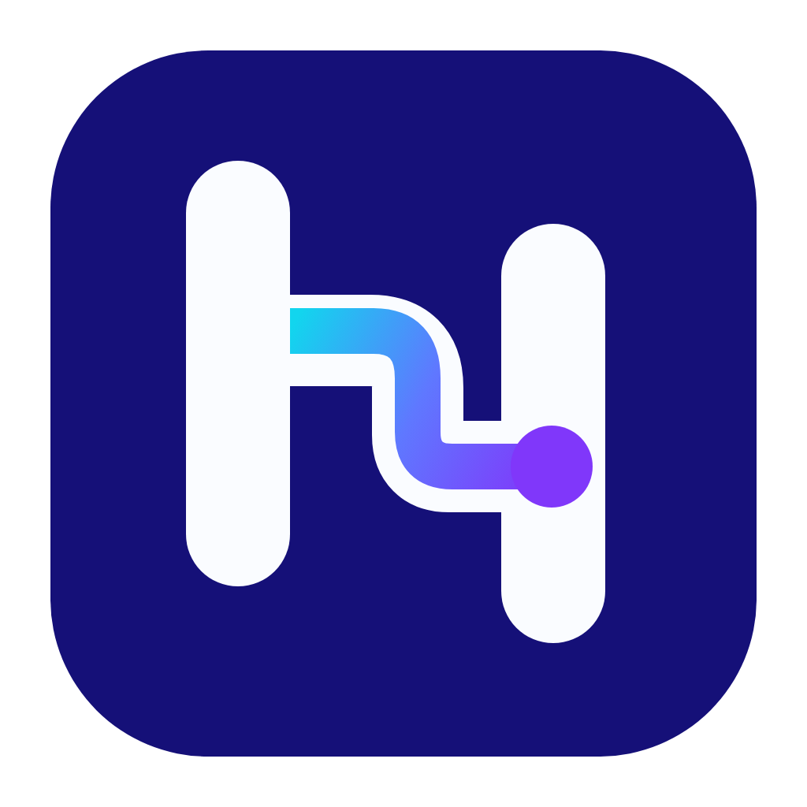
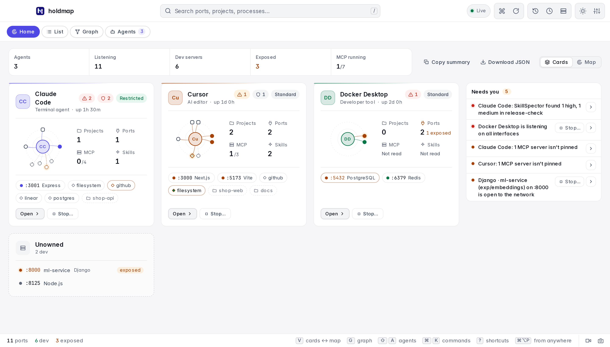
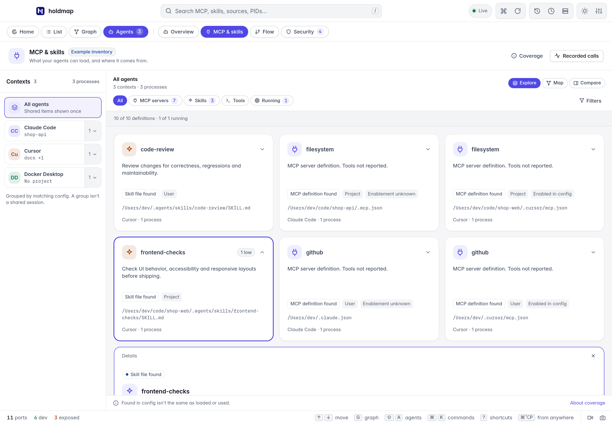
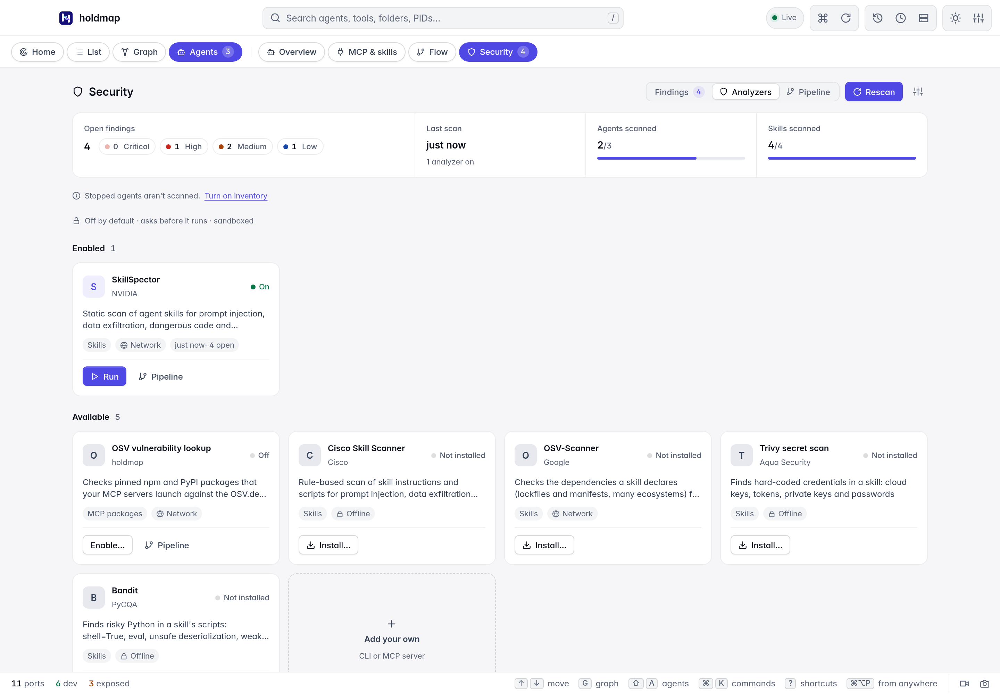
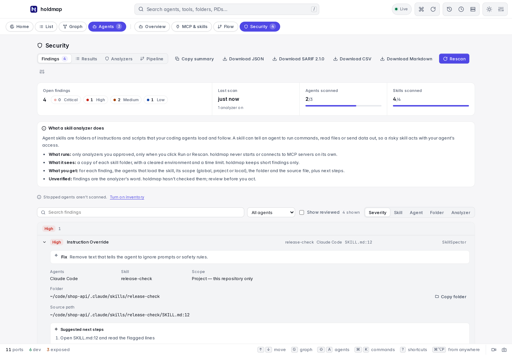
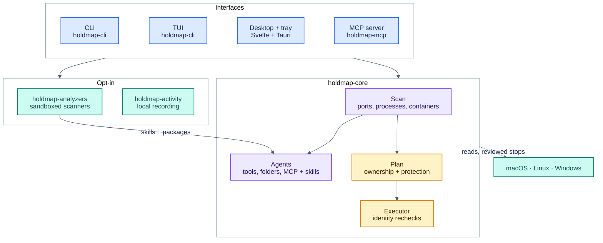

<p align="center">
  
</p>

<h1 align="center">holdmap</h1>

<p align="center">
  <b>See which agent, tool or app holds every port, what each agent is set up with, and stop only what you mean to.</b><br/>
  CLI · TUI · desktop and tray app · MCP server, all on one Rust core. macOS, Linux and Windows.
</p>

<p align="center">
  <a href="https://santoshshinde2012.github.io/holdmap/"><b>Website</b></a> ·
  <a href="https://santoshshinde2012.github.io/holdmap/#demo">Live demo</a> ·
  <a href="https://santoshshinde2012.github.io/holdmap/docs/">Guide</a> ·
  <a href="#install">Install</a> ·
  <a href="#quick-start">Quick start</a>
</p>

<p align="center">
  <a href="https://github.com/santoshshinde2012/holdmap/actions/workflows/ci.yml"></a>
  <a href="https://github.com/santoshshinde2012/holdmap/releases/latest"></a>
  <a href="#license"></a>
</p>

<p align="center">

[](https://m8ven.ai/mcp/santoshshinde2012-holdmap-1nt5m9?s=readme)

</p>

<p align="center">
  
</p>

<p align="center">
  
  
</p>

<p align="center">
  
</p>

## Features

- **Who owns the port.** The process, command, folder, project, git branch and framework, or
  the Docker / Podman / OrbStack container, and why the port is busy.
- **Safe stops.** Review the plan, stop the whole dev-server tree gracefully (SIGTERM, then
  SIGKILL) and check that the port is free. System processes, shells, IDEs and agent hosts
  are protected.
- **Your agents.** Claude Code, Codex, Cursor, Copilot, Gemini CLI, Windsurf, Aider and more:
  folders, child tools, ports, connections, CPU, memory and access. Every fact is marked as
  seen, inferred or unknown. You can stop just the services an agent started.
- **MCP servers and skills (opt-in).** How each MCP server launches and whether it's pinned
  or running, plus skills, permission rules and instruction files. holdmap reads names only,
  never values or file bodies, and never starts an MCP server.
- **Analyzers (opt-in).** Scan skills and MCP packages with SkillSpector, the built-in OSV.dev
  lookup, presets (Cisco Skill Scanner, OSV-Scanner, Trivy, Bandit) or any MCP server. Each one
  stays off until you approve exactly what it gets, and runs on a copy in a sandbox. Add any
  MCP server in three steps: source, tools, review.
- **Home, maps and graphs.** Agents as Cards or a Map with a Timeline and a **Needs you**
  list, the service graph with clusters, and agent flow.
- **Local capture.** Screen or window recording to MP4/GIF and PNG snapshots. Nothing is uploaded.
- **Scriptable.** Every read command takes `--json`. holdmap has no product analytics.

## Architecture



<details>
<summary>Mermaid source</summary>



</details>

All process decisions live in `holdmap-core`, so every interface applies the same rules.
See [docs/architecture.md](docs/architecture.md) for details.

## Install

<!-- release-please updates this source-version marker; download links follow published releases. -->
<!-- x-release-please-start-version -->
Source version: **0.10.0**.
<!-- x-release-please-end -->
Downloads come from the [latest published release](https://github.com/santoshshinde2012/holdmap/releases/latest),
and `main` can be ahead of it ([changelog](CHANGELOG.md)).

**CLI, TUI and MCP server, macOS and Linux**

```sh
curl --proto '=https' --tlsv1.2 -LsSf https://github.com/santoshshinde2012/holdmap/releases/latest/download/holdmap-installer.sh | sh
```

**CLI, TUI and MCP server, Windows (PowerShell)**

```powershell
powershell -ExecutionPolicy Bypass -c "irm https://github.com/santoshshinde2012/holdmap/releases/latest/download/holdmap-installer.ps1 | iex"
```

The binary goes to `~/.local/bin` (`%USERPROFILE%\.local\bin` on Windows). If that folder isn't
on your `PATH` yet, the installer adds it: open a new terminal.

**Desktop app.** Download the latest installer, or pick one on the [website](https://santoshshinde2012.github.io/holdmap/#install):

| Platform | Download |
|---|---|
| macOS, Apple silicon | [Download .dmg](https://github.com/santoshshinde2012/holdmap/releases/latest/download/holdmap-macos-arm64.dmg) |
| macOS, Intel | [Download .dmg](https://github.com/santoshshinde2012/holdmap/releases/latest/download/holdmap-macos-x64.dmg) |
| Windows x64 | [Download .msi](https://github.com/santoshshinde2012/holdmap/releases/latest/download/holdmap-windows-x64.msi) · [Download setup .exe](https://github.com/santoshshinde2012/holdmap/releases/latest/download/holdmap-windows-x64-setup.exe) |
| Linux x64 | [Download .AppImage](https://github.com/santoshshinde2012/holdmap/releases/latest/download/holdmap-linux-x64.AppImage) · [Download .deb](https://github.com/santoshshinde2012/holdmap/releases/latest/download/holdmap-linux-x64.deb) · [Download .rpm](https://github.com/santoshshinde2012/holdmap/releases/latest/download/holdmap-linux-x64.rpm) |

macOS builds are ad-hoc signed and Windows installers are unsigned, so see
[first open](https://santoshshinde2012.github.io/holdmap/docs/desktop/#first-open). Every release
has SHA-256 checksums and build provenance
(`gh attestation verify FILE --repo santoshshinde2012/holdmap`). Linux ARM64 gets the CLI only.

**From source** (Rust 1.95+): `cargo install --locked --path crates/holdmap-cli`.

## Quick start

```sh
holdmap list                    # every listening port, grouped by kind
holdmap explain 3000            # who holds it, why, and what to do (or just: holdmap 3000)
holdmap stop 3000 --dry-run     # show exactly what a stop would do
holdmap stop 3000               # stop it gracefully, then check the port is free
holdmap run -p 3000 -- npm run dev   # free 3000, then start your server on it
holdmap agents                  # running agents and tools
holdmap agents --capabilities   # add their MCP servers and skills (opt-in)
holdmap                         # interactive TUI (Shift+Tab opens Agents)
```

**MCP server.** Add holdmap to Claude Desktop or Cursor (`~/.cursor/mcp.json`):

```json
{ "mcpServers": { "holdmap": { "command": "holdmap", "args": ["mcp"] } } }
```

Stops over MCP always preview first and need a one-use `confirmation_id`. Protected processes
are never stopped. See the [MCP guide](https://santoshshinde2012.github.io/holdmap/docs/mcp/).

**Shell hook.** Add `eval "$(holdmap init zsh)"` to `~/.zshrc` (also `bash`, `fish`, `powershell`)
and a failed "port in use" command tells you who holds the port.

## CLI

<details>
<summary>All commands</summary>

| Purpose | Commands |
|---|---|
| Look | `holdmap list`, `holdmap inspect`, `holdmap explain`, `holdmap graph`, `holdmap agents`, `holdmap needs`, `holdmap watch`, `holdmap ssh HOST` |
| Act | `holdmap stop`, `holdmap kill`, `holdmap restart`, `holdmap run`, `holdmap open` |
| Ports | `holdmap free-port --near 3000`, `holdmap wait 5432 --timeout 30s` |
| Projects | `holdmap up`, `holdmap down`, `holdmap status`, `holdmap init` |
| Remember | `holdmap pin`, `holdmap unpin`, `holdmap pins`, `holdmap history` |
| Analyzers | `holdmap analyzers list`, `holdmap analyzers show`, `holdmap analyzers approve`, `holdmap analyzers revoke`, `holdmap analyzers run`, `holdmap analyzers auto`, `holdmap analyzers add`, `holdmap analyzers presets`, `holdmap analyzers servers`, `holdmap analyzers tools`, `holdmap analyzers map`, `holdmap analyzers remove`, `holdmap analyzers key set`, `holdmap analyzers key delete` |
| Analyzer catalog | `holdmap analyzers catalog`, `holdmap analyzers catalog status`, `holdmap analyzers catalog fetch`, `holdmap analyzers catalog import`, `holdmap analyzers catalog accept`, `holdmap analyzers catalog reject` |
| Findings | `holdmap insights`, `holdmap insights review`, `holdmap insights snooze`, `holdmap insights reopen` |
| Recording | `holdmap activity serve`, `holdmap activity setup`, `holdmap activity snapshot`, `holdmap activity hook` |
| Integrate | `holdmap tui`, `holdmap mcp`, `holdmap completions zsh`, `holdmap man` |

</details>

Exit codes: `0` ok, `1` busy, not found or timed out, `2` error, `3` blocked by the safety
policy, `4` needs elevation. Every flag is in the [CLI reference](docs/cli.md).

## Safety

- **Plan first.** Every stop is a plan you can review (`--dry-run`). The desktop and MCP bind
  execution to a one-use preview and refuse it if the effects changed.
- **The right target.** holdmap stops the dev-server tree root so nothing respawns, and goes
  through Docker, systemd, pm2 or brew for managed services.
- **Protected processes.** OS processes and holdmap itself can never be stopped. Shells,
  terminals, IDEs and agent hosts need an explicit override (never available over MCP).
  Identity and protection are checked again right before each signal.
- **Private by default.** Credentials in commands are redacted, state files are private
  (`0600`/`0700` on Unix), and agent inventory, analyzers and recording are all opt-in and local.

See [SECURITY.md](SECURITY.md) for the full model, limits and how to report a vulnerability.

## Benchmarks & evaluation

Measured on a Linux VM (8 vCPU Xeon, Debian 13). A Mac or Windows PC will differ, so rerun
the scripts on yours. Details, the environment and how to reproduce are in
[docs/benchmarks.md](docs/benchmarks.md).

| Measurement | Result |
| --- | --: |
| CLI startup (`holdmap --version`), median | 1.2 ms, 4.7 MiB peak RSS |
| `holdmap list --json` with 127 / 1,027 / 5,027 listening ports, median | 47 / 45 / 189 ms |
| Peak RSS at 5,027 ports | 36.5 MiB |
| Analyzer overhead per skill (staging copy, sandbox, parsing) | 36–41 ms |
| CLI download (macOS / Linux / Windows) | 1.6–2.8 MiB |
| Desktop installer (`.dmg`, `.msi`, `.deb`) | 5.9–6.9 MiB |

Analyzer and preset detection on 17 labelled fixture skills, findings at medium or above:

| Analyzer | Precision | Recall |
| --- | --: | --: |
| Trivy secrets | 1.00 | 1.00 |
| Bandit | 1.00 | 0.80 |
| OSV-Scanner | 1.00 | 1.00 |
| Cisco Skill Scanner | 0.67 | 1.00 |
| SkillSpector (`--no-llm`) | 1.00 | 0.92 |

Two fixtures ship a `.bandit` or `.trivyignore` that hides their problem. Run directly, those
scanners report nothing. Through holdmap, which leaves the files out of the copy, both
problems are found. The set is small and hand-made: it checks the pipeline, not how good the
scanners are on real skills.

## Docs

| Guide | What it covers |
|---|---|
| [Getting started](https://santoshshinde2012.github.io/holdmap/docs/) | Install, first commands and recipes |
| [Agents, tools and apps](https://santoshshinde2012.github.io/holdmap/docs/agents/) | Agent inventory, MCP and skills, flow and recording |
| [Analyzers](https://santoshshinde2012.github.io/holdmap/docs/analyzers/) | Opt-in scanners, presets, sandboxes and findings |
| [Desktop app](https://santoshshinde2012.github.io/holdmap/docs/desktop/) | Home, graph, shortcuts, capture and first open |
| [MCP for AI agents](https://santoshshinde2012.github.io/holdmap/docs/mcp/) | Client setup, tools and stop confirmation |
| [Project stacks](https://santoshshinde2012.github.io/holdmap/docs/projects/) | `.holdmap.toml`, `holdmap up` and `down` |
| [Troubleshooting](https://santoshshinde2012.github.io/holdmap/docs/troubleshooting/) | PATH, hidden ports, updates, environment variables and uninstalling |
| [CLI reference](docs/cli.md) | Every command and flag |
| [Architecture](docs/architecture.md) | How the crates, desktop app and MCP server fit together |
| [Agent flow](docs/agent-flow.md) | Local recording: providers, privacy and bounds |
| [Benchmarks and evaluation](docs/benchmarks.md) | Measured speed, memory, sizes and analyzer detection, and how to reproduce them |
| [Contributing](CONTRIBUTING.md) | Setup, checks, conventions and releases |
| [Changelog](CHANGELOG.md) | Every release |

## License

Dual-licensed under [Apache-2.0](LICENSE-APACHE) or [MIT](LICENSE-MIT), at your option. Unless
you state otherwise, any contribution you submit is dual-licensed the same way. The desktop app
bundles Inter and JetBrains Mono under the SIL Open Font License 1.1.
