<p align="center">
  
</p>

<h1 align="center">holdmap</h1>

<p align="center">
  <b>Full visibility and control over your agents, MCP servers, skills, tools, apps and ports.</b><br/>
  CLI · TUI · desktop and tray app · MCP server, all on one Rust core.
</p>

<p align="center">
  <a href="https://santoshshinde2012.github.io/holdmap/"><b>Website</b></a> ·
  <a href="https://santoshshinde2012.github.io/holdmap/#demo">Live demo</a> ·
  <a href="https://santoshshinde2012.github.io/holdmap/docs/">Guide</a>
</p>

<p align="center">
  <a href="https://github.com/santoshshinde2012/holdmap/actions/workflows/ci.yml"></a>
  <a href="https://github.com/santoshshinde2012/holdmap/releases/latest"></a>
  <a href="#license"></a>
  
</p>

<p align="center">
  
</p>

`EADDRINUSE: address already in use :::3000`? Most tools hand you a PID and a `kill -9`.
holdmap shows which agent or tool holds it, what each agent is set up with, and stops only what
it should, after a plan you review.

Download installers from the
[latest published release](https://github.com/santoshshinde2012/holdmap/releases/latest); `main`
can be ahead of it ([changelog](CHANGELOG.md),
[what's new](https://santoshshinde2012.github.io/holdmap/docs/whats-new/)). Screenshots use
sample data.

## Features

- **Home.** Every agent as **Cards** or a **Map** with a **Timeline** of uptime, ports and MCP,
  plus a **Needs you** list. Click any port for **Details** or **Stop…**.
- **Who owns the port.** Process, user, command, folder, project, git branch and framework, or
  the Docker / Podman / OrbStack container — in plain English, with why it's busy.
- **A safe stop.** Preview the plan, stop the dev-server tree gracefully (SIGTERM, then SIGKILL)
  and check the port is free. System processes and IDEs are protected.
- **Your agents, tools and apps.** Claude Code, Codex, Cursor, Copilot, Gemini CLI, Windsurf,
  Aider, Docker Desktop and more: folders, child tools, ports, connections, CPU, memory and
  access, each fact marked seen, inferred or unknown. Stop only the services an agent started.
- **Each agent's capabilities (opt-in).** MCP servers (how they launch, pinned or not, remote
  host, running now), skills, built-in tools, permission rules and instruction files. Env and
  header **names** only; values, prompts and file bodies are never read, and MCP servers are
  never started.
- **Maps and graphs.** Computer / Footprint / Project agent maps, the service graph with
  clusters (Compose, Kubernetes, workspaces), and the Explore / Map / Compare capability explorer.
- **Local capture.** Screen or window recording to MP4/GIF and PNG snapshots. Nothing is uploaded.
- **Everywhere you work.** A scriptable CLI (`--json`), a TUI, a desktop and tray app, and an MCP
  server for AI coding assistants. macOS, Linux and Windows. No product analytics.

## Install

**macOS and Linux**

```sh
curl --proto '=https' --tlsv1.2 -LsSf https://github.com/santoshshinde2012/holdmap/releases/latest/download/holdmap-installer.sh | sh
```

**Windows (PowerShell)**

```powershell
powershell -ExecutionPolicy Bypass -c "irm https://github.com/santoshshinde2012/holdmap/releases/latest/download/holdmap-installer.ps1 | iex"
```

The binary goes to `~/.local/bin` (`%USERPROFILE%\.local\bin` on Windows). If that folder is
already on your `PATH`, `holdmap` works right away. If not, the installer adds it and tells
you: open a new terminal, or run the PATH command it prints.

**Desktop app**

Choose your platform and installer format in the [website's download section](https://santoshshinde2012.github.io/holdmap/#install).
It follows the latest published release, including while a newer source version is being built.

| Platform | Download |
|---|---|
| macOS, Apple silicon | [holdmap_aarch64.dmg][dmg-arm64] |
| macOS, Intel | [holdmap_x64.dmg][dmg-x64] |
| Windows, x64 | [.msi][msi] or [setup .exe][nsis] |
| Linux, x64 | [.AppImage][appimage], [.deb][deb] or [.rpm][rpm] |

Linux ARM64 has a CLI archive, but no prebuilt desktop installer.

On a Mac with Apple silicon (M1 or newer), choose the **Apple silicon** download.
It runs natively and does not require Rosetta. Choose **Intel** for an Intel Mac;
Apple menu → **About This Mac** shows either a chip name or an Intel processor.
See [Apple's guidance on native apps and Rosetta](https://support.apple.com/en-gb/102527).

<!-- release-please updates this source-version marker; download links follow published releases. -->
<!-- x-release-please-start-version -->
Source version: **0.9.0**.
<!-- x-release-please-end -->

[dmg-arm64]: https://santoshshinde2012.github.io/holdmap/#install
[dmg-x64]: https://santoshshinde2012.github.io/holdmap/#install
[msi]: https://santoshshinde2012.github.io/holdmap/#install
[nsis]: https://santoshshinde2012.github.io/holdmap/#install
[appimage]: https://santoshshinde2012.github.io/holdmap/#install
[deb]: https://santoshshinde2012.github.io/holdmap/#install
[rpm]: https://santoshshinde2012.github.io/holdmap/#install

**From source** (Rust 1.95+): use the versioned Cargo command in
[Install](https://santoshshinde2012.github.io/holdmap/#install) to build a published release.
To install your checked-out source, run `cargo install --locked --path crates/holdmap-cli`
from the repository root. Homebrew and npm-registry installation are not available;
the release's npm tarball is a downloadable asset.

Every release has SHA-256 checksums and build provenance (`gh attestation verify FILE --repo santoshshinde2012/holdmap`).

## Environment

| Variable | Purpose |
|---|---|
| `HOLDMAP_HOME` | Config/history directory (overrides the platform default) |
| `HOLDMAP_COLOR` | `auto` / `always` / `never` (also via `--color`) |
| `HOLDMAP_TRACE` | Diagnostics topics, e.g. `scan` or `all` |
| `HOLDMAP_ACTIVITY_ENDPOINT` | Active local collector URL for CLI hooks, snapshots and MCP recording |
| `HOLDMAP_ACTIVITY_TOKEN` | Temporary bearer token printed by `activity serve`; keep private |
| `HOLDMAP_EDITOR` | Editor executable for folder actions; when unset, a known installed editor |

## Quick start

```sh
holdmap list                 # every listening port, grouped by kind
holdmap agents               # compact overview of running agents and tools
holdmap agents codex         # detailed tools, folders, ports and access
holdmap agents claude --stop-ports --dry-run   # plan stopping what that agent started
holdmap inspect 3000         # owner, process tree, connections, bind risk and the stop plan
holdmap list --sort memory   # heaviest apps first
holdmap stop 3000 --dry-run  # show exactly what stop would do
holdmap stop 3000            # stop it gracefully, then check the port is free
holdmap run -p 3000 -- npm run dev   # free 3000 safely, then start your server on it
holdmap                      # interactive TUI (Shift+Tab opens Agents)
```

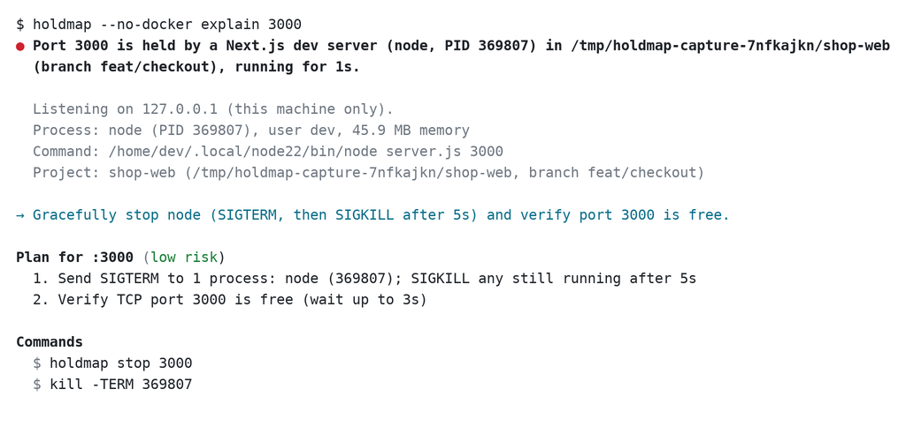

**Project stacks.** Describe a project's services once in `.holdmap.toml` (`holdmap init` writes
one from what's running) and start them in dependency order with `holdmap up`:

```toml
name = "shop"

[services.api]
port = 4000
command = "npm run dev"   # runs with PORT set
depends_on = ["db"]

[services.db]
port = 5432               # no command: started elsewhere, up just waits for it
```

`holdmap status` shows the stack and `holdmap down` stops it, dependents first.
Stack files support up to 512 services within 1 MiB. Set `ready_timeout_s` to 1–3,600 seconds
per service (default 60); `holdmap status` runs at most 32 HTTP checks concurrently.

## CLI

| Purpose | Commands |
|---|---|
| Look | `holdmap list`, `holdmap inspect`, `holdmap explain`, `holdmap graph`, `holdmap agents`, `holdmap needs`, `holdmap watch`, `holdmap ssh HOST` (read-only, nothing to install remotely) |
| Act | `holdmap stop`, `holdmap kill`, `holdmap restart`, `holdmap run`, `holdmap open`, `holdmap agents AGENT --stop-ports` |
| Ports | `holdmap free-port --near 3000`, `holdmap wait 5432 --timeout 30s` |
| Projects | `holdmap up`, `holdmap down`, `holdmap status`, `holdmap init` |
| Remember | `holdmap pin`, `holdmap unpin`, `holdmap pins`, `holdmap history` |
| Analyze (opt-in) | `holdmap analyzers list`, `holdmap analyzers show`, `holdmap analyzers approve`, `holdmap analyzers revoke`, `holdmap analyzers run`, `holdmap analyzers auto`, `holdmap analyzers key set`, `holdmap analyzers key delete`, `holdmap insights`, `holdmap insights review`, `holdmap insights snooze`, `holdmap insights reopen` |
| Integrate | `holdmap activity serve`, `holdmap activity setup`, `holdmap activity snapshot`, `holdmap activity hook`, `holdmap tui`, `holdmap mcp`, `holdmap completions zsh`, `holdmap man` |

Every read command takes `--json`. Exit codes: `0` ok, `1` busy / not found / timed out, `2`
error, `3` blocked by the safety policy, `4` needs elevation. All flags are in the
**[CLI reference](docs/cli.md)**.

Name-based stops with `--no-tree` retain every matching process, and tree stops
verify TCP/UDP listeners held by every included descendant in a PID/name tree stop.
Supervisor commands must match the planned service or app; systemd service stops recheck
protection for other members of the same service before running.

**Agents.** `holdmap agents` lists running agents and developer tools with child tools
(including likely MCP processes), folders, ports, connections and resource totals. Filter by
product, vendor, owned PID (`pid:1234`), folder or tool name: `holdmap agents claude`.
`--wide` adds processes and redacted commands; `--json` keeps evidence and collection limits.
Recent folders are account history, not proof of current work.

**Capabilities (opt-in).** `holdmap agents --capabilities` adds each agent's MCP servers
(runner, package, pinned or not, remote host, env/header **names**, running now), skills,
built-in tools, permission rules and instruction files. Values, prompts and file bodies are
never read; MCP servers are never started. The desktop, the TUI (**c** in Agents) and MCP
`list_agents` with `include_capabilities` show the same inventory. Configured does not mean
loaded or used. See [MCP and skills](site/src/content/docs/agents.md#mcp-and-skills).

**Analyzers (opt-in).** Run a scanner you pick on your agents' skills and MCP packages:
[NVIDIA SkillSpector](https://github.com/NVIDIA/SkillSpector) (installed by you) or the built-in
OSV.dev lookup for pinned npm/PyPI packages. Every analyzer is off until you approve it.
`holdmap analyzers show ID` prints exactly what it gets: the folders or package versions, the
command, the network hosts, the cleared environment. Approval is pinned to that manifest and
program; any change asks again. Runs get a copy of each folder, no environment values and a
time limit. Only capped findings are kept, never matched text. holdmap never starts MCP
servers for this. `holdmap insights --format sarif` exports the findings.

**Terminal agents.** Start `holdmap` and press **Shift+Tab**
to open Agents. Use **↑/↓** to choose an agent, **/** to search, and **PgUp/PgDn** to read its
tools, folders, connections and access. Wide terminals show the list beside the details;
small terminals stack them. **p** pauses refreshes, **r** refreshes, and **?**
shows help.
**x** opens every service-stop plan; only **y** confirms. Graph search keeps the selection
across refreshes, and pasted text never triggers an action.

<details>
<summary>Current terminal agent overview, small-screen details and service review</summary>

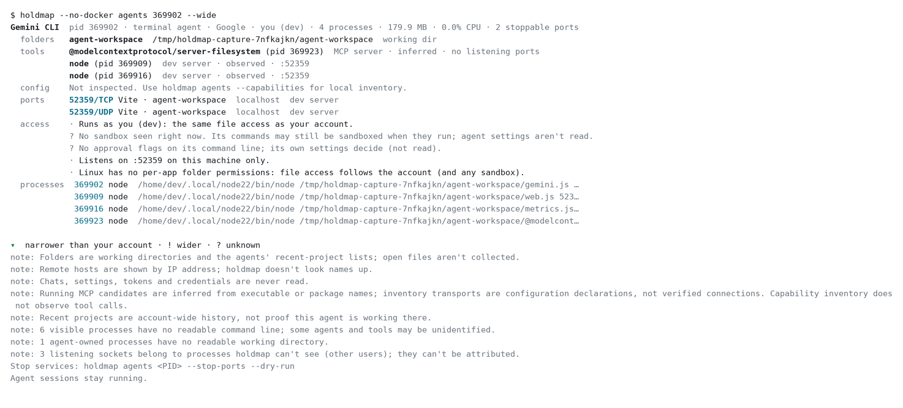
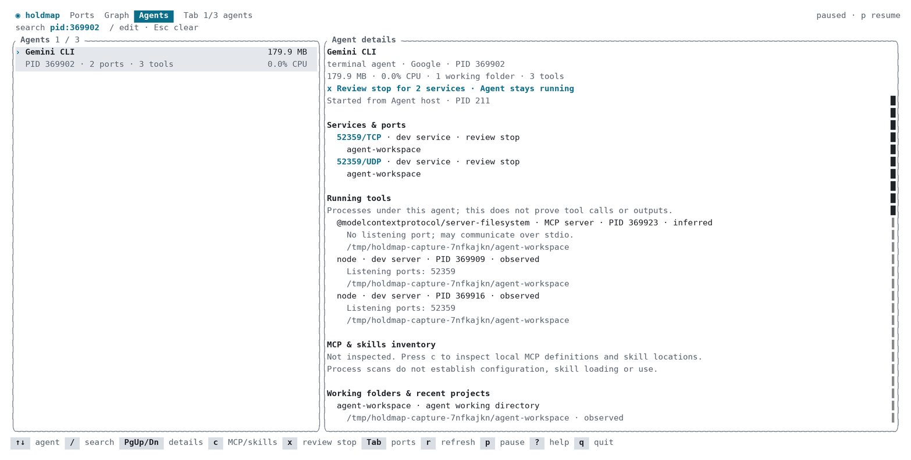
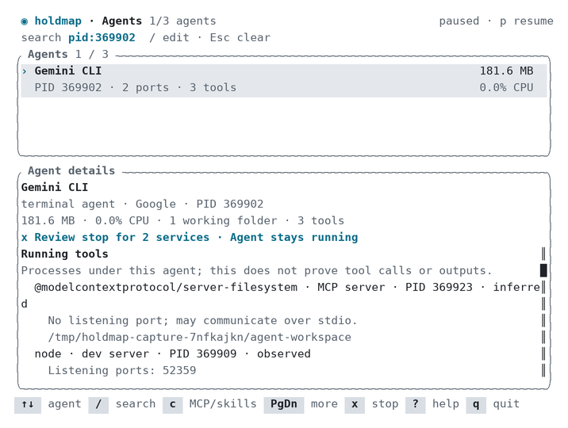
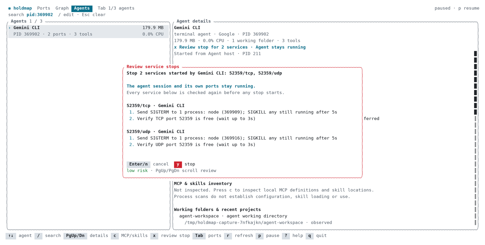

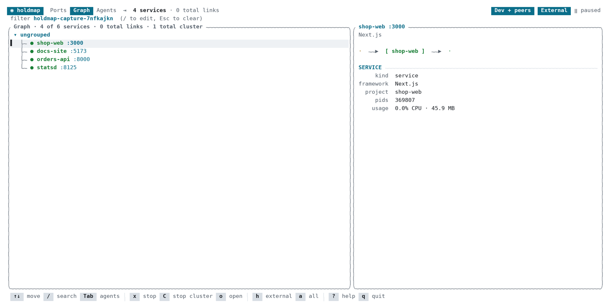

</details>

**Agent flow.** Open **Agents → Flow**. **Connections** shows observed processes, listeners and
sockets with evidence for each relationship. **Calls** shows reported tool/model work and agent
handoffs once you enable local recording; only reported trace parents create call edges, and
unknowns stay visible.

**Single-key shortcuts** can be turned off in **Settings → General** for speech input; arrows
and modifier shortcuts still work.

Recording is off by default, local-only and memory-only. Start it in the local desktop, review
**Setup**, then explicitly configure a supported agent. Pause freezes the view; **Stop recording**
closes the collector, and **Clear** removes retained metadata. A new recording session creates
a fresh token and an OS-assigned loopback endpoint; reconfigure producers after every start. Full app quit loses the recording. The website demonstrates these views
with labelled sample data. [Agent flow guide](docs/agent-flow.md) explains provider coverage,
privacy, metadata contracts and the CLI alternative:

```sh
holdmap agents --flow --json        # observed relationships; no recording required
holdmap activity serve              # keep running in this terminal
```

In a second terminal, set `HOLDMAP_ACTIVITY_ENDPOINT` and `HOLDMAP_ACTIVITY_TOKEN` to the
exact values printed by that collector, then run the commands below. Keep the token private.
`setup` prints a reviewable configuration example; it does not change the agent's settings.
Apply that example to the supported agent, or enable recording for this MCP server:

```sh
holdmap activity setup --provider codex   # prints configuration for the active collector
holdmap activity snapshot --json    # retained metadata from that collector
holdmap mcp --record-activity        # optional recording of this server's known tools
```

<details>
<summary>Observed connections, reported calls and a narrow-screen inspector</summary>


</details>

**Shell hook.** Add `eval "$(holdmap init zsh)"` to `~/.zshrc` (also `bash`, `fish`, `powershell`).
When a command fails with "port in use", it prints who holds the port and how to free it.

## Desktop app

A tray and menu-bar app on the same core as the CLI. `⌘⌥P` (`Ctrl+Alt+P`) brings it up from any
app; `⌘K` / `Ctrl+K` opens the command palette; `?` lists every shortcut.

- **Home** shows every agent as **Cards** or a **Map** (press `V`), with a **Timeline** of
  uptime, ports and MCP and a **Needs you** list. Click any port — a card chip, a map node or a
  timeline pin — for **Details** or **Stop…**; Stop always opens the stop plan first. Narrow
  windows list each agent's ports with the same menu.
- **List** and **Graph** (`G`): ports with project, branch and memory; the service graph with
  clusters. From a port's details: open, restart, open its folder (`HOLDMAP_EDITOR`), copy a URL.
- **Agents** (`⇧A`): Computer / Footprint / Project maps, **MCP & skills** with Explore / Map /
  Compare, and **Flow**. Stop only the services an agent started.
- **Local capture:** screen or window recording (`⇧V`) to MP4/GIF and PNG snapshots (`⇧S`).
  Nothing is uploaded.
- **Power:** shut down now or schedule a shutdown or a service stop, each after a review.

The [live demo](https://santoshshinde2012.github.io/holdmap/#demo) runs the same UI with sample
data. Details: [desktop guide](site/src/content/docs/desktop.md).

| Home as Map | Stop from Home |
|---|---|
|  | 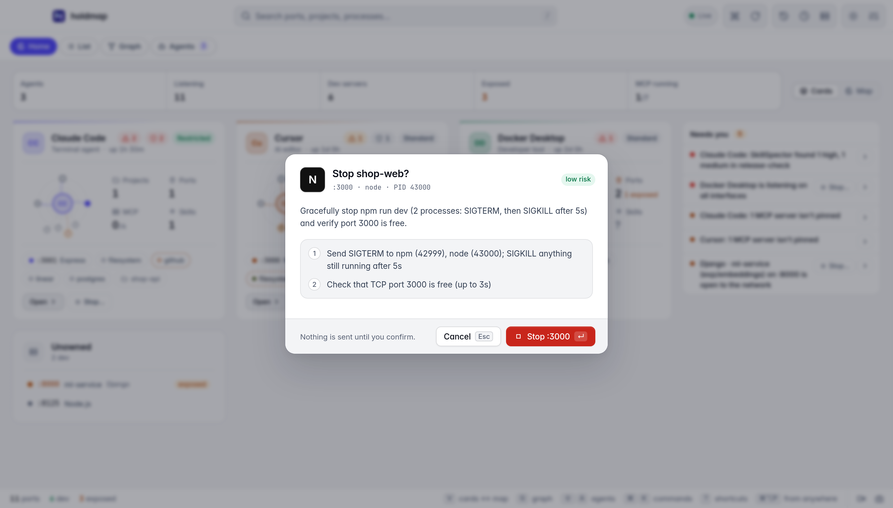 |

<details>
<summary>More screenshots</summary>

| Narrow Map with ports | Port menu |
|---|---|
| 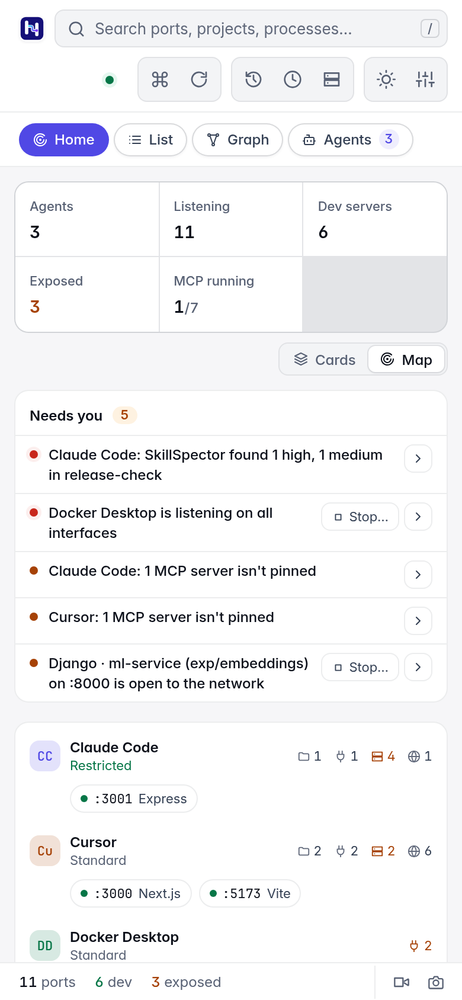 | 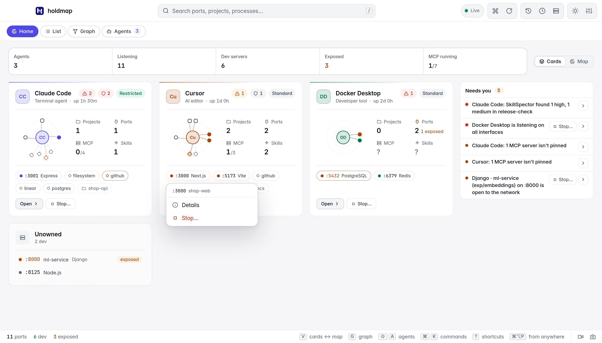 |
| **Agents** | **Service graph** |
|  | 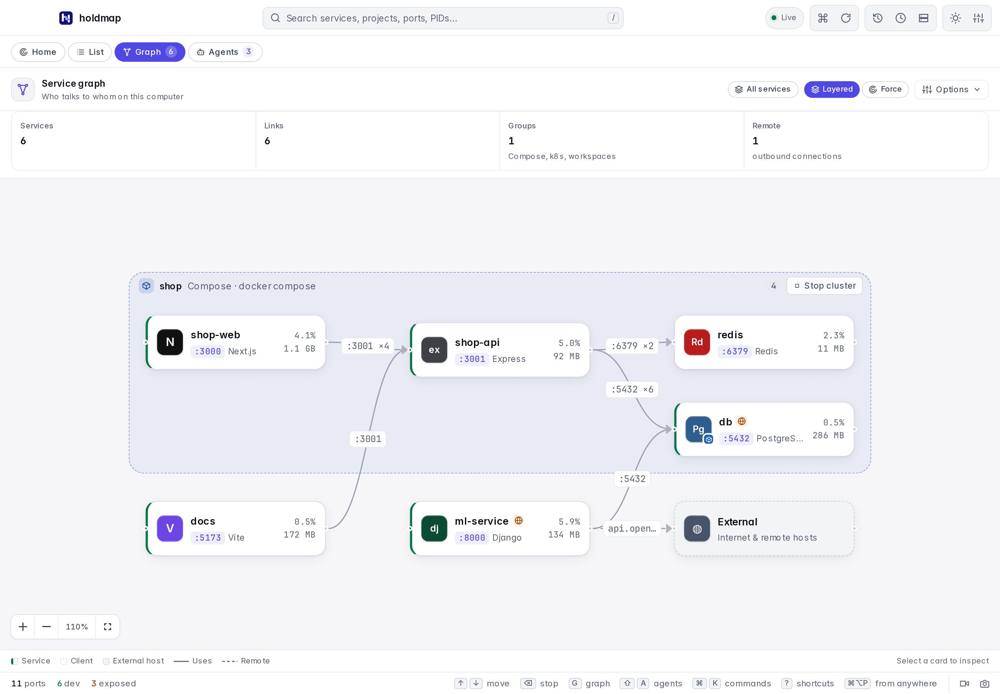 |
| **Capability explorer** | **Command palette** |
| 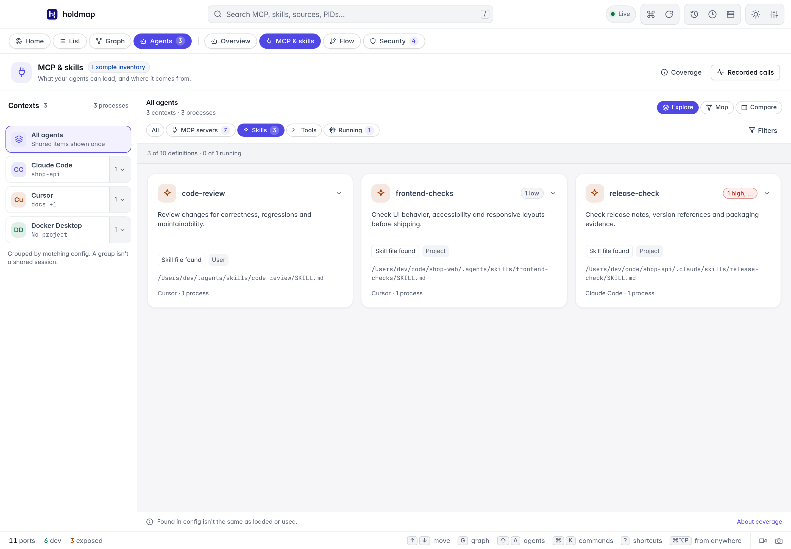 |  |
| **Screen recording** | **TUI** |
|  | 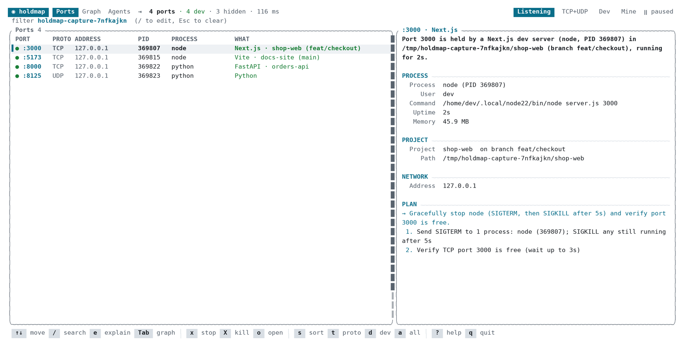 |

</details>

Every capture: [screenshots](docs/screenshots.md).

**Install and update.** Download the installer for your OS and architecture from the latest
release; desktop updates are manual unless a signed updater feed is configured. Check
**Settings → About** after reopening. Published macOS builds are ad-hoc signed and Windows
installers are unsigned: verify checksums and provenance first
([first-open guide](https://santoshshinde2012.github.io/holdmap/docs/desktop/#first-open)).

## MCP server

`holdmap mcp` gives AI coding assistants fourteen tools to list, explain and inspect ports, find a
free port, wait for a server, read the service graph, list agents (`list_agents`, with
`include_capabilities` for the opt-in inventory), follow agent flow (`get_agent_flow`), read opt-in analyzer findings (`list_analyzers`, `list_insights`), read the "needs you" list
(`list_needs`) and stop
ports. For Claude Desktop or Cursor (`~/.cursor/mcp.json`):

```json
{
  "mcpServers": {
    "holdmap": { "command": "holdmap", "args": ["mcp"] }
  }
}
```

VS Code (`.vscode/mcp.json`) uses `"servers"` with `"type": "stdio"`. If the client can't find
`holdmap`, use the full path, for example `/Users/you/.local/bin/holdmap`.

Stops preview by default; executing one needs the one-use `confirmation_id` from a preview in the
same session, and protected processes are never stopped. A `holdmap://guide` resource and the
`diagnose_port`, `prepare_dev_server` and `inspect_agents` prompts help clients; retrieving a
prompt does nothing. See the [MCP guide](site/src/content/docs/mcp.md).

## Safety model

holdmap stops processes, so one set of rules in `holdmap-core` applies to every surface:

State-read/write failures stay visible and preserve existing files.
If a stop completes but its history cannot be saved, the desktop preserves the actual result
and blocks automatic restart or later queued stops. CLI `stop --json` includes `history_error`
and exits with code 2; additional requested targets are not attempted.

- **Graceful first:** SIGTERM (`taskkill` on Windows), then a force kill after `--timeout` (5 s).
- **The right target:** the dev-server tree root (`npm`, `nodemon`, `uvicorn --reload`…) so nothing
  respawns; containers through their runtime, services through their supervisor.
- **Protected processes:** policy blocks core OS processes, holdmap and its ancestors. Shells,
  terminals, IDEs and AI-assistant hosts are protected by default; the CLI's `--allow-protected`
  or the desktop's explicit review can authorize soft protection. The executor rechecks identity
  and current protection before signalling and escalation. MCP has no protected-owner override.
- **Reviewed effects:** desktop stops retain the original plan behind a one-use handle, limited
  to 128 pending previews for five minutes, and reject changes found by a fresh semantic check.
  Agent bulk dialogs show every queued plan. MCP uses the same effect comparison with its own
  session previews. Plans support `--dry-run`, and execution checks whether ports are free.
- **Credential handling:** recognized secrets in command lines, errors and exported results are
  conservatively redacted, including headers and nested JSON values. Human terminal output
  neutralizes untrusted control sequences. Agent visibility uses process/socket metadata and
  bounded project-history fields. Explicit capability inspection parses bounded supported
  configuration files and retains only server aliases, declared transport/enablement and source
  locations, plus optional sanitized skill-header names and purposes. Command, URL,
  environment/header values and skill instruction bodies are excluded. Config files
  may contain credentials, so those bytes can be read while parsing even though their values
  are not retained. Optional recording discards prompt, argument and result
  fields after accepting explicitly configured local exporter requests; it does not inspect chats
  or credential stores. Redaction
  is heuristic; arbitrary positional secrets may be missed.
- **State privacy:** restart history retains raw commands. Unix history/config/log files use
  `0600`, state directories `0700`, with ownership and link checks. Windows uses inherited
  account/profile-directory ACLs and does not impose an account-exclusive DACL; keep a custom
  `HOLDMAP_HOME` private. Product analytics are absent. Optional agent recording accepts local
  allowlisted metadata into a bounded in-memory store; it never persists trace payloads.
- **Locked down:** desktop actions identify ports, history entries or known agent folders.
  The backend checks targets, constructs localhost URLs and resolves folders through a fresh
  scan. The webview has a strict CSP and local-only capabilities. Stack files are checked and
  read through one handle; Unix permits current-account/root ownership and rejects group/world
  writes, while Windows relies on checkout ACLs. State and CLI output writes reject link
  redirection. See [SECURITY.md](SECURITY.md) for OS limits and reporting.

## Architecture

`holdmap-core` owns collection, attribution, protection and stop planning. The CLI/TUI, native
backend and MCP adapter coordinate requests and present its types. The website builds the same
Svelte UI. The public website demo uses sample data; `npm run dev` and the desktop app read live local scans.


<details>
<summary>Mermaid source</summary>

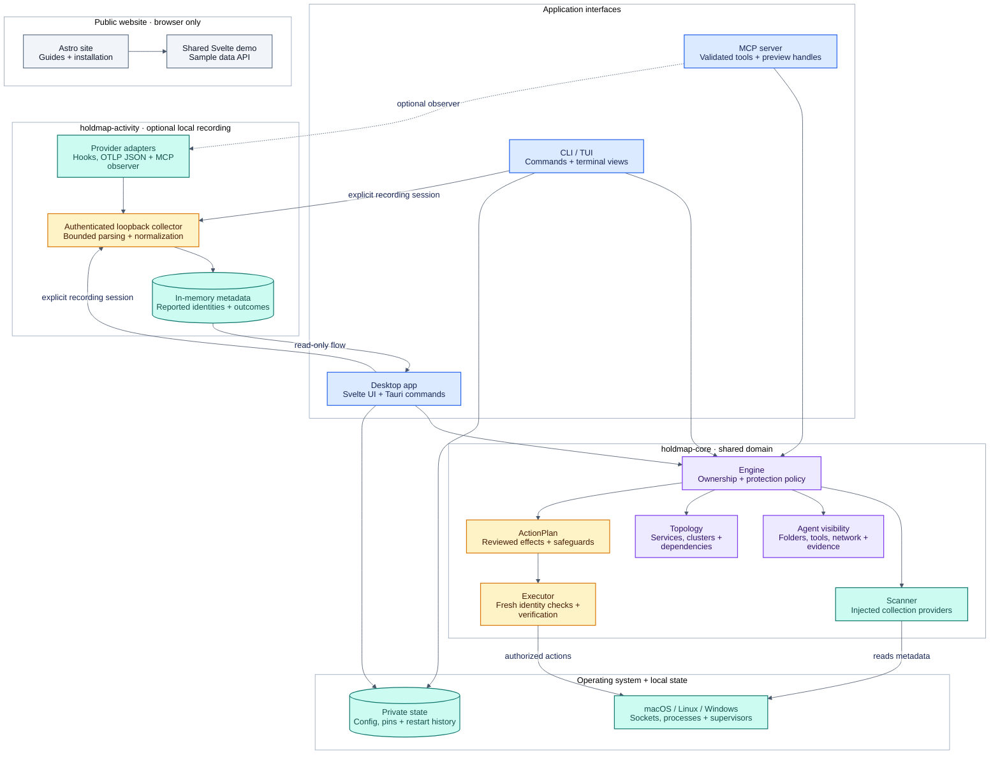

</details>

Blue groups interfaces, violet shows domain logic, amber marks action safeguards, teal marks
collection and state, and slate identifies the public website. Labels and boundaries carry the
same meaning independently of color. The browser demo uses sample data and has no native OS access.

SOLID guides these boundaries: collection, domain policy, execution and presentation have
separate owners; registries extend detection and planning; narrow provider, detector and
classifier traits accept system implementations or fixtures. Composition points choose
implementations. Activity adapters share metadata validation, while recording controls,
graph presentation and MCP delivery remain separate. The
[design notes](docs/architecture.md#7-design-notes) map all five principles to concrete
contracts and regression coverage. [Contributor review guidance](CONTRIBUTING.md#design-review)
explains how to preserve those contracts when extending the app.

Action authority stays at the adapters and executor: desktop and MCP retain immutable previews,
compare fresh effects before execution, and pass the original plan to the shared identity and
protection checks. Persistence, credential redaction and terminal-safe rendering have separate
boundaries. CI combines all-severity npm audits, cargo-deny, full-history/source Gitleaks scans
and CodeQL for JavaScript/TypeScript, Rust, Python and Actions; daily dependency checks and
immutable action pins keep those gates reviewable. The Linux GTK dependency uses
[audited GLib source fixes](vendor/README.md), verified by source hashes and optimized regressions.

The folder layout keeps each surface's code and tooling together:

```text
crates/holdmap-core/       Scanning, agents, topology, planning and execution
crates/holdmap-cli/        CLI, TUI and integration tests
crates/holdmap-mcp/        Protocol, schemas, tools, resources, prompts and observer contract
crates/holdmap-activity/   Metadata contracts, provider adapters, bounded local collector and client
apps/desktop/src/         Shared Svelte UI and pure TypeScript view logic
apps/desktop/src-tauri/   Native commands, cache, watcher and tray
apps/desktop/e2e/         Browser tests using sample data
site/                     Astro website, guides and demo build
docs/                    Architecture, generated CLI reference and published screenshots
scripts/                  Workspace checks, docs generation and development helpers
vendor/                   Audited third-party security backport and upstream provenance
```

Source assets and published screenshots are kept with their consumers. Build output,
dependencies and temporary captures are regenerated; Git history holds earlier versions.

## Troubleshooting

- **`command not found: holdmap`** right after installing: open a new terminal or use the
  PATH command printed by the installer. The default macOS/Linux shell setup uses
  `source ~/.config/holdmap/env.sh`; custom install/config locations can change that path.
  On Windows, open a new PowerShell window and check `Get-Command holdmap`.
- **An old copy runs instead of the new one:** check `command -v holdmap` (macOS/Linux) or
  `Get-Command holdmap` (Windows), then `holdmap --version`. A Cargo-installed copy in
  `~/.cargo/bin` can shadow the installer's copy in `~/.local/bin`; update or remove only the
  old copy you identified. Very old installations used the separate name `portwise`.
- **`Permission denied` on a shell rc file:** an old `sudo` left it owned by root. Run
  `sudo chown "$USER" ~/.bash_profile` and install again. Never run the installer with `sudo`.
- **Other users' ports are hidden:** run with `sudo` (an elevated terminal on Windows).
- **Slow or stale list:** `HOLDMAP_TRACE=scan holdmap list` prints how long each part of a scan
  took (sockets, processes, containers).
- **Uninstall:** remove the binary at the path reported above, remove the installer's PATH
  setup, and uninstall the desktop app through your OS. Settings and restart history remain in
  `~/.config/holdmap` (macOS: `~/Library/Application Support/holdmap`, Windows: `%APPDATA%\holdmap`),
  or your custom `HOLDMAP_HOME`. Delete that directory separately to clear them. History contains
  raw launch commands; inspect it before sharing diagnostics.

## Learn more

- [Website and guide](https://santoshshinde2012.github.io/holdmap/): the live demo and short how-tos.
- [What's new](https://santoshshinde2012.github.io/holdmap/docs/whats-new/): Home, the agent inventory, port stops and upgrade notes.
- [Website maintenance](site/README.md): SEO checks, deployment and current website snapshots.
- [Agents, tools and apps](https://santoshshinde2012.github.io/holdmap/docs/agents/): folders, access and stopping what an agent started.
- [CLI reference](docs/cli.md): every command and flag.
- [Architecture](docs/architecture.md): how the core, CLI, TUI, desktop app and MCP server fit together.
- [Brand assets](apps/desktop/assets/README.md): the vector master and icon regeneration guide.
- [Changelog](CHANGELOG.md) and [security policy](SECURITY.md).

## Contributing

Use Rust 1.95+ and Node.js 22.12+ (`nvm use`). [CONTRIBUTING.md](CONTRIBUTING.md) covers native
system dependencies, Chromium, actionlint and cargo-deny setup.

For browser development with live local data, build the CLI first, then start the desktop UI:

```sh
cargo build --locked -p holdmap
cd apps/desktop
npm ci
npm run dev
```

Add `?demo=1` to the development URL for sample data. The live development collector is
read-only; `npm run tauri dev` from `apps/desktop` runs the native app with real actions.
The public website always uses sample scan data. See the
[development guide](https://santoshshinde2012.github.io/holdmap/docs/desktop/#develop-with-local-data).

Run these checks from the repository root:

```sh
cargo test --locked                                  # core, CLI/TUI, MCP and activity
(cd apps/desktop && npm ci && npm run check && npm test && npm run test:e2e)
(cd site && npm ci && npm run check && HOLDMAP_SITE_OFFLINE=1 npm run build && npm test && npm run test:demo)
scripts/check-all.sh                                  # complete workspace and native checks
```

The full check script builds the UI before native checks and covers formatting, clippy,
Rust/native tests, browser tests, docs, website links/budgets, SEO and dependency audits.

## License

Dual-licensed under [Apache-2.0](LICENSE-APACHE) or [MIT](LICENSE-MIT), at your option. Unless
you state otherwise, any contribution you submit is dual-licensed the same way. The desktop app
bundles Inter and JetBrains Mono under the SIL Open Font License 1.1.
