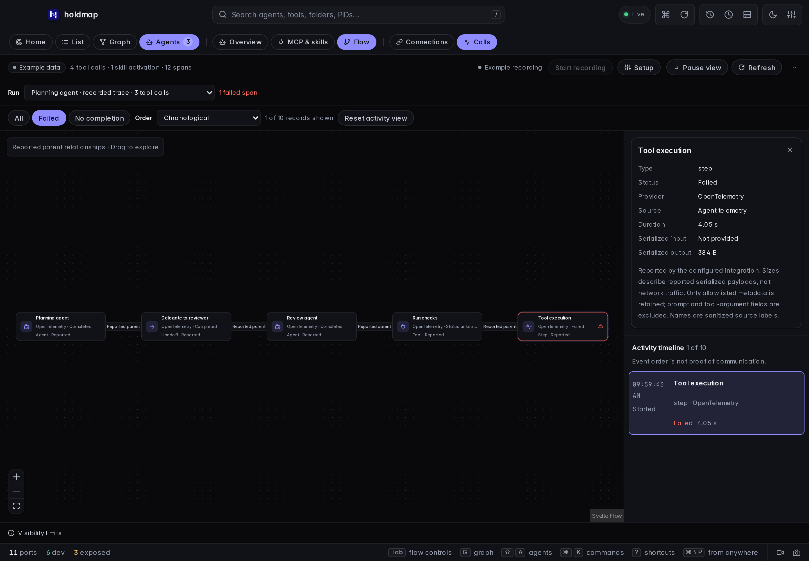
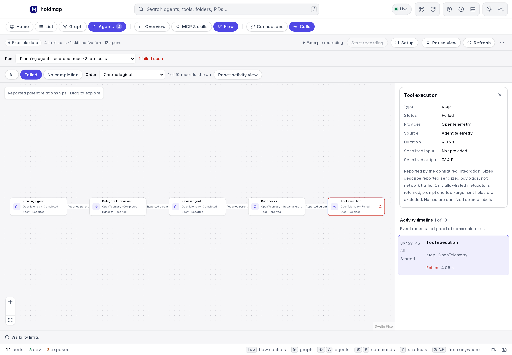

# Agent flow and local recording

Version 0.5.0 adds **Agents → Flow** in the desktop and shared browser demo.
Version 0.4.0 downloads predate this view; use 0.5.0 or newer for native recording.

Version 0.8.0 adds explicit MCP server aliases and Claude skill activation records to Calls,
alongside a separate opt-in **Agents → MCP & skills** inventory. See the
[0.8.0 release notes](../CHANGELOG.md#080---2026-10-16).
Use 0.8.0 or newer CLI/desktop and collector builds for these records. The 0.8.0-and-later
decoder accepts older snapshots with no MCP alias. An older 0.7.1 decoder rejects new fields
or the skill kind, and its collector does not produce this new skill activation projection.
The `/v1` route names remain unchanged; they do not imply forward-compatible decoding of
unrecognized metadata. Missing activity from an older collector is not proof of no usage.

Version **0.9.0** adds **Explore / Map / Compare** and Purpose, Source, Evidence and Activity
inspection over the existing capability inventory. It adds no recording adapter or name-based
join: the Activity tab links to separately reported Calls rather than attributing them to a
similarly named file. [Capability explorer guide](../site/src/content/docs/agents.md#mcp-and-skills).
Its [PNG snapshots](../site/src/content/docs/desktop.md#take-a-png-snapshot) and MP4/GIF screen
recordings capture pixels locally; they are separate from the metadata recording described here.
During 0.9.0 release preparation, use the latest published installers or a matching source build;
published 0.8.0 installers do not contain the new explorer or PNG snapshots.

## Read the flow

Start with **Connections**. Nodes represent observed agents, child processes, listeners and
network endpoints. Edges distinguish parent relationships, listener ownership and observed TCP
sockets. Select an edge to see its source PIDs and evidence. Process lineage can identify a
likely MCP server, including a stdio server without a listening port; it cannot establish that
an agent invoked a particular tool. Socket counts measure observed connections, not messages,
traffic direction, payload bytes or agent intent. Remote SSH reports do not enable recording
or local power actions on the remote machine.

Switch to **Calls** for explicitly reported activity. The run picker separates recorded traces
from sessions without parent spans. A graph edge requires a reported parent within the same
trace. Parallel tools occupy distinct records. Agent and handoff spans can show delegation when
the exporter supplies that relationship; common session membership and event order cannot
establish internal communication. The timeline remains useful when no causal graph exists.
A missing parent or unknown outcome stays visible instead of being filled in. Unsupported
signals are rejected and counted as dropped records. The failed execution step beneath a Claude tool wrapper is distinct from that wrapper.

Select a node or timeline item to inspect its source, status, duration and available serialized
input/output sizes. These sizes describe the reported serialized value or, for Holdmap MCP,
the individual compact JSON-RPC envelope. They are not network transfer totals. Provider events
without size fields show **Unknown**. Recorded identities are pseudonyms and do not authorize
opening folders, stopping services or any other process action.

The built-in hook/OTLP adapters derive an MCP server alias only when a Claude hook explicitly
supplies `mcp_server.name`, or a sanitized `mcp__server__tool` label has an unambiguous split.
Ambiguous or redacted names remain unknown. An explicit normalized integration can also report
the optional `ActivitySpan.mcp_server` field on a tool record through `/v1/activity`; the
collector applies the same bounded identifier sanitization and record validation. Every path
provides source-reported metadata, not authentication of a server or a match to a configured
alias or process. The standard MCP protocol does not require this client-specific prefix.
A skill activation is a separate record and count, not a tool invocation or a workflow result.
Hidden custom names show **name not reported**.

Search keeps matching relationships in context. Fit, zoom and the accessible participant list
support navigating larger graphs. The inspector stays readable in narrow windows. **Pause**
freezes view updates; recording continues until **Stop recording**. Refresh remains available
while paused. Navigation discards late responses so another view cannot overwrite the current
selection or reuse an old port selection for keyboard actions.

In Calls, **All**, **Failed** and **No completion** filter individual records. The metadata search
also narrows timeline rows, while graph context retains matching records, the inspected record
and explicitly reported ancestors. **Order** selects chronological or longest reported duration;
missing durations stay last and are never estimated. A finished record with unknown outcome
does not match No completion. Shown/total counts and **Reset activity view** explain and clear
active filters without changing stored metadata. Changing runs clears the old inspected record.

The example below filters the failed execution step while retaining its four reported ancestors.
The inspector and timeline stay visible in both themes; the example contains no private agent data.

| Dark | Light |
|---|---|
|  |  |

## Start a desktop recording

1. Open **Agents → Flow → Calls**, then **Start recording** on the local desktop.
2. Open **Setup**, select Codex or Claude, and copy the reviewed configuration example.
3. Apply the example yourself and restart that agent in a new terminal. Keep Holdmap open.
4. Run agent work, then inspect reported calls. Exporter batching and completed-span delivery
   can delay arrival. A stop closes the endpoint; unmatched requests become unknown outcomes.
5. Clear retained metadata when finished. A full app quit loses all recording metadata.

Setup never edits agent configuration automatically. Each new recording has an OS-assigned loopback
port and a fresh 256-bit bearer token. The token appears only in explicitly requested setup or
CLI credentials; it is absent from status, graphs, snapshots and errors. Treat copied setup as
private and remove stale agent exporter settings when finished. Recording is not persistent
across a full quit/restart and does not start again automatically.

The public website uses labelled examples. It cannot start a collector or perform OS actions.

## CLI and hooks

Start a collector in one terminal:

```sh
holdmap activity serve
# Optionally limit its lifetime:
holdmap activity serve --duration 1h --json
```

Use the printed endpoint and token in a second terminal. The values below are placeholders,
not a working recording session:

```sh
export HOLDMAP_ACTIVITY_ENDPOINT='http://127.0.0.1:PORT'
export HOLDMAP_ACTIVITY_TOKEN='TOKEN_FROM_ACTIVITY_SERVE'
holdmap activity setup --provider codex
holdmap activity setup --provider claude
holdmap activity snapshot --json
holdmap mcp --record-activity
```

For PowerShell, set the equivalent `$env:HOLDMAP_ACTIVITY_ENDPOINT` and
`$env:HOLDMAP_ACTIVITY_TOKEN`, then request `activity setup --provider claude --windows`.
`activity serve` stays active until Ctrl+C or its optional duration. The desktop and CLI
collectors are separate sessions: configure producers for the collector you intend to inspect.

`holdmap activity hook --provider codex` or `--provider claude` consumes a supported hook's JSON
from stdin, projects only metadata, and sends it to that collector. Configure lifecycle hooks
explicitly according to the provider documentation, including tool failure events where
supported. Reuse each provider's tool-use ID so parallel calls with the same name stay separate.
Hooks return no stdout and treat recording errors as advisory, preserving the agent's approval
and execution flow. A pre-tool hook means **Requested**, since it can run before permission is
granted. Missing completion is not success. A Codex PostToolUse with an explicit nonzero numeric exit code is a failure; missing
or ambiguous outcome fields remain unknown. Do not enable hooks and telemetry for the same events unless you
intend to inspect separate source records; this release does not deduplicate across sources.

MCP recording is opt-in per Holdmap server invocation. The observer receives fixed catalog
names, a local call ordinal, times, outcome and serialized envelope sizes. It receives no
arguments, results, error messages, JSON-RPC IDs or client metadata. A bounded worker posts
metadata without putting diagnostics into protocol stdout. Missing collector configuration and
recording failures leave MCP tools operational. Calls to other servers require their own
instrumentation; this observer cannot see them.

<a id="record-skill-activations-current-source"></a>
<a id="record-skill-activations"></a>

## Record skill activations (0.8.0)

Claude's documented `claude_code.skill_activated` OTLP **log** event reports activation through
the Skill tool or a user slash command. Holdmap requires the reported session ID, event sequence
and source timestamp to correlate it. Alongside common pseudonymous source/correlation fields,
it retains a sanitized name and activation time, with no workflow duration or outcome.
Custom/third-party names may be the provider's
`custom_skill` placeholder and stay unknown; do not enable tool-detail logging to uncover them.
That flag also exports command and argument content.

The ordinary Claude setup recipe remains **trace-only** for hierarchy and execution steps.
To choose activation/completion logs instead, start an active collector as above, set its real
endpoint/token in `HOLDMAP_ACTIVITY_ENDPOINT` and `HOLDMAP_ACTIVITY_TOKEN`, then launch a new
Claude process with this **alternate log-only** configuration (POSIX shell):

```sh
export CLAUDE_CODE_ENABLE_TELEMETRY=1
export OTEL_TRACES_EXPORTER=none
export OTEL_METRICS_EXPORTER=none
export OTEL_LOGS_EXPORTER=otlp
export OTEL_EXPORTER_OTLP_LOGS_PROTOCOL=http/json
export OTEL_EXPORTER_OTLP_LOGS_ENDPOINT="${HOLDMAP_ACTIVITY_ENDPOINT}/v1/logs"
export OTEL_EXPORTER_OTLP_LOGS_HEADERS="Authorization=Bearer ${HOLDMAP_ACTIVITY_TOKEN}"
export OTEL_METRICS_INCLUDE_SESSION_ID=true
export OTEL_BLRP_MAX_EXPORT_BATCH_SIZE=32
export ENABLE_BETA_TRACING_DETAILED=0
export OTEL_LOG_USER_PROMPTS=0
export OTEL_LOG_ASSISTANT_RESPONSES=0
export OTEL_LOG_TOOL_DETAILS=0
export OTEL_LOG_TOOL_CONTENT=0
unset OTEL_LOG_RAW_API_BODIES OTEL_EXPORTER_OTLP_COMPRESSION OTEL_EXPORTER_OTLP_LOGS_COMPRESSION
claude
```

PowerShell uses the same variable names and values through `$env:NAME = 'value'`; use
`$env:OTEL_EXPORTER_OTLP_LOGS_ENDPOINT = "$env:HOLDMAP_ACTIVITY_ENDPOINT/v1/logs"` and
`$env:OTEL_EXPORTER_OTLP_LOGS_HEADERS = "Authorization=Bearer $env:HOLDMAP_ACTIVITY_TOKEN"`,
then remove the three unset variables with `Remove-Item Env:NAME -ErrorAction SilentlyContinue`.
Keep this configuration/token private and reconfigure after every new recording session.
Review existing user/managed telemetry settings first: if policy forces content export or a
different destination, do not use this recipe. Older producers may not emit the activation
event; missing or unsupported records do not establish that no skill ran.

Choose this stream **instead of** Claude traces or overlapping hooks. Exporting tool logs and
traces together can count the same call twice. This mode loses trace hierarchy and does not
observe other MCP servers unless the producer explicitly reports them.

## Provider coverage and research

The implementation uses provider wire contracts and a synthetic fixture generated by the
actual Codex OTel exporter, not private conversations or agent logs.

| Source | What is supported | Limits that affect the picture |
|---|---|---|
| OS snapshot | Process ancestry, listeners and observed TCP peers | No tool calls, messages, encrypted payloads or stdio exchanges |
| Codex OTLP JSON logs | Known tool result events, reported call/session IDs, result and duration | Session grouping is not a parent trace; finished events arrive in batches |
| Claude enhanced OTLP JSON traces | Agent/model/tool wrappers, execution steps and supplied trace parents | Provider beta; spans arrive after completion, and dropped parents remain missing |
| Claude OTLP JSON logs (0.8.0) | Tool completions and explicit skill activation records | Log-only recipe; activation names can be redacted and activation never proves workflow success |
| Codex/Claude hooks | Supported lifecycle events with tool-use IDs | Requested state precedes execution; no guessed causal edges |
| Holdmap MCP observer | This server's validated catalog calls and outcomes | Does not observe other MCP servers or general agent messages |
| Generic OTLP JSON traces | Recognized agent, model, tool and execution-step operations with supplied parents | Exporter-specific coverage; no automatic SDK installation or universal capture |

Codex's configuration documents opt-in OpenTelemetry and prompt logging controls.
[Advanced configuration](https://developers.openai.com/codex/config-advanced/) and the
[configuration reference](https://developers.openai.com/codex/config-reference/) guide the
reviewable JSON log exporter. The current exporter emits numeric duration as a text attribute,
uses `conversation.id`, and can put a source location in top-level `eventName`; normalization
uses the supported `event.name` attribute and reported event timestamp. The regression fixture
records those details, with provenance pinned to
[the Codex source](https://github.com/openai/codex/tree/8c0f7011674145da7e10627769fb221c74fbf7a0/codex-rs/otel).

[Codex hooks](https://developers.openai.com/codex/hooks/) describe call identity and lifecycle
coverage. Hooks may arrive out of order, and some hosted operations have no local tool hook.
Normalization therefore pairs by identity and protects completed outcomes from late starts.

[Claude monitoring](https://code.claude.com/docs/en/monitoring-usage) documents enhanced tracing,
parent propagation, content controls and completed-span delivery. Setup selects trace export
only, disables content flags, detailed beta tracing and the shell raw-body variable. Use Claude
Code v2.1.212 or newer for Content-Length HTTP export; older chunked exporters are refused. Existing user
or managed raw-body settings must also be disabled; managed policy can override local exporter
configuration. Review the effective destination before launching. Tool wrappers retain unknown
outcome when the source leaves it unset; an execution child supplies its own result.

The same [primary monitoring reference](https://code.claude.com/docs/en/monitoring-usage#skill-activated-event)
defines skill activation logs and name redaction. The
[Claude hook contract](https://code.claude.com/docs/en/hooks#pretooluse-input) documents explicit
MCP provenance metadata and its version floor; legacy names follow its
[MCP tool prefix convention](https://code.claude.com/docs/en/hooks#match-mcp-tools).
[Agent Skills](https://agentskills.io/specification) defines local `SKILL.md` packaging;
[activation](https://agentskills.io/client-implementation/adding-skills-support) is a separate
client operation. File presence is not an activation signal or proof of successful execution.

[MCP transports](https://modelcontextprotocol.io/specification/2025-11-25/basic/transports)
and [tools](https://modelcontextprotocol.io/specification/2025-11-25/server/tools) distinguish
newline-delimited stdio, protocol errors and tool errors. The observer preserves existing
protocol negotiation and output while recording those outcomes separately. No new discovery
or agent execution capability is introduced.

[OpenTelemetry GenAI conventions](https://github.com/open-telemetry/semantic-conventions-genai)
provide operation and trace relationships. Instrumentation remains dependent on each producer.
An OpenAI Agents SDK trace processor would need an explicit exporter bridge; this release does
not claim a built-in SDK adapter. Gemini and other recognized agents retain passive OS
visibility; their hook contracts are not silently treated as Codex/Claude contracts.

## Privacy, security and bounds

The collector binds only `127.0.0.1` and requires its session bearer token. It rejects browser
Origins, nonlocal Host headers, ambiguous framing, chunked bodies, unsupported compression,
oversized requests and unsupported endpoints. It has four workers, eight queued connections,
an absolute one-second request deadline, a 256 KiB body limit, a 256-record request limit and
a 120-request-per-second admission limit. Setup uses JSON, no compression and smaller export
batches. Large individual producer payloads can still exceed the limit and be rejected.

Producers may transmit rich OTLP or hook payloads to the local parser. The parser immediately
projects allowlisted metadata, discarding prompts, arguments, results, raw errors, headers,
paths and unrelated attributes before storage. Identifiers become domain-separated SHA-256
pseudonyms. Names are bounded and sanitized; known credential-shaped names are rejected.
Sanitization is not a guarantee that an arbitrary custom label is safe, so use metadata-only
exporters and keep source content controls disabled. The collector is not a general-purpose
telemetry proxy and forwards nothing externally.

Explicit normalized metadata at `/v1/activity` can also report handoff records with agent
identities. Generic OTLP operation parsing does not invent a handoff from an arbitrary span.

Retention is at most 1,000 spans in memory. Large runs render at most 128 graph nodes, show the
omitted count, and keep every retained record accessible in the timeline; selecting another
record brings its reported parent context into the graph. Counters and limits disclose evicted or rejected
records; OTLP partial-success responses report rejected records. Snapshots are bounded and
authenticated. Source snapshots cannot write extra fields into the strict normalized schema.
Conflicting immutable identities are refused, and late starts cannot erase a completed failure.
A collector stop joins its bounded workers. No persistence, traffic interception, chat scanning,
remote collector, replayed execution or automatic stop is provided.

## Design and validation

`holdmap-core::agents::flow` is a pure projection from one consistent scan and agent report.
`holdmap-activity` separates contracts, source adapters, metadata policy, memory storage,
transport, client and setup generation. Hook and OTLP adapters share validation and sanitization;
typed routes have exhaustive dispatch and one credential/request-limit policy. Configuration
generation validates credentials without constructing an HTTP client.

`holdmap-mcp::observer` is a narrow injectable observation interface with a no-op default.
The CLI's `activity/mcp.rs` adapts observer events and owns bounded asynchronous delivery;
activity commands handle CLI arguments, hooks and rendering. Native recording commands share
one authorized, serialized session boundary. Svelte `RecordingControls` owns recording/setup
actions and `AgentFlowView` owns graph/run selection; graph building, layout and polling remain
separate. Unknown recording status is shown explicitly. These boundaries apply SOLID through
concrete responsibilities without adding an interface for every function.

`agent-flow/triage.ts` owns metadata filtering, reported-duration ordering and parent-context
projection as pure functions. It does not change the collector snapshot or source outcomes.
`AgentFlowView` owns the local filter controls and inspected record; `ActivityTimeline` presents
the resulting rows. The shared keyboard policy remains separate from recording and process
actions, and an explicit callback clears the application search.

Tests exercise actual loopback HTTP, slow/partial requests, hostile framing and payloads,
parallel same-name hooks, reversed completion, the Codex exporter fixture, MCP protocol output,
source-field exclusion, native opt-in lifecycle, stale asynchronous responses, graph evidence,
keyboard isolation, both themes and narrow layouts. They use owned fixtures or injected effects,
never real shutdown or stops of user processes. See [architecture](architecture.md) and
[contributor checks](../CONTRIBUTING.md) for the complete validation workflow.

## Interaction standards and research

The interface follows [WAI-ARIA keyboard conventions](https://www.w3.org/WAI/ARIA/apg/practices/keyboard-interface/)
for native controls and composite selection, and the [combobox pattern](https://www.w3.org/WAI/ARIA/apg/patterns/combobox/)
for command search. Composition keys remain with the input method. A persisted single-key
shortcut setting provides the disable mechanism described by
[WCAG 2.2 character-key shortcuts](https://www.w3.org/WAI/WCAG22/Understanding/character-key-shortcuts.html).
Palette result counts use a polite status region; activity counts avoid announcements on every
poll, following [status-message guidance](https://www.w3.org/WAI/WCAG22/Understanding/status-messages.html).

[W3C Trace Context](https://www.w3.org/TR/trace-context/) and the stable
[OpenTelemetry span API](https://opentelemetry.io/docs/specs/otel/trace/api/) guide reported parent
relationships and outcome handling. An unset status is not an error and is not evidence that a
call remains active. Duration sorting uses only the supplied duration field. GenAI semantic
conventions remain under development, so this view makes its supported source contracts explicit
rather than claiming universal agent instrumentation.

Further improvements need distinct source contracts: fixed-category collector/producer health
would help diagnose absent records without retaining raw errors; explicit
[OpenTelemetry span links](https://opentelemetry.io/docs/specs/otel/overview/#links-between-spans)
could represent reported cross-trace work. Neither is inferred from current data or silently
enabled by this interface.
