# Analyzers, end to end

How to find risky agent skills with holdmap: install a scanner with consent, run it, read the
results down to the folder and the file line, act, export and confirm the fix. Every screenshot
is from the browser demo's sample data (`~/code/shop-api` and the other paths are made up).

- [Steps to follow](#steps-to-follow)
- [Demo script (3 minutes)](#demo-script-3-minutes)
- [What a skill analyzer means for security](#what-a-skill-analyzer-means-for-security)
- [Consent and sandbox](#consent-and-sandbox)
- [Walkthrough](#walkthrough)
- [Worked example (demo data)](#worked-example-demo-data)
- [Troubleshooting](#troubleshooting)
- [Privacy](#privacy)

## Steps to follow

From a fresh install to an exported, fixed result. Bold text is the exact label in the app.

1. Open **Agents → Security → Analyzers**. ([screenshot](#1-find-an-analyzer))
2. On an analyzer card, choose **Install…**. Read what it installs, tick **Install *name version*
   into holdmap's folder**, then **Install**. Wait for the verified version. ([screenshot](#2-guided-install))
3. Choose **Review and turn on…** (or **Enable…** on the card), check the permissions, then turn it on. ([screenshot](#3-turn-on))
4. Choose **Rescan** (all analyzers that are on) or **Run** on the card. ([screenshot](#4-run-and-watch-progress))
5. Watch the run dock and the status bar pill; keep working or choose **Cancel**. ([screenshot](#4-run-and-watch-progress))
6. When the dock says it's done, choose **View results**. This opens **Results**. ([screenshot](#5-results))
7. Filter with **All agents** or group by **Agent** or **Folder**; search with **Search findings**. ([screenshot](#5-results))
8. Expand a row (**Show details for …**) and use **Copy path** or **Show in folder** to open the
   source file. ([screenshot](#6-finding-detail))
9. Follow **Suggested next steps**: fix or remove the flagged text, or turn the skill off. If it's
   expected, choose **Mark reviewed**. ([screenshot](#6-finding-detail))
10. Choose **Download JSON**, **Download SARIF 2.1.0**, **Download CSV** or **Download Markdown**.
    Only what's on screen is exported. ([screenshot](#7-export))
11. After fixing, choose **Rescan** (or **Rescan** on the finding) and check the finding is gone and
    **Run history** shows the new run. ([screenshot](#8-run-history))

## Demo script (3 minutes)

Use the live demo (<https://santoshshinde2012.github.io/holdmap/#demo>) or `npm run dev` in
`apps/desktop`. It's sample data; nothing is installed, run or sent.

1. **0:00** Open **Agents → Security**. Point at the summary (open findings, agents and skills
   scanned) and **What a skill analyzer does**.
2. **0:30** **Analyzers → Install…** on Bandit. Show the package, folder, hosts and consent box;
   tick it, **Install**, show the verified version.
3. **1:15** **Rescan**. Switch to **Home** while it runs: the dock and status pill stay.
4. **1:45** **View results**, group by **Agent**, expand *Instruction Override*: agent, scope,
   folder, `SKILL.md:12`, suggested steps.
5. **2:30** Filter **2 medium**, **Download Markdown**: the file says what was included.
6. **2:50** **Home** shows the skill findings tile; Claude Code's details list the skill.

## What a skill analyzer means for security

A skill is a folder of instructions and scripts your coding agent loads and follows. A risky
skill acts with your agent's access: it can tell the agent to ignore rules, run commands, read
files or send data out. A skill analyzer reads a copy of each skill folder and reports what
looks risky.

| holdmap can confirm | holdmap can't confirm |
| --- | --- |
| Which agents load the skill, from its inventory | That a finding is real: findings are the analyzer's word, marked **unverified** |
| The skill's folder and the file and line the analyzer named | That a skill with no findings is safe |
| Its scope: global, project or local, or **Unknown** when it can't tell | What the skill does at run time |
| The analyzer's version and program hash, pinned at approval | Anything about agents that aren't running |

## Consent and sandbox

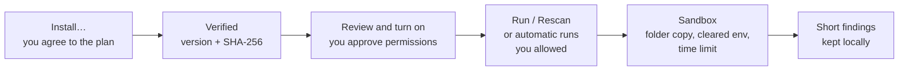

- **Nothing installs or runs without you.** Installing needs the consent box; an installed
  analyzer is still off until you turn it on. Changes to the program or manifest stop it until
  you review it again.
- **holdmap never starts or connects to MCP servers on its own.** An MCP analyzer runs only when
  you choose **Run** or **Run now**. An approved offline analyzer also reruns when a skill
  changes; one that uses the network does so only if you allow it.
- **Each run** gets a copy of each folder, a cleared environment (only a key you set for that
  analyzer is passed), a private temporary home, a time limit and the OS sandbox that's available
  (bubblewrap or Landlock on Linux, Seatbelt on macOS, a Job Object on Windows). No sandbox stops
  every file read, so approve only analyzers you trust. Details: [site docs](https://santoshshinde2012.github.io/holdmap/docs/analyzers/#sandbox).
- **Installs** use your `uv` or `go`, into holdmap's own `analyzers/tools/ID` folder, with a
  cleared environment and a 10-minute limit. No admin rights; your shell config isn't touched.

## Walkthrough

### 1. Find an analyzer

**Agents → Security → Analyzers** lists enabled and available analyzers with publisher, what
each checks, network use and state (**On**, **Off**, **Not installed**).

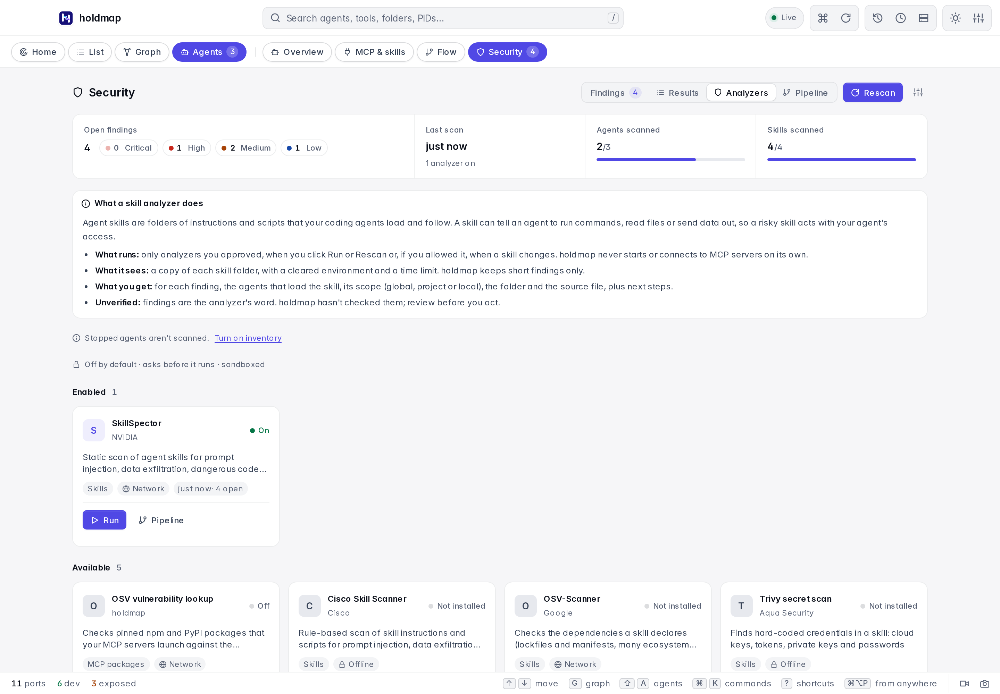

### 2. Guided install

**Install…** shows the pinned package and version, its source, the installer, the folder, the
hosts contacted during install, how it's checked and what each run reads. **Install** stays
disabled until you tick the consent box. **Prefer to run it yourself?** shows the command to copy.

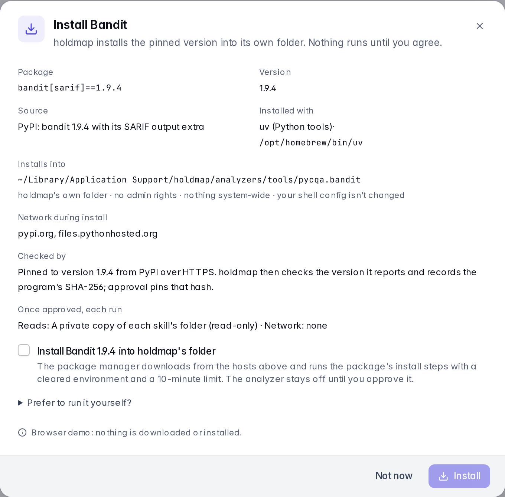

Progress and the installer's output are live, with **Cancel install**. When it ends, holdmap
checks the reported version and records the program's SHA-256.

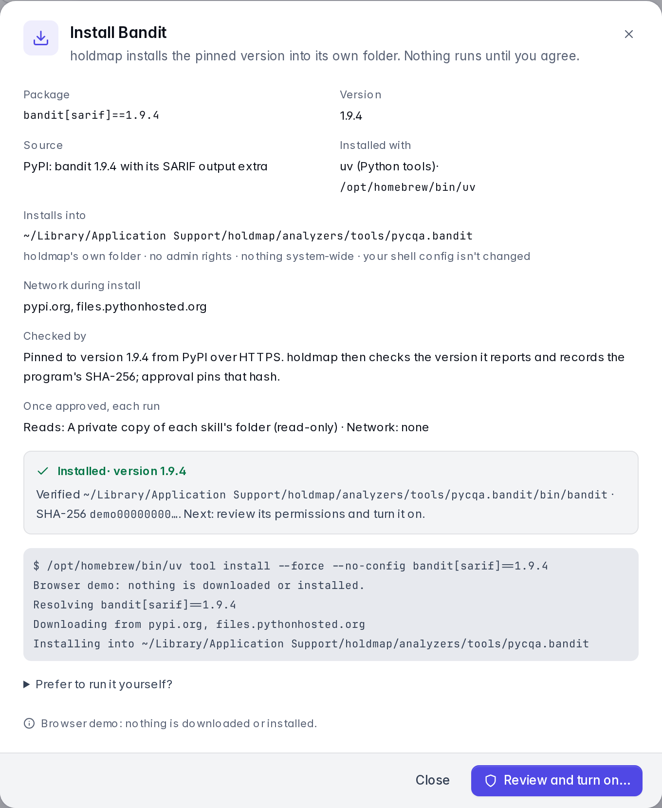

A failure says why and offers **Retry**. A missing `uv` or `go` is detected before anything runs
and links to its official install page.

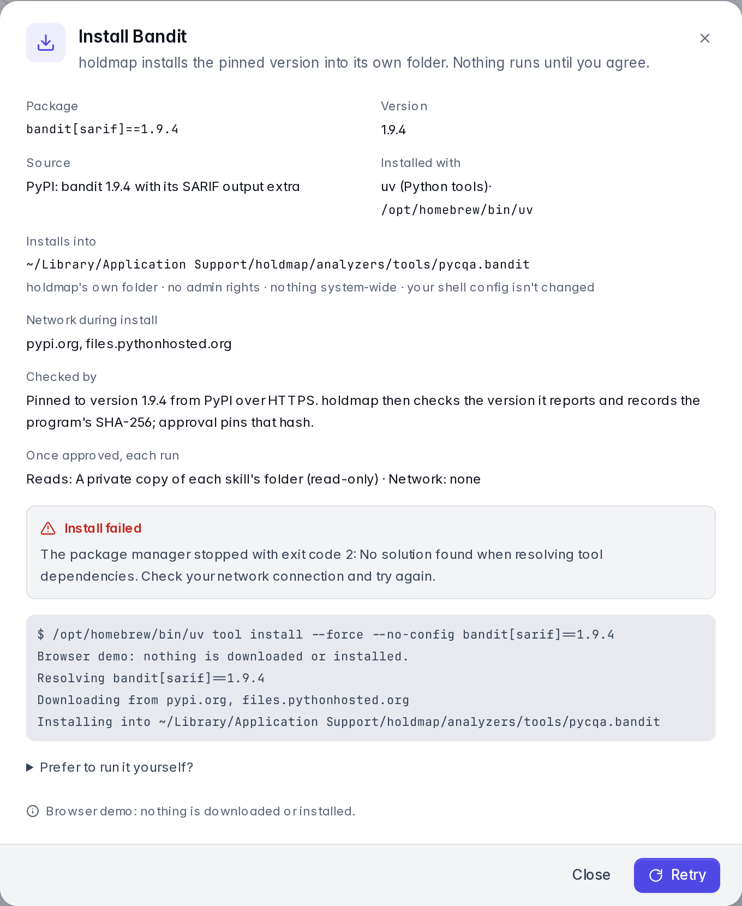

### 3. Turn on

**Review and turn on…** opens **Settings → Analyzers**: the folders or packages it gets, the
command, hosts, environment variable names, sandbox and when it runs. Turning it on pins all of
it. **Run now** runs it from here.

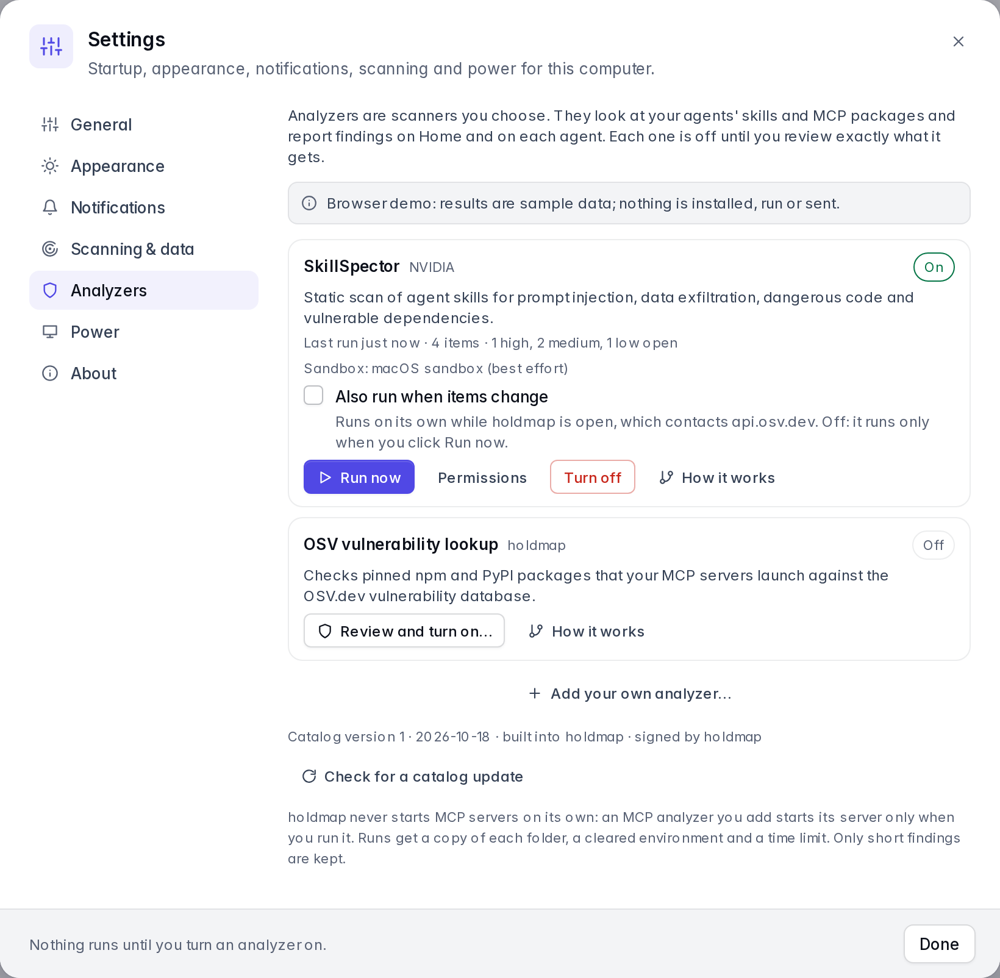

### 4. Run and watch progress

**Rescan** runs every analyzer that's on. The dock shows each analyzer's step (preparing,
copying, scanning *skill* (n of m), collecting), elapsed time and **Cancel**. The status bar pill
and the card show the same step, on any tab.

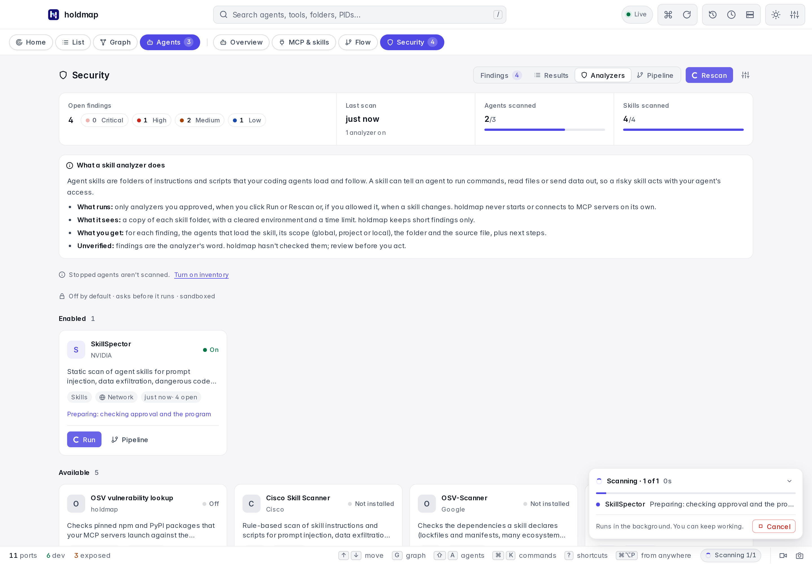

### 5. Results

**Results** is a table of severity, rule, message, agent, skill, folder and path. Sort by any
column, filter by severity or **All agents**, search, and group by **Severity**, **Skill**,
**Agent**, **Folder** or **Analyzer**.

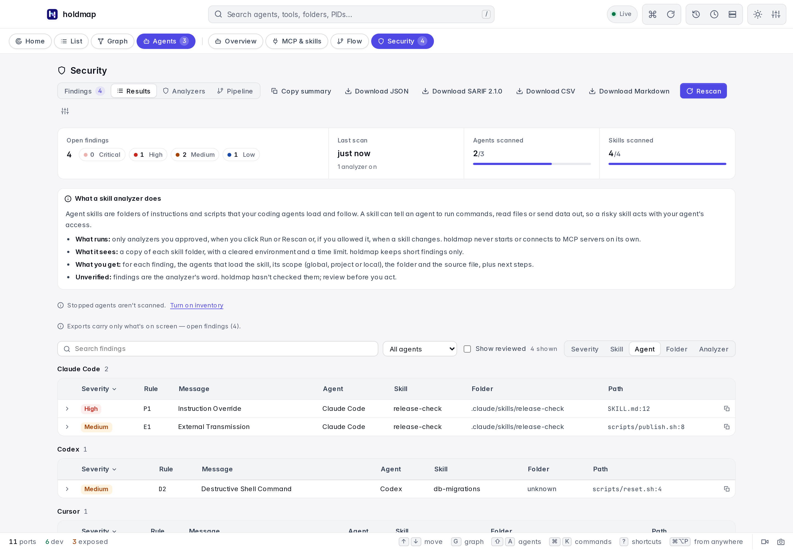

### 6. Finding detail

A row expands to **Agents**, **Skill**, **Scope**, **Folder** and **Source path**, with **Copy
folder**, **Show in folder** (desktop; the browser copies instead) and **Suggested next steps**.
"Reported by *analyzer*; holdmap hasn't verified it" stays on every finding.

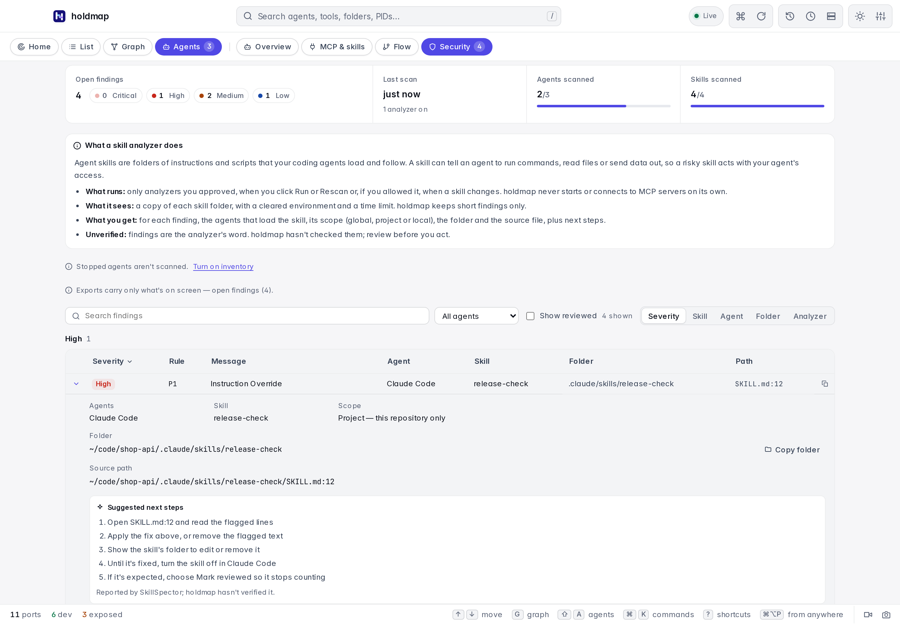

### 7. Export

The export buttons save only the findings on screen, with an **Included** note naming the
filter. Your home folder is written as `~`; raw evidence is never exported.

| Format | Contains | Use it for |
| --- | --- | --- |
| JSON (`holdmap-report/1`) | Included note, coverage, counts, and per finding: rule, severity, state, title, analyzer, skill, agents, scope, folder, path, line, fix | Scripts, archives |
| SARIF 2.1.0 | One run per analyzer with rules, results and locations | GitHub code scanning, IDEs |
| CSV | One row per finding with the same fields; cells can't start a formula | Spreadsheets |
| Markdown | Summary, included note, coverage, the "unverified" note and a table | Tickets, PRs |

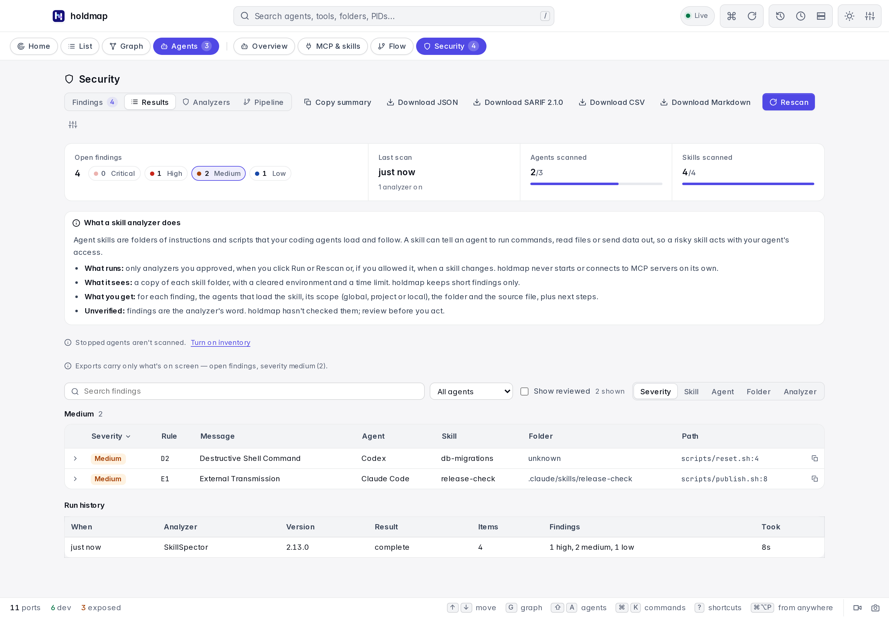

### 8. Run history

**Run history** lists recent runs with time, version, result, subjects
and counts. Use it to confirm a rescan after a fix.

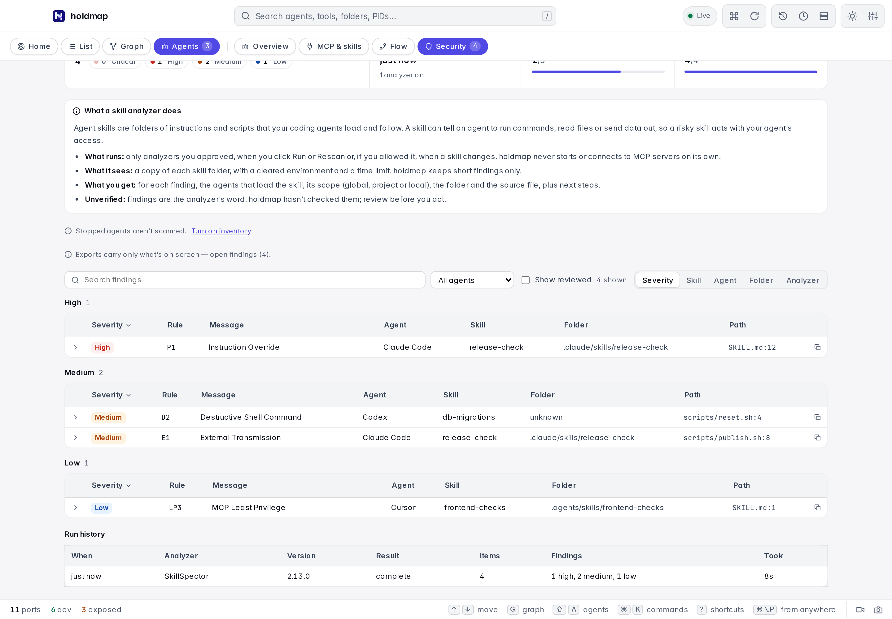

### 9. Summaries on Home, agents and Pipeline

**Home** has a skill findings tile that opens **Security**. An agent's details list its skills
with open findings, with scope and folder. **Pipeline** shows how an analyzer works and which
skills had findings in its last run.

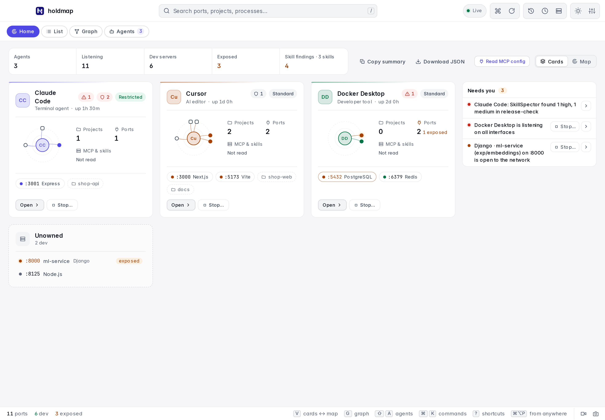

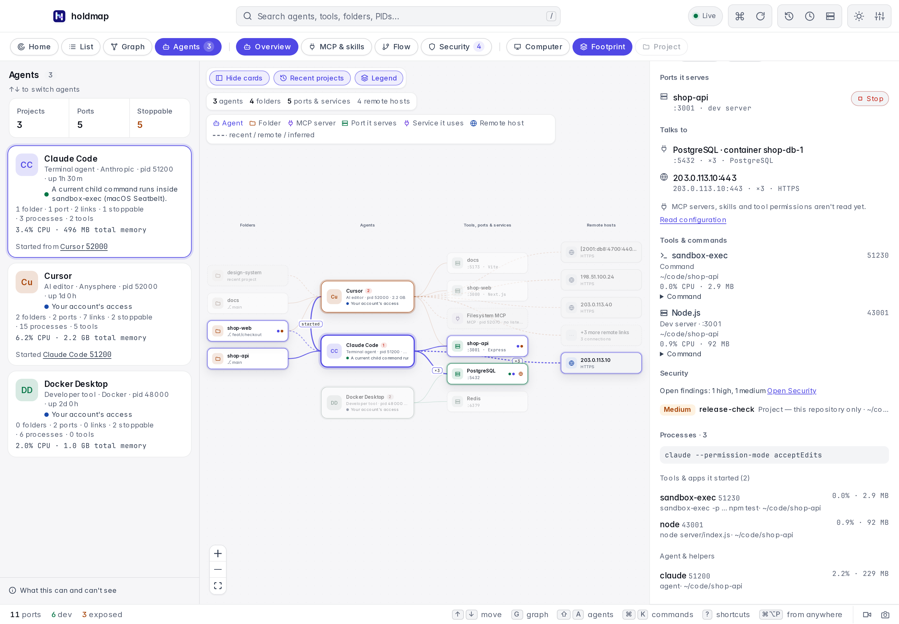

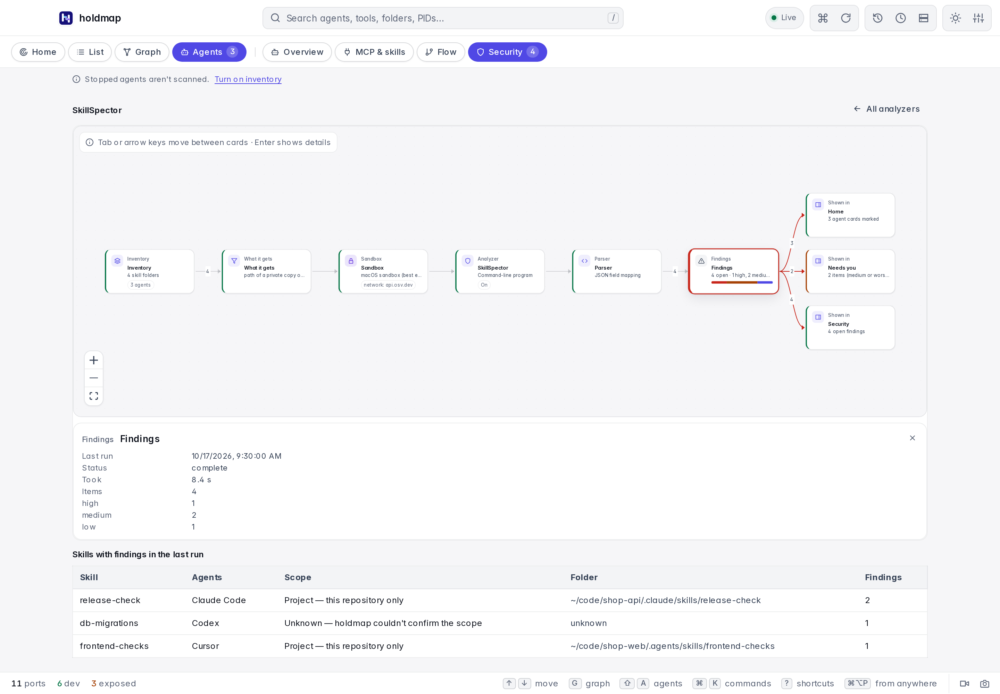

## Worked example (demo data)

**Demo data**, exported with **Download Markdown** from the browser demo with no filter:

```markdown
**Included:** Only what's on screen: open findings (4 findings).
**Coverage:** 2 of 3 agents, 4 of 4 skills, last scan 2026-10-17.
**By severity:** Critical 0 · High 1 · Medium 2 · Low 1 · Info 0

> Findings are what each analyzer reported; holdmap hasn't verified them. Home folders are shown as `~`.

| Severity | Rule | Message | Agents | Skill | Scope | Folder | Path |
| --- | --- | --- | --- | --- | --- | --- | --- |
| High | P1 | Instruction Override | Claude Code | release-check | project | ~/code/shop-api/.claude/skills/release-check | ~/code/shop-api/.claude/skills/release-check/SKILL.md:12 |
| Medium | D2 | Destructive Shell Command | Codex | db-migrations | unknown | unknown | scripts/reset.sh:4 |
| Medium | E1 | External Transmission | Claude Code | release-check | project | ~/code/shop-api/.claude/skills/release-check | ~/code/shop-api/.claude/skills/release-check/scripts/publish.sh:8 |
| Low | LP3 | MCP Least Privilege | Cursor | frontend-checks | project | ~/code/shop-web/.agents/skills/frontend-checks | ~/code/shop-web/.agents/skills/frontend-checks/SKILL.md:1 |
```

Reading it: `release-check` is a **project** skill Claude Code loads in `shop-api`. Line 12 of
its `SKILL.md` tells the agent to override instructions (high), and `scripts/publish.sh:8` sends
data out (medium). The fix: open `SKILL.md:12`, remove the override, check where `publish.sh`
sends data, then **Rescan**. `db-migrations` has scope and folder **unknown** because Codex isn't
running, so holdmap can't place it; the path is relative to the skill.

## Troubleshooting

| You see | Do this |
| --- | --- |
| **Not installed** | **Install…**, or install it yourself and choose **Rescan** |
| "needs uv / go, which wasn't found" | Install it from the linked official page, then **Retry** |
| Install failed with an exit code | Check your network and the hosts listed in the dialog, then **Retry** |
| The analyzer stopped and asks for review | Its program or manifest changed; review and turn it on again |
| "Stopped agents aren't scanned" | Start the agent, or turn on inventory, then **Rescan** |
| Scope or folder **Unknown** | The agent isn't running or holdmap couldn't place the skill; the path is still shown |
| A run takes too long | **Cancel** in the dock; each run also has a time limit |
| Exported fewer findings than expected | Exports follow the filter; clear it or tick **Show reviewed** |

CLI equivalents: `holdmap analyzers`, `holdmap analyzers show ID`, `holdmap analyzers approve ID`,
`holdmap analyzers run ID`, `holdmap insights --format sarif`.

## Privacy

- Everything stays on your computer. Approvals, results, history and install records are private
  files (`0600`, folders `0700`) in holdmap's own folder.
- Only short findings are kept (title, location, fix hint, severity), never matched text or file
  contents.
- An analyzer gets a copy of the skill folders and nothing else from holdmap; no environment
  variables, tokens or secrets, except a key you set for it in the OS keychain.
- Network use is limited to what the analyzer declares and the install hosts shown before you agree.
- Exports carry only what's on screen, with your home folder as `~`.
