# holdmap architecture

holdmap shares one Rust library (`holdmap-core`) across its CLI, TUI, desktop app and MCP
server. The core determines ownership, protection and stop plans. Adapters validate requests,
coordinate collection and confirmation, and present the returned types. Optional crates add
analyzers (`holdmap-analyzers`) and local activity recording (`holdmap-activity`).

Sections 1–8 cover the shared core and its adapters; 9–13 cover individual features; 14–15
cover the website and verification. The [README](../README.md#architecture) has the one-picture
overview.

## 1. Layers


<details>
<summary>Mermaid source</summary>

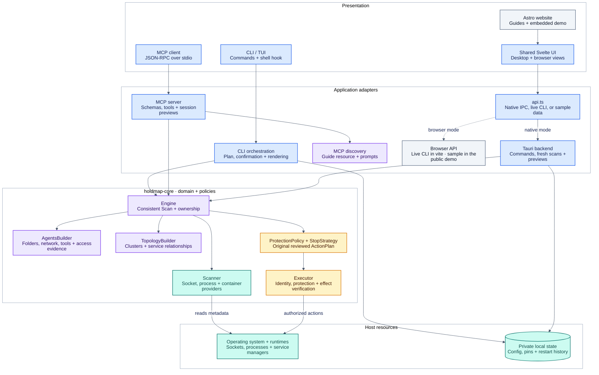

</details>

The previews use an explicit white SVG background so they remain readable in light and dark
viewers. Each preview retains its Mermaid source below it. Regenerate the previews with
[`scripts/render-mermaid.py`](../scripts/render-mermaid.py) and Mermaid CLI 12.0.0:

```sh
# Requires Node.js 22.13+ and a Chromium installation usable by Puppeteer.
npm exec --yes --package=@mermaid-js/mermaid-cli@12.0.0 -- python3 scripts/render-mermaid.py
# Add --puppeteer-config /path/to/puppeteer.json for a custom Chromium executable.
```

All component diagrams use the same palette: blue for interfaces and adapters, violet for
domain logic, amber for action safeguards, teal for collection and state, and slate for
browser-only website components. Named boundaries and arrow labels make the meaning readable
without relying on color.

The website builds the same desktop UI for browser mode; `api.ts` selects native IPC or sample
data. The native cache belongs to the desktop adapter. Core engines operate on a consistent
`Scan`, which other adapters collect directly. Local configuration, pins and stop history use
`store`; project stacks and bounded HTTP probes have separate modules.

The Linux GTK3 binding family currently requires GLib 0.18. A narrow
[local source backport](../vendor/README.md) preserves that API while fixing upstream iterator
unsoundness and boxed-inline slice allocation, plus a documented local zero-initialization
fix for `Value` copies. It is excluded from the first-party workspace.
Whole-snapshot hash verification, locked Cargo resolution and optimized Linux regressions
check the override; registry advisory scans alone do not inspect local path packages. The
original version and license remain unchanged.

## 2. Scan → plan → execute

The core is built from small traits so each piece can be swapped (real OS, recorded fixture, or a
fake in a test) without touching the others (dependency inversion).


<details>
<summary>Mermaid source</summary>

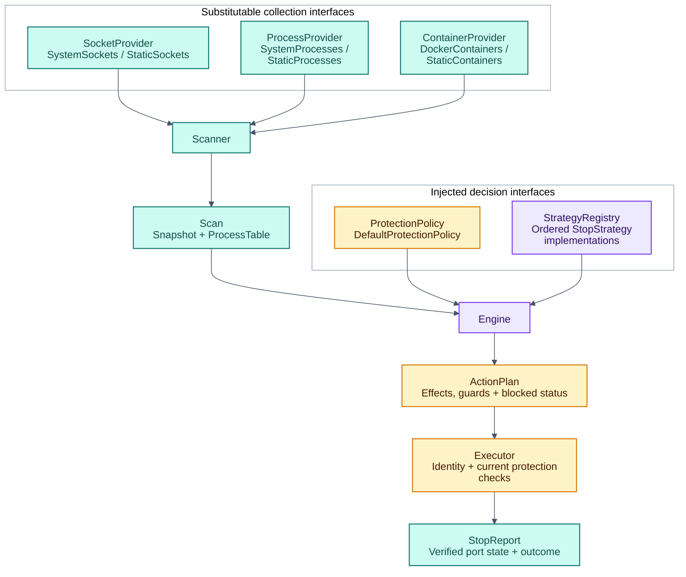

</details>

`StrategyRegistry` asks each `StopStrategy` in priority order whether it applies to an owner and
takes the first that does:

| Strategy | Handles |
|---|---|
| `container` | docker-proxy / published container ports → stop the container |
| `hidden` | socket whose owner we can't see → "needs elevation" |
| `os_service` | AirPlay, HTTP.sys, wslrelay … → explain, never kill |
| `systemd` | unit or `.socket` activation → `systemctl stop` |
| `pm2` | pm2-managed app → `pm2 stop` |
| `brew` | `brew services` → `brew services stop` |
| `protected` | own tree, IDE/AI-assistant hosts, interactive shells, PID 1 … → blocked |
| `other_user` | another user's process → needs elevation |
| `process_tree` | fallback: launcher tree (npm → node → esbuild …) bottom-up SIGTERM → SIGKILL |

Supervisors come before `protected` on purpose: a pm2 app or a systemd unit must be stopped
through its supervisor even though its process would also match a later rule. The table is the
order of `StrategyRegistry::default()` in `engine/strategies/mod.rs`.

`StopStrategy` and `StrategyRegistry` extend owner resolution without changing the engine's
dispatch loop. A new supervisor family also needs a typed `Supervisor` identity, exact command
matching and executor authorization, with identity/protection regressions. Adapter changes
depend on whether the serialized contract or presentation changes.

### Stop sequence

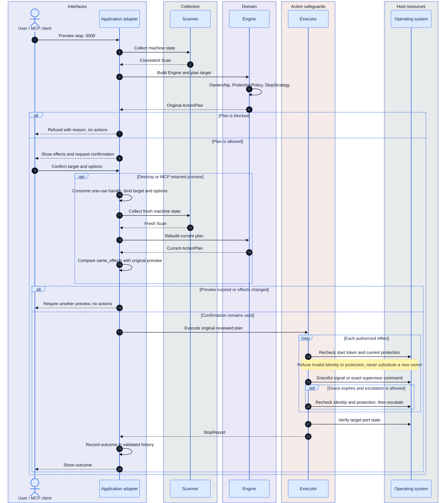

<details>
<summary>Mermaid source</summary>

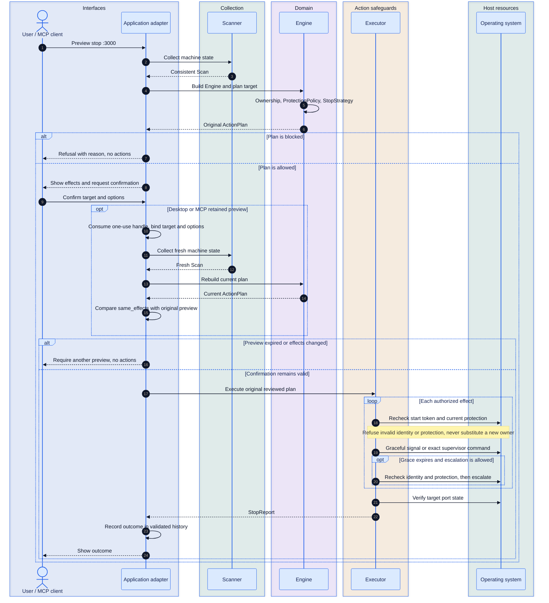

</details>

Planning does not signal processes. Desktop and MCP preview handles retain the original plan.
An executing request must match its preview's target/options and a fresh plan's semantic effects;
changed identities or actions require another preview. `ActionPlan::same_effects` compares effect
identity and authorization while ignoring display text and resource metrics. Desktop agent bulk
confirmation shows every queued plan; MCP validates the entire captured bulk before acting.
The executor receives the original plan rather than substituting fresh effects.

`ActionPlan::allow_protected` carries an explicit soft-protection override, defaulting to false
when deserializing older plans. Core execution rechecks process start tokens and hard/soft
protection before the initial signal and escalation. Ordinary supervisor commands carry an
optional `RunCommand.guard` to pin their owner; named systemd socket units use logical unit
identity and check the associated service's protection instead of signalling its PID 1 manager.
MCP exposes no protected-owner override. Its adapter independently checks current-account
ownership for every pinned process effect, because supervisor strategy priority and a low-risk
label do not establish account ownership. Unknown or foreign owners and unpinned systemd socket
plans are refused. Agent bulk targets retain each matched listener's TCP/UDP protocol. Execution
verifies target ports afterwards; blocked
plans cannot execute. OS identity binding still has platform limits described in
[SECURITY.md](../SECURITY.md).

### Batches and failed history writes

The desktop stop adapter flattens the original `StopReport` and adds `history_error`;
it preserves execution facts when recording fails. Only a successful, freed result with
saved history permits automatic restart. Core state mutations use `try_config` and
`try_history`, whose missing-file behavior is compatible with first run and whose other
errors propagate without replacing saved files. Native adapters clone the store before
dispatching file work to background threads. CLI single-stop JSON retains its existing
plan/report shape with an optional history error and halts additional requested targets
after a recording failure.

Immediate agent batches use `stop_many`: a bounded list of exact TCP/UDP listener requests
with their original one-use confirmation handles. Native request validation, current-account
ownership, agent membership and fresh effect comparison all complete before dispatch.
The executor then uses the retained plans, including their PID-reuse and protection guards,
so a child that releases two listeners does not invalidate its second reviewed plan merely
by exiting. Each attempted target returns its own execution and persistence result; the
first incomplete result halts further dispatch. OS effects remain sequential and cannot be
rolled back if a later effect fails.
Identical guarded supervisor commands completed successfully earlier in the batch are
removed from later execution copies, while each listener verification and original history
plan remain intact. Command identity includes the executable, exact argument array and
guard PID/start token; display descriptions do not grant authority.
`holdmap_core::exec::CompletedSupervisorStops` applies the same rule to immediate desktop,
native schedules and MCP execution. MCP errors retain structured actual stop reports with
an optional history error, halt further dispatch and require a fresh preview before retry.
Their structured data and compatible text JSON follow the supported protocol's
[structured tool result contract](https://modelcontextprotocol.io/specification/2025-11-25/server/tools#structured-content).

## 3. Topology / mesh


<details>
<summary>Mermaid source</summary>

```mermaid
---
config:
  theme: base
  look: classic
  htmlLabels: false
  themeVariables:
    darkMode: false
    background: "#ffffff"
    primaryColor: "#DBEAFE"
    primaryTextColor: "#172554"
    primaryBorderColor: "#2563EB"
    secondaryColor: "#CCFBF1"
    tertiaryColor: "#ffffff"
    textColor: "#0F172A"
    lineColor: "#475569"
    edgeLabelBackground: "#ffffff"
    clusterBkg: "#ffffff"
    clusterBorder: "#94A3B8"
  flowchart:
    wrappingWidth: 240
---
flowchart LR
  accTitle: Service topology and dependency-aware stop planning
  accDescr: A consistent scan and cluster registry build service nodes and connection edges. The graph supports exports, interface views and dependency-aware stop plans.
  SNAP["Scan<br/>raw sockets + process table"] --> TB["TopologyBuilder"]
  TB -->|"listeners → service roots"| N["nodes"]
  TB -->|"ESTABLISHED pairs → edges"| ED["edges (+ external, collapsed)"]
  TB --> TUN["tunnel::detect<br/>kubectl · ssh -L · cloudflared · ngrok"]
  CR["ClusterRegistry<br/>Compose → Kubernetes → Supervisor → Workspace → Git"] --> TB
  N & ED & TUN --> G["Graph"]
  G --> EXP["GraphExporter<br/>Json · Dot · Mermaid · Tree"]
  G --> ORD["stop_order<br/>(dependents first, cycle-safe)"]
  ORD --> PC["Engine::plan_cluster → ActionPlan"]
  G --> UI["TUI graph tab · desktop GraphView · MCP get_topology"]

  classDef surface fill:#DBEAFE,stroke:#2563EB,color:#172554,stroke-width:1.5px
  classDef domain fill:#EDE9FE,stroke:#7C3AED,color:#2E1065,stroke-width:1.5px
  classDef safety fill:#FEF3C7,stroke:#D97706,color:#451A03,stroke-width:1.5px
  classDef data fill:#CCFBF1,stroke:#0F766E,color:#134E4A,stroke-width:1.5px
  class SNAP,N,ED,TUN,G data
  class TB,CR domain
  class ORD,PC safety
  class EXP,UI surface
```

</details>

* **Nodes** are services, not PIDs: a listener is folded up to its service root (the launcher
  tree), so `npm run dev → node → esbuild` is one node with all its ports.
* **Edges** come from ESTABLISHED sockets where both ends are local; traffic weight is the
  connection count. Remote peers collapse into one `external` node per host.
* **Clusters** come from the first `ClusterDetector` that claims a node (compose project label,
  k8s namespace of a port-forward, pm2/turbo/concurrently/nx parent, workspace root, git repo).
* **Stop order**: callers before callees (`web → api → db`), so nothing reconnects to a
  dependency mid-shutdown. The order is deterministic, which proptest checks.
  Dependents outside the cluster become warnings in the plan.

### Agents

`agents::AgentsBuilder` turns the same `Scan` into an `AgentsReport`:


<details>
<summary>Mermaid source</summary>

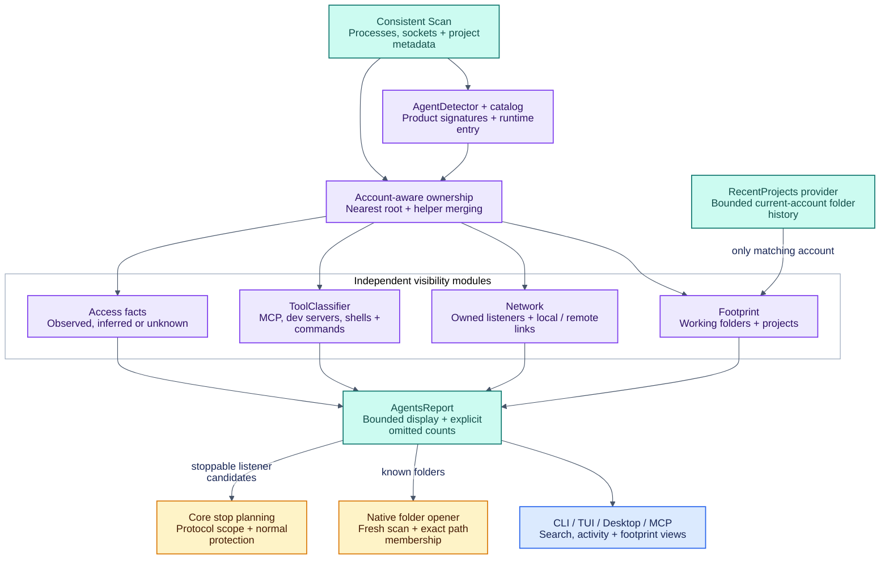

</details>

* **Who.** `agents::catalog` names each agent product: bundle, process name, install path or
  entry script. Kinds cover terminal agents, AI editors, desktop apps, extensions, hosts and
  developer tools (Docker Desktop, OrbStack…). Parsed executable and runtime signatures avoid
  treating a product name in an ordinary argument as an agent. Editors, desktop apps and tools
  fold their helpers into one root; a terminal agent started inside one remains its own agent,
  linked by a parent edge. `ProtectionPolicy` shares the catalog for session recognition. Tool
  products retain their existing OS-service policy rather than acquiring AI-session protection.
* **Where.** Folders are the members' working directories, with project details from the scan,
  plus recent projects from a `RecentProjects` source. It reads only directory names under
  `~/.claude/projects` and the window folder URIs in the editors' `storage.json`. It never opens
  chats, settings or tokens.
* **Reach.** Listening ports held by the agent or its children, and ESTABLISHED links grouped by
  local service or remote `ip:port` (no DNS). Local listener attribution matches both the address
  and port; a listener bound to a specific interface can be reachable beyond loopback. An IPv6
  wildcard can be a fallback for a possible dual-stack IPv4 listener; `IPV6_V6ONLY` is not
  observed, so that fallback is an attribution hint.
* **Tools.** Child processes are classified separately as likely MCP servers, development
  servers, shells or commands. MCP candidates are visible even without a listening socket.
  These are process-derived hints, with evidence labels; running a server does not establish
  which tools an agent called.
* **Access.** Each fact (account, sandbox, approvals, network, privacy) carries `observed`,
  `inferred` or `unknown`. Folders inside macOS privacy-protected areas are listed but not read.

Agent detection, process ownership, network attribution and tool classification have separate
modules. `AgentsBuilder` composes an `AgentDetector`, a `ToolClassifier` and a `RecentProjects`
source; the defaults use the shared product catalog and observed process metadata. Its project
cache can also be supplied explicitly, so tests use isolated caches while production shares the
normal cache. Tests can replace these boundaries without scanning the host or reading real
agent state.

| Agent module | Responsibility |
|---|---|
| `builder.rs` | Compose dependencies, collect a report and apply display limits |
| `catalog.rs` | Product signatures, conservative runtime parsing and `AgentDetector` |
| `ownership.rs` | Assign descendants to their nearest root and merge matching helper accounts |
| `footprint.rs` | Working folders, project metadata, privacy boundaries and recent-folder deduplication |
| `network.rs` | Owned listeners and address-aware local or remote connections |
| `tools.rs` | `ToolClassifier` and process-derived MCP, dev-server, shell or command metadata |
| `access.rs` | Account, sandbox, approval and exposure facts with evidence; well-known debug/model-server port names |
| `recent.rs` | Bounded, allowlisted current-account project history |
| `model.rs` | Serializable report types, shared search and folder/port control candidates |

Recent-project sources describe the current Holdmap account's history. The builder attaches
that history only when the root matches the current account: compare numeric UIDs when both
are known, otherwise require a matching nonempty user name. Other or unknown accounts do not
query the history provider. History is not proof of work by a specific running instance.
Working folders from live process metadata remain visible for every account.

Re-parented editor helpers merge only when their account identity matches: numeric UID when
available, otherwise user name. Roots with no known account identity remain separate. The
protection policy uses the same catalog and parsed runtime entry as discovery, so runtime
flags do not make a recognized agent lose its session protection.

Reports keep all owned process IDs for lookup while bounding the displayed process, tool,
folder and link lists. Children take priority over helpers in the process display. Omitted
counts and collection warnings make partial visibility explicit. Resource and remote-host
totals are computed before clipping. `Agent::matches` owns query semantics for CLI and MCP:
product, vendor, exact owned PID, folder paths and tool names. Raw command text is excluded.
Desktop filtering also searches visible ports, services and hosts, with exact PID queries and
explicit `port:3000` queries; its layout and rendering remain pure presentation logic.

`known_folders()` supplies folder actions, and the native backend forces a fresh scan before
checking exact path membership in the current agent report. `stoppable_ports()` identifies development/service port candidates;
normal core planning still decides which can be stopped. CLI, TUI, desktop and MCP preserve the
agent-service stop controls without signalling the agent root merely because it is visible.

### Optional capability inventory

`CapabilityDiscovery` separates configured metadata from process-derived tools and recorded
usage. The default `NoCapabilities` strategy performs no configuration inspection. Only explicit
CLI `agents --capabilities`, the terminal Agents **c** toggle, desktop **MCP & skills**, or MCP
`include_capabilities:true` requests select bounded current-account discovery. Terminal inspection
refreshes only while enabled in Agents; pressing **c** again or leaving Agents revokes queued
inspection, clears retained inventory and discards late replies. Bounded file work already
underway may finish. Desktop/background scans remain on the default strategy. The browser dev bridge propagates the same opt-in; the
public demo labels sample data.

The inventory projects server aliases, declared transport/enablement, scope and source paths
from supported Codex/Claude Code/Cursor JSON/TOML locations, Claude Desktop's documented
manual MCP JSON on macOS/Windows, legacy Windsurf's user `mcp_config.json`, Gemini CLI
`settings.json` `mcpServers`, Copilot workspace/user default MCP files and Cline's default
MCP settings. Claude Desktop extensions, connectors and skills are not inspected. Custom
homes and Aider explicit MCP file flags are not followed. Whole bounded config bytes can
contain credentials while parsing; command, URL, environment/header values are not retained.
Skills retain folder identities and `SKILL.md` file locations. A bounded prefix permits only
optional sanitized YAML-header `declared_name` and `description` metadata (purpose capped at
300 characters); instruction bodies are not retained or executed. Unsafe or malformed headers
leave that metadata absent without turning observed file presence into validity or activation.
Only observed working folders/project roots are considered. Explicit limits retain unsupported,
inaccessible and bounded coverage instead of treating an empty inventory as absence.
Each report inspects at most 16 distinct agent contexts. Each context is limited to eight
observed projects, 24 existing file/directory sources, 256 candidate entries and 1 MiB of
configuration/header reads; individual configs are capped at 256 KiB and skill prefixes at
8 KiB. At most 64 definitions of each kind are retained. The 100 ms context deadline is checked
cooperatively between operations and cannot interrupt a blocked OS filesystem call. See the
[detailed source and limit tables](../site/src/content/docs/agents.md#mcp-and-skills).

Configuration presence establishes neither loading, authorization nor invocation. Reported MCP
aliases and skill activations stay in Calls without alias-only joins to an inventory or process.
Metadata identities do not authorize stops, file actions or execution of configured commands.
See [the usage/source contracts](agent-flow.md#provider-coverage-and-research).

Pure capability projections feed **Explore**, **Map** and **Compare**. Exact
client/account, observed folder-source context, inventory and coverage group matching agent
roots while retaining their original IDs and PIDs. Runtime candidates remain independent
observations. Purpose cards display bounded author metadata. Comparison keeps exact source,
scope and project identities, with missing evidence labelled unreported rather than absent.
The inspector separates Purpose, Source, Evidence and Activity, and never joins recorded usage
by matching a name. Tools shows a missing-catalog explanation without launching an MCP server.

The retained `buildCapabilityMap` and SvelteFlow canvas put contexts between MCP definitions
and skill files, with runtime candidates in a separate lane without configuration edges.
Only exact shared definition identities collapse. Resource sampling does not change layout
identity. The renderer caps the map at 24 contexts, 64 definitions and 24 runtime candidates,
preserves explicit selection where possible, and reports omitted cards and relationships.
These display bounds are separate from discovery bounds. Narrow canvases start at a readable
hub-centered zoom; users can pan or explicitly fit the graph. Keyboard focus reveals offscreen
cards without selecting them; pointer focus leaves a pressed card in place until click completes.

The workspace loads dynamically only after explicit navigation, with pending, retry and reload
states. The site budget verifies its unique JavaScript stays within 20 KiB and is not a static
dependency of startup or Agents Overview; shared imports keep their existing budgets. Opening
the explorer retains the same explicit inventory opt-in. No new client catalog or telemetry
adapter is introduced.

### Capability discovery sources

The supported files are a bounded metadata inventory, not an implementation of each client's
configuration resolver. The following primary-source checks determine what can be inferred:

| Primary reference | Implementation decision |
| --- | --- |
| [Codex MCP](https://learn.chatgpt.com/docs/extend/mcp?surface=cli) and [local skills](https://learn.chatgpt.com/docs/build-skills) | Inspect default account/observed-project files. Keep trust, ancestor/admin/system/plugin loading, symlink targets and effective skill enablement unresolved. `.codex/skills` remains a compatibility inspection root. |
| [Claude MCP](https://code.claude.com/docs/en/mcp), [Cursor MCP](https://cursor.com/docs/mcp) and [Cursor skills](https://cursor.com/docs/skills) | Preserve source and scope separately. A URL alone cannot establish Cursor's negotiated HTTP/SSE transport; shallow skill discovery does not reproduce client recursion. |
| [VS Code configuration](https://code.visualstudio.com/docs/agents/reference/mcp-configuration) | Distinguish `servers` from portable `mcpServers`; permit comments and trailing commas only in VS Code's supported files. |
| [Copilot CLI configuration](https://docs.github.com/en/copilot/how-tos/copilot-cli/customize-copilot/add-mcp-servers) and [separate enablement state](https://docs.github.com/en/copilot/reference/copilot-cli-reference/cli-config-dir-reference) | Recognize local launch declarations and bare/wrapped project maps in `.mcp.json`/`.github/mcp.json`. Do not infer trust, precedence or enablement from these definitions. |
| [Gemini settings](https://geminicli.com/docs/reference/configuration/), [loader](https://github.com/google-gemini/gemini-cli/blob/main/packages/cli/src/config/settings.ts) and [transport implementation](https://github.com/google-gemini/gemini-cli/blob/main/packages/core/src/tools/mcp-client.ts) | Accept comments without accepting trailing commas. Older and current URL defaults differ, so retain explicit transport declarations or dedicated HTTP fields and otherwise report unknown. Separate enablement policy is not resolved. |
| [Cline configuration](https://docs.cline.bot/getting-started/config), [MCP](https://docs.cline.bot/mcp/mcp-overview) and [skills](https://docs.cline.bot/customization/skills) | Honor its `streamableHttp`/legacy SSE declarations and documented `disabled` switch. Inspect only the declared default roots; compatibility/custom/editor storage remains outside coverage. |
| [Current Cascade documentation](https://docs.devin.ai/desktop/cascade/mcp) | The former Windsurf documentation now describes newer Devin locations. Label the existing `.codeium/windsurf` adapter as legacy; do not silently scan unrelated homes or guess a remote transport. |
| [MCP tools](https://modelcontextprotocol.io/specification/2025-11-25/server/tools) and [request schema](https://modelcontextprotocol.io/specification/2025-11-25/schema#calltoolrequestparams) | Reject malformed argument envelopes before dispatch; preserve ordinary tool errors, typed flow output and legacy JSON parity. No name-based inventory/process/call join is introduced. |
| [WCAG focus visibility](https://www.w3.org/WAI/WCAG22/Understanding/focus-not-obscured-minimum.html) and [APG dialog guidance](https://www.w3.org/WAI/ARIA/apg/patterns/dialog-modal/) | Keep these graph disclosures nonmodal: dismiss on focus leave/outside interaction without stealing the new focus. Keep interactive card text opaque; emphasis applies to decorative paths and borders. Do not claim modal behavior without inert background content. |

Fixtures cover provider formats, malformed/comment-delimiter strings, unknown/mixed declarations,
privacy bounds, protocol envelopes, terminal opt-out races and browser focus/theme behavior.
These checks establish the tested contracts; they do not establish runtime client loading or
certify every accessibility or operating-system interaction. Upstream source links are moving
references checked in October 2026; client format changes require another adapter review.

### Launch, run state, permissions and instructions

`agents/capabilities/` splits the inventory by responsibility: `launch` (runner and package),
`runtime` (configured vs running), `policy` (permission rules and allowlisted settings),
`instructions` (rules, commands, prompts, subagents, memory files) and `builtin` (documented
tool names). Each module is pure over parsed input; `capabilities.rs` only reads files.

- **Launch**: runner (`npx`, `uvx`, `docker`, script, binary), package or image basename and
  whether an exact version or digest is named. HTTP servers keep `host[:port]` only. Arguments,
  URL paths and queries, and env/header values are never exported; env and header **names** are.
  Package names that look like secrets are dropped.
- **Run state**: a local stdio server is `running` only when its package identity appears in
  that agent's own process tree; otherwise `not_seen`. Remote, disabled or unparsed servers stay
  `unknown`. This is the only inventory/process join, and it is scoped to one agent.
- **Policy**: allow/ask/deny rules from Claude, Cursor CLI and Gemini settings (≤64, ≤200 chars,
  secret-looking rules dropped) and three allowlisted keys: Codex `approval_policy`,
  `sandbox_mode` and Claude `permissions.defaultMode`, accepted only with documented values.
- **Instructions**: names and front-matter descriptions only; bodies are never retained.
- **Built-in tools** are the documented list for Claude Code, Codex and Gemini, labelled
  "documented, not observed".

Holdmap never starts, connects to or queries an MCP server. The desktop reads this inventory
only after the **agents.inventory** opt-in (first run, Home or an agent card) or when the
**MCP & skills** section is open.

## 4. Project detection


<details>
<summary>Mermaid source</summary>

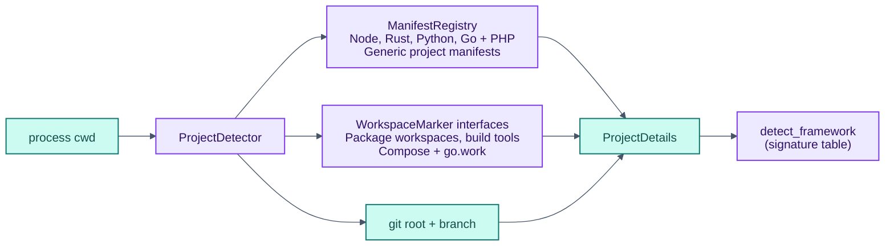

</details>

## 5. Desktop app


<details>
<summary>Mermaid source</summary>

```mermaid
---
config:
  theme: base
  look: classic
  htmlLabels: false
  themeVariables:
    darkMode: false
    background: "#ffffff"
    primaryColor: "#DBEAFE"
    primaryTextColor: "#172554"
    primaryBorderColor: "#2563EB"
    secondaryColor: "#CCFBF1"
    tertiaryColor: "#ffffff"
    textColor: "#0F172A"
    lineColor: "#475569"
    edgeLabelBackground: "#ffffff"
    clusterBkg: "#ffffff"
    clusterBorder: "#94A3B8"
  flowchart:
    wrappingWidth: 240
---
flowchart TB
  accTitle: Desktop UI and native backend components
  accDescr: Svelte feature views compose a shared UI kit and pure view models. The API boundary calls validated Tauri commands, which own freshness and confirmation state.
  subgraph Rust["src-tauri (holdmap-desktop)"]
    LIB["lib.rs · Composition root<br/>Plugins + command registration"]
    CMD["commands.rs · Native operations<br/>Validated reads, plans, stops + openers"]
    ST["state.rs<br/>AppState (config, last snapshot)"]
    CF["confirmation.rs<br/>one-use reviewed plans"]
    TR["tray.rs<br/>menu + top ports"]
    W["watch.rs · Background scans<br/>Events, notifications + tray refresh"]
    SC["shortcuts.rs<br/>presets, re-registered at runtime"]
    LIB --> CMD & TR & W & SC
    CMD & TR & W --> ST
    CMD --> CF
  end
  subgraph UI["Svelte 5 front-end"]
    APP["App.svelte · Presentation root<br/>wires state, views and dialogs"]
    APPLIB["App logic (pure / runes)<br/>lib/app-prefs.svelte.ts · app-commands.ts · app-shortcuts.ts"]
    SHELL["components/shell/<br/>TitleBar · ViewToolbar · SearchBox · Notices · StatusBar"]
    HOME["components/home/<br/>HomeView · AgentCards · MachineMap · MapList · AgentLanes · NeedsList<br/>Pure view models: lib/home.ts · agent-card.ts · machine-map.ts · agent-lanes.ts"]
    GV["GraphView.svelte<br/>@xyflow/svelte"]
    AV["AgentsView.svelte<br/>agent cards + C4 pictures<br/>(lib/agents.ts: context / footprint / project)"]
    NODES["components/graph/<br/>ServiceNode · ClusterNode · TrafficEdge · FitOnChange"]
    AGNODES["components/agents/<br/>AgentNode · FootNode · AgentTools"]
    LG["lib/graph.ts<br/>dagre layered · force · toFlow · related · sections"]
    OTHER["Feature panels + dialogs<br/>Detail, settings, history + confirmation"]
    LIST["components/list/<br/>PortList, rows, groups, badges + sparklines<br/>Pure view models: lib/rows.ts · lib/port-list.ts"]
    KIT["components/ui/<br/>UI kit (see below)"]
    API["lib/api.ts: Tauri IPC, live CLI in vite, or lib/mock.ts demo data"]
    APP --> GV --> NODES
    APP --> AV --> AGNODES
    GV --> LG
    APP --> OTHER --> KIT
    APP --> LIST --> KIT
    APP --> SHELL --> KIT
    APP --> HOME
    APP --> APPLIB
    APP --> API
  end
  API -- "Tauri IPC" --> CMD

  style Rust fill:#ffffff,stroke:#94A3B8,stroke-width:1px
  style UI fill:#ffffff,stroke:#94A3B8,stroke-width:1px

  classDef surface fill:#DBEAFE,stroke:#2563EB,color:#172554,stroke-width:1.5px
  classDef domain fill:#EDE9FE,stroke:#7C3AED,color:#2E1065,stroke-width:1.5px
  classDef safety fill:#FEF3C7,stroke:#D97706,color:#451A03,stroke-width:1.5px
  classDef data fill:#CCFBF1,stroke:#0F766E,color:#134E4A,stroke-width:1.5px
  class LIB,CMD,TR,W,SC,APP,APPLIB,SHELL,HOME,GV,AV,NODES,AGNODES,OTHER,LIST,KIT,API surface
  class LG domain
  class CF safety
  class ST data
```

</details>

`commands.rs` validates action targets, schedules blocking work and calls the core. Native
state owns freshness and preference handling. View logic such as layout, filtering and ordering
lives in pure TypeScript modules covered by Vitest. Stateful app-shell behaviour that is not
view logic (screen recording lifecycle) lives in a controller class
(`lib/screen-capture.svelte.ts`). The app shell is split by responsibility: `AppPrefs`
(`lib/app-prefs.svelte.ts`) owns persisted view preferences, `appCommands`
(`lib/app-commands.ts`) builds the command palette, and `decideKey` (`lib/app-shortcuts.ts`)
maps a key and a snapshot of app state to one intent. `App.svelte` wires state to components,
runs intents, and owns no markup beyond the main view switch and dialogs (`SearchBox`,
`ReviewPendingDialog`, `SettingsUnavailableDialog`).

`AppState` serializes scans and shares a cache keyed by socket view and Docker collection.
Agent, topology and explanation commands require a scan no older than one second, even when
called before a UI poll. Derived reads retain the cached socket view, and failed refreshes
return an error while leaving the previous cache eligible for a retry. Collection holds the
scan lock without holding the engine mutex. Folder actions run off-thread and force a fresh
scan rather than authorizing paths from an old cache. Openers construct localhost URLs or
resolve port/agent folders in the backend; the webview cannot supply an arbitrary command or URL.
Tray updates requested by scans use the native event loop rather than creating a thread per
refresh. Shortcut replacement registers the new shortcut before releasing the working one,
so a collision leaves the previous shortcut active.

`window_lifecycle.rs` intercepts main-window close requests only while a working tray exists.
On macOS it uses Tauri's application hide, which calls
[AppKit `NSApplication.hide`](https://developer.apple.com/documentation/appkit/nsapplication/hide(_:)).
Hiding only the fullscreen window can leave its Space active with no content. Application
hiding deactivates Holdmap while retaining the same window, webview and fullscreen state;
it does not race an asynchronous fullscreen exit. Other platforms hide the main window.
Secondary windows close normally, and a missing tray preserves ordinary main-window closing.
Tray and global-shortcut requests share the restore operation: unhide the macOS application,
restore it if minimized, then show and focus the window. macOS Dock `RunEvent::Reopen` also uses this
operation; minimized windows count as visible in AppKit's reopen event, so restoration does
not depend on that event's visibility flag.

`confirmation.rs` owns a separate in-memory cache of immutable plans: at most 128 pending
previews, each valid for five minutes and consumed once. The native stop command requires the
preview's handle and exact target/force/soft-protection authorization, builds a fresh plan,
rejects different effects, then executes the retained original. TCP and UDP row targets keep
their protocol, and all plans in an agent bulk action appear in the confirmation dialog.
These handles bind reviewed effects; they are not authentication credentials.

The main webview's local-only capability permits event listen/unlisten and window dragging.
Native commands enforce their own target checks, and the CSP limits script loading and network
connections to the app and native IPC. Svelte renders untrusted process, agent and HTTP prose as
escaped text, including inline command spans. The browser demo has no native IPC access.

Configured signed updates use `update.rs`: manifest requests time out after 30 seconds and
downloads after 10 minutes. A shared guard serializes installations, including if an awaiting
caller disappears while the filesystem worker continues. Signature verification precedes
installation; synchronous archive and filesystem work runs on a blocking worker.
Signed release configuration requires the signature's authenticated version to match the
announced update. `verify_updater.rs` streams each updater artifact through the same minisign
verifier before release upload, checks its signed version and collected SHA-256 digest, and
emits platform metadata. One final job validates all four platform manifests against the
published asset digests and IDs, then publishes the complete `latest.json` index.

### Desktop UI

- **Screen recording.** `lib/screen-record.ts` owns consent copy, duration bounds, filenames
  and blob downloads. `lib/screen-record-backend.ts` chooses browser or native capture.
  `lib/screen-record-encode.ts` processes browser video (video only),
  encodes H.264/MP4 with WebCodecs (`mediabunny`) or `MediaRecorder` when that codec is missing,
  and writes a bounded GIF with `gifenc`. `ScreenRecordDialog.svelte` confirms before the OS
  picker, then the title bar shows Stop + elapsed time so the modal does not cover this window
  while recording. Files stay on the machine (`blob:` / `mediastream:` CSP; macOS Screen Recording
  usage string). `lib/screen-record-native.ts` adapts the bounded native session and binary exports
  to the same preview. Tests cover helpers, both backends, the dialog and synthetic media.
- **Folder actions.** Map and card paths share `FolderActions.svelte` rather
  than separate opener flows. `lib/folders.ts` selects an exact-path owner once and revalidates
  that same target during polling; the UI never silently switches agents. The dialog handles
  choices, clipboard feedback and focus through the shared UI kit, while injected callbacks
  keep native opening in `App.svelte`/`api.ts`. Native commands force a fresh scan before
  validating owner/path membership, then call the core's directory-validated openers.
  The configured editor is an executable, never a shell command; a missing explicit
  `HOLDMAP_EDITOR` fails without choosing a substitute.
  Browser callbacks report simulations. This separates presentation, ownership policy and OS
  effects into small contracts that fixture providers can exercise without opening real apps.
- **UI kit.** `apps/desktop/src/components/ui/` provides shared controls (fields, selects,
  switches, buttons, dialogs, action docks, action pills and tabs). Exclusive toolbar choices are
  hinged action docks, not nested segmented tracks; independent toggles use the same pill with a
  soft fill. Feature components compose them and use the shared design tokens for local controls.
  Open the app with `#ui-gallery` to see every control in both themes.
- **Agents C4 pictures.** `lib/agents.ts` builds three zoom levels from the same `AgentsReport`
  (never invented peers): Computer context (this machine, agents, observed remotes), Footprint
  containers (folders, tools, ports, hosts), and Project components (one source tree).
  `AgentsView.svelte` fits those graphs into Svelte Flow; Computer / Footprint / Project are
  exclusive action docks on the Overview toolbar. Folder clicks zoom, then open
  `FolderActions.svelte`. Evidence labels stay observed / inferred / unknown.
- **Pure view logic.** `lib/rows.ts` (badges, status, sparklines), `lib/detail.ts` (details pane)
  and `lib/settings.ts` (the Settings contract) are pure and unit-tested, so components depend on
  interfaces rather than on `api.ts`.
- **Compact details and menus.** Detail panels keep shared tabs on one scrolling
  row and long content within the pane, while a dedicated action footer distinguishes port
  stops from computer power controls. The shared Select calls pure `lib/popover.ts`
  placement logic to fit the viewport; feature panels do not duplicate edge calculations.
  Both depend on small presentation contracts and injected action callbacks rather than
  native APIs.
- **Accessibility.** The list is a `role=listbox` with `aria-activedescendant`, dialogs trap and
  restore focus, and `src/contrast.test.ts` keeps text tokens at WCAG AA in both themes.
- **Typography.** Inter Variable for UI text and JetBrains Mono Variable for code, PIDs and paths,
  bundled locally (SIL OFL 1.1). One scale (11–32 px, base 13 px, weights 400/500/600) exposed as
  semantic tokens in `app.css`; `src/typography.test.ts` rejects raw values. The TUI and CLI map the
  same roles onto bold and colour.

## 6. Graph library

The graph view uses **Svelte Flow (`@xyflow/svelte`) and `@dagrejs/dagre`**. Nodes are real DOM
buttons with the shared icons, tokens and focus rings; group nodes draw existing cluster hulls.
The pure layout finds components from existing edges and
cluster membership, lays each one out independently, then packs their bounds, including cluster
headers. Dagre gives a left-to-right layout inside each connected component. The alternative
Force layout runs the deterministic simulation inside components only; isolated services do
not repel unrelated services across a vast canvas. Force remains bounded to 100 visible nodes,
with Layered as the fallback. Packing and proximity never add edges or infer relationships.

`graphForQuery` projects matched nodes plus their immediate observed neighbors and existing
edges; the matching predicate uses displayed metadata, exact `port:`/`:port` and `pid:`
selectors, and AND between terms. It does not inspect process command lines. `App.svelte`
owns Graph search separately from List filters and resolves Graph selections against the full
snapshot, so hidden List preferences cannot hide a selected service's details.

Graph opens without the List summary pane. An explicit card click or native button activation
opens that listener's details; close, hide and Escape clear the Graph selection and restore focus
to its card or the graph region. Wide canvases dock details, while smaller canvases use the
existing modal drawer. Structure changes drive layout; viewport adjustment follows explicit
scope, layout and search changes after fresh topology arrives. Refreshes preserve the user's
viewport. `GraphViewport.svelte` waits for measured nodes and establishes a readable
initial scale, with separate actions for fitting the entire graph and restoring readable size.
On wider canvases, the minimap appears only when graph bounds extend beyond the viewport.

Primary chrome contains compact counts, All services and layout controls. Options discloses
Traffic, External and Legend. Its Escape handling precedes Graph selection while leaving
overlaid modal dialogs in control of their keyboard. Reduced motion disables traffic animation.
External stays idle
until there are outbound hosts, and a short no-links message explains disconnected graphs.
Editor-extension nodes keep the extension identity, not the inherited project. The public
sample's All services mode adds eligible listeners from the same snapshot without inventing
edges, including the existing bounded `mockPorts` load samples. Agent cards and the Flow inspector retain their
separate presentation and visibility controls.

## 7. Design notes

The SOLID boundaries are concrete responsibilities and substitutable interfaces:

| Principle | Boundary |
|---|---|
| Single responsibility | Scanning, ownership, planning and execution stay separate. Hook/OTLP parsing is separate from shared metadata validation; MCP delivery and recording controls have their own modules. |
| Open/closed | Catalog entries, strategy registries and injected detectors/classifiers extend behavior through established boundaries. |
| Liskov substitution | System and fixture providers satisfy the same collection contracts. No-op and recording MCP observers preserve protocol output, including when recording fails. |
| Interface segregation | Socket, process, container, recent-project, detector and classifier interfaces each expose a small contract. MCP observation receives metadata only; recording UI receives action callbacks. |
| Dependency inversion | Core orchestration accepts provider and classifier traits; MCP accepts an observer and recording UI accepts callbacks. Composition points choose implementations. Setup generation depends on credential policy rather than HTTP transport. |

- `scan` gathers, `engine` decides, `exec` acts, `topology` relates and `store` persists. The
  desktop backend is split into `commands`, `confirmation`, `state`, `tray`, `watch` and `shortcuts`.
- Behaviour is extended through registries: `StrategyRegistry`, `ClusterRegistry`,
  `ManifestRegistry`, `WorkspaceMarker`s and the `exporter(name)` factory.
- `Engine` and `Scanner` take trait objects, so tests inject static providers and fixture tables.
  `Scanner::system()` (used by `Engine::new`) selects the production socket, process and
  container providers. Execution, HTTP probes, project detection and recent-project sources
  have their own OS and filesystem boundaries.
- Project and shell features stay out of the engine: `stack` parses and validates
  `.holdmap.toml` and answers "is this listener ours?" (pure data, no I/O beyond reading the
  file), `hint` reads a command line for the ports it would bind, and `http` probes a port with a
  bounded `GET /`. The CLI composes them with the engine's normal plan → confirm → execute path,
  so `down`, `up --replace` and `stop --all-dev` get the same protection checks as `stop`.
  The CLI and TUI enforce the nearest project's `protect` setting against all known effects
  of a plan, including other listeners held by the same process, descendants, containers and
  managed services. Explicit stack files add their protected ports to that policy. They reload
  the policy and scan after confirmation before execution; unreadable, invalid or untrusted
  project files fail closed. Only CLI `stop`/`kill --allow-protected` authorizes the project
  override. Desktop and MCP share the engine's process policy without loading CLI stack files.
- `docs/cli.md`, the man pages and the shell completions are all generated from the clap
  definitions; `cargo test` fails when `docs/cli.md` is stale.
- Desktop app information reports the running binary's version, architecture, location
  and actual signed-updater capability. Settings renders that contract; update/help actions
  stay in the API/native adapters. Manual help accepts named destinations mapped to fixed
  official HTTPS pages behind the shared local-window guard, rather than arbitrary URLs.
  Builds without a signed updater perform no automatic update checks.

### Files, credentials and untrusted output

Persistence checks files before consuming or truncating them. Unix Store reads require a
private account-owned directory, owned regular single-link files and no group/world writes;
atomic writes use exclusive temporary files and directory-descriptor-relative operations.
Private files/directories use `0600`/`0700`. Windows rejects final reparse points and extra
hard links, while inheriting filesystem ACLs from the chosen directory; it does not install or
verify an account-exclusive DACL. Custom state locations must remain account-controlled.
Restart commands come from this validated history, rather than a command supplied by the UI.
State mutations use an in-process mutex and a checked cross-process file lock; acquiring the
file lock times out after five seconds on every supported OS. Configuration serialization is
bounded to 1 MiB; an oversized save fails before replacing the existing settings. History reads inspect only the
newest 64 MiB, skip lines over 1 MiB, and retain at most 5,000 valid entries. Writes enforce the
same size and count limits before atomic replacement. A recorded restart directory must still
be absolute and exist as a directory; entries without a recorded directory retain their legacy
behavior.

Project stack validation opens, checks and reads the same file handle. Unix permits current
account or root ownership and rejects group/world writes; Windows trusts the checkout's ACLs.
Project-file creation is exclusive, and forced CLI exports check for link redirection before
truncating a file. Explicit stack commands retain the user's shell authority. HTTP health paths
reject request/header injection; subprocess capture limits output to 4 MiB per stream and
respects a deadline even when descendants retain inherited pipes.
Stack input is limited to 1 MiB and 512 services, with `ready_timeout_s` from 1 to 3,600 seconds.
Dependency ordering uses an ordered ready queue and deduplicated dependency counts.
`holdmap status` probes at most 32 services concurrently; disabled or nonrunning services
create no probe workers. Startup diagnostics read only a 64 KiB log suffix, omit a cut first
line, and redact recognized credentials before display.

Container-runtime HTTP responses are capped at 4 MiB including framing, with 64 KiB limits
for headers and trailers. Incremental chunk parsing validates boundaries before decoding and
rejects malformed, truncated or ambiguous framing. Unix/TCP connect, writes and reads share
one request deadline. DNS callers wait within it, with at most four outstanding OS resolver
workers and 16 candidate addresses; OS lookups themselves cannot be cancelled. Windows
named-pipe open callers wait within the same deadline, with at most four outstanding workers
and late handles closed automatically. OS opens have no guaranteed cancellation, so stalled
workers consume that bounded capacity and later requests fail promptly at the limit.
Connected pipes use nonblocking mode and bounded polling for reads and writes.
Runtime error displays redact recognized credentials and retain at most 2,000 characters.

The shared redactor recognizes credential flags, assignments, URL userinfo, encoded query
keys, headers and nested JSON values with parsing limits. Raw arguments remain available for
authorized execution; displayed commands and errors use redacted forms. Arbitrary positional
secrets may not be recognizable. Human terminal renderers neutralize external OSC/CSI/C1
controls and row-breaking fields while preserving Holdmap's own styling and layout. JSON
results retain their structured metadata. These boundaries have synthetic regression fixtures;
they do not establish an absence of every possible leak or filesystem race.

## 8. MCP adapter

`holdmap mcp` exposes the core through newline-delimited JSON-RPC on stdio. The adapter keeps
protocol concerns separate from scanning, ownership and execution:

| Module | Responsibility |
|---|---|
| `lib.rs` | Transport, version negotiation, request routing and protocol results |
| `catalog.rs` | Tool names, descriptions, input/output contracts and client instructions |
| `validation.rs` | Check arguments against the published input contracts before live work |
| `tools.rs` | Convert validated arguments, call the core and summarize returned types |
| `resources.rs` | Serve the compiled-in agent guide through an exact resource URI |
| `prompts.rs` | Discover and render workflow templates with validated string arguments |

Tool metadata drives input validation so a client cannot turn an invalid `dry_run` string into
an executing stop. The core remains responsible for ownership, stop plans, protected processes,
execution and PID reuse checks. Output schemas describe structured results; compatibility
handling keeps text JSON available to older clients.

Both stop tools default to previews. Execution requires a session-local one-use
`confirmation_id`, bound to the preview's target/options/filter, a matching agent selection
for bulk stops, and fresh matching effects for every captured plan. The session retains at
most 32 previews for five minutes; expired, reused or changed requests require a new preview.
A dry run in another session does not authorize execution. All bulk plans are validated before
any are executed, and the core receives the captured original plans. A captured preview is
bounded to 128 ports or agents and 1 MiB of serialized metadata.

Valid execution attempts consume the handle before option/fresh-state checks; a mismatch or
collection/execution failure requires a new preview. Malformed envelopes or tool arguments do
not consume it. Restarting or reinitializing the session invalidates pending previews. Bulk
execution stops at the first failed plan, without rolling back earlier actions. Handles bind
effects rather than authenticate a user or prove consent; the client obtains authorization.

The transport bounds each newline-delimited frame to 1 MiB excluding the newline. Legacy
protocol batches are limited to 64 messages. Oversized frames are fully drained and oversized
batches are rejected as a whole before dispatch, preserving the next frame's boundary.

The resource and prompt layers perform no scans, probes, file reads or mutations. Clients
supporting those MCP capabilities can discover tool-selection guidance and the `diagnose_port`,
`prepare_dev_server` and `inspect_agents` workflows. A retrieved prompt is context for the client,
not an executing workflow. Clients exposing tools alone can use the same tools directly:
`list_ports`, `explain_port`, `inspect_port`, `find_free_port`, `wait_for_port`, `get_topology`,
`list_agents`, `get_agent_flow`, `list_analyzers`, `list_insights`, `list_needs`,
`stop_agent_ports`, `plan_cluster_stop` and `stop_port` (fourteen in all).
`inspect_port` shares `explain_port`'s structured inspection. `get_agent_flow` is process
ancestry and live TCP edges, not recorded tool calls. `stop_agent_ports` uses the shared agent
matcher and previews by default. Tools preserve collection warnings alongside returned data;
`wait_for_port` waits for TCP readiness, not application health. No live subscriptions are
advertised.

## 9. Analyzers

`holdmap-analyzers` runs opt-in scanners over the skills and pinned MCP packages that the
capability inventory found. It depends on `holdmap-core` for that inventory and never on an
interface crate.

| Module | Responsibility |
|---|---|
| `manifest.rs` | Analyzer manifests: inputs, command, network hosts, environment names, placeholders such as `{subject.dir}`, `{output}` and `{empty.file}` |
| `consent.rs`, `store.rs` | Approval pinned to the manifest and the program's path, hash and version; private state under `HOLDMAP_HOME` |
| `service/` | The entry point the CLI, desktop and MCP adapters call: list, approve, run and store findings |
| `cli_runner.rs` | Staged copy without scanner settings files, cleared environment, private home and time limit |
| `sandbox.rs`, `landlock.rs` | The OS sandbox for each run |
| `mcp_runner.rs` | Starts an MCP analyzer's server only for a run, pins its tool list and flags descriptions that look like tool poisoning |
| `osv.rs` | Built-in OSV.dev lookup for pinned npm and PyPI packages |
| `parse/` | SARIF and custom JSON into capped findings; message text is never kept |
| `catalog.rs` | The minisign-signed catalog; updates are applied only after a reviewed diff |
| `presets.rs` | Ready-made manifests (Cisco Skill Scanner, OSV-Scanner, Trivy secrets, Bandit) outside the signed catalog |

Sandboxes are bubblewrap or Landlock on Linux, Seatbelt on macOS and a Job Object on Windows;
the permissions sheet names the one in use and what it does not block. Any change to the
manifest or program stops the analyzer until it is approved again. Findings feed **Needs you**,
**Insights**, MCP `list_insights` and `holdmap insights --format sarif`. The user guide is
[Analyzers](../site/src/content/docs/analyzers.md).

## 10. Agent communication

The read-only Connections projection uses one consistent scan and `AgentsReport`. It retains
exact socket holders and process start tokens; it marks missing and ambiguous ownership rather
than choosing a guessed peer. Limits bound OS graph output to 256 nodes and 512 edges.

The separate Calls pipeline requires explicit local opt-in. `holdmap-activity` owns strict
metadata contracts, pure provider normalization, bounded storage, loopback HTTP and a bounded
client. Native commands share the trusted-main-window policy with Power; CLI hooks and MCP
recording compose the same client. `ToolCallObserver` is injected into MCP with a no-op default,
so protocol handling and optional recording have separate responsibilities. It receives only
catalog names, timing, outcomes and serialized sizes. Recording failure never disables tools.

Hook and OTLP adapters parse their source formats independently, then apply the same metadata
invariants and name policy. One typed route contract covers accepted paths and exhaustive
dispatch; client and setup generation share credential validation without constructing a
transport just to generate text. Request bounds come from the collector's limits contract.
Native recording commands use one authorized, serialized session boundary. The CLI MCP
adapter owns its bounded delivery queue and worker lifetime separately from activity commands.

Tool records carry an optional sanitized `mcp_server` and there is a separate
`skill` kind for explicit Claude activation logs. Skill records carry a source event time,
pseudonymous session/counter identity and unknown workflow outcome; they do not increase tool
call counts. Built-in adapters derive MCP aliases only from explicit hook metadata or an
unambiguous sanitized client label. Explicit normalized tool records can also report the
optional alias through `/v1/activity`, subject to the shared identifier sanitization and record
validation. None creates a configuration/process join, authenticated identity or action authority. Default Claude
setup stays trace-only; the documented alternate log-only recipe receives activation events
without enabling tool-detail or content flags.
Current decoding accepts older snapshots with an omitted MCP alias. The strict older decoder
does not accept newly populated fields or the skill kind, so new usage requires matching
collector and CLI/desktop builds; `/v1` route names do not promise unknown
record shapes will be accepted. This preserves rejection of unrecognized normalized fields.

The browser adapter supplies labelled examples. Pure TypeScript builds reported parent edges,
layout and timeline models; an invalidatable loader prevents stale requests from changing a
later view. Components present evidence and setup without authority to stop a reported PID.
`RecordingControls` owns recording actions, setup copying and confirmation; `AgentFlowView`
owns graph and run selection. Injected callbacks connect these components to the application.
The pure triage projection filters metadata rows, orders reported durations and retains matching
or inspected records with their explicit ancestors. Controls do not rewrite stored runs or
infer parent links, and the existing graph window still bounds canvas work.
An unavailable recording status remains unknown until a successful refresh supplies it.
A source-provided parent defines an edge; socket presence, elapsed time and common session
membership cannot define tool causality. Provider setup remains reviewable text that the user
applies explicitly. No source settings or private conversations are read automatically.


<details>
<summary>Mermaid source</summary>

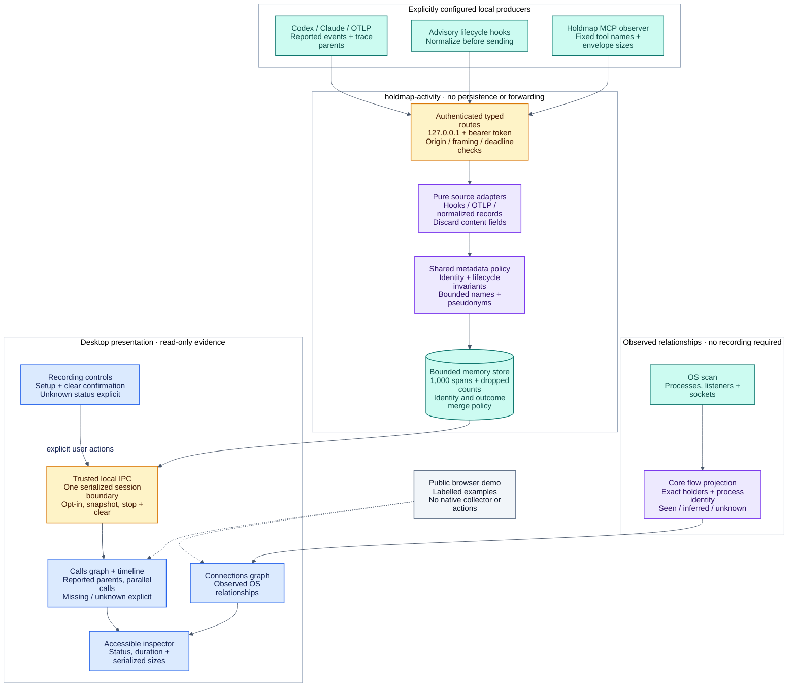

</details>

Adapters depend on narrow contracts; domain projections do not depend on presentation or
transport. Tests substitute scans, clocks, MCP observers and executors without redefining
production policy. Provider wire fixtures, hostile HTTP tests, out-of-order updates, full CLI
roundtrips and keyboard regressions verify the composition. [Agent flow](agent-flow.md) records
primary research, exporter setup, source coverage and privacy limits.

## 11. Terminal agents

The terminal Agents view uses one background scan and one cached `AgentsReport`; render and
navigation never collect processes or read project history. `tui/agents_view.rs` holds pure
filter, count, safe-text and wrapping helpers, `tui/agents_state.rs` owns stable selection,
search and review requests, and `tui/agents_ui.rs` renders the responsive list/details panes.
`app.rs` coordinates keyboard events, worker messages and refresh sequencing. Agents **c**
opts into `Engine::agents_with_capabilities()` for the next scan; the default refresh still
calls `Engine::agents()`. A refresh queued behind an in-flight scan discards its older
response, including after a completed stop.

`tui/terminal_modes.rs` owns paired mouse/paste modes and terminal restoration;
`tui/input.rs` owns printable, bounded search text. Paste events enter only active search and
never the action-key dispatcher. Graph filtering and navigation use visible node IDs, while
Ports and Agents retain their independent selection state. Supported terminals send bracketed
paste as one event; unframed keyboard bytes cannot establish whether the user typed or pasted.

CLI and TUI share `agent_actions.rs` for reviewed service stops. Each protocol-qualified plan
retains the agent identity and exact listener/process identities. One fresh snapshot must
validate the entire batch before the first effect; execution consumes the original plans and
halts after a failure or history-write error. Injected execution and recording functions test
policy without stopping processes. Presentation cannot broaden that authorization. Terminal
metadata is printable, commands stay redacted, and confirmation keeps cancellation visible.


<details>
<summary>Mermaid source</summary>

```mermaid
---
config:
  theme: base
  look: classic
  htmlLabels: false
  themeVariables:
    darkMode: false
    background: "#ffffff"
    primaryColor: "#DBEAFE"
    primaryTextColor: "#172554"
    primaryBorderColor: "#2563EB"
    secondaryColor: "#CCFBF1"
    tertiaryColor: "#ffffff"
    textColor: "#0F172A"
    lineColor: "#475569"
    edgeLabelBackground: "#ffffff"
    clusterBkg: "#ffffff"
    clusterBorder: "#94A3B8"
  flowchart:
    wrappingWidth: 210
---
flowchart LR
  accTitle: Terminal agent visibility and reviewed service actions
  accDescr: A background collector supplies one agent snapshot to compact CLI reports and responsive terminal views. A session boundary pairs mouse and bracketed paste modes with restoration; paste routes only to bounded search text. View state keeps stable identity selection. Shared reviews retain exact protocol and process identity. Fresh batch checks precede execution and private history recording, with no automatic retries.
  SCAN["Background collector<br/>Engine + agent snapshot"] --> REPORT["CLI overview and details<br/>Redacted, printable metadata"]
  SCAN --> STATE["Terminal view state<br/>Search + stable identity selection"]
  INPUT["Terminal session boundary<br/>Mouse + bracketed paste<br/>Paired restoration"] --> ROUTE["Input routing<br/>Paste → bounded search only<br/>Typed keys → current view"] --> STATE
  STATE --> UI["Responsive presentation<br/>Agent list + scrollable details"]
  REPORT & UI --> REVIEW["Shared service review<br/>Exact TCP / UDP plans<br/>Agent root stays protected"]
  REVIEW --> CHECK["Fresh whole-batch validation<br/>Identity, ownership and policy"]
  CHECK --> EXEC["Retained plan executor<br/>Verify result; halt on failure"]
  EXEC --> HISTORY["Checked private history<br/>Completed effects + errors"]
  classDef surface fill:#DBEAFE,stroke:#2563EB,color:#172554,stroke-width:1.5px
  classDef domain fill:#EDE9FE,stroke:#7C3AED,color:#2E1065,stroke-width:1.5px
  classDef safety fill:#FEF3C7,stroke:#D97706,color:#451A03,stroke-width:1.5px
  classDef data fill:#CCFBF1,stroke:#0F766E,color:#134E4A,stroke-width:1.5px
  class REPORT,UI surface
  class STATE,SCAN,ROUTE domain
  class INPUT,REVIEW,CHECK,EXEC safety
  class HISTORY data
```

</details>

## 12. Local capture

### Screen recording

Screen pixels have a separate, user-initiated lifecycle from agent activity metadata. The
capture call runs directly from the Choose screen action so the operating system retains
control of source selection and consent. A generation guard releases late streams after
cancellation or unmount, and stopping releases capture tracks before finalizing exports.
Holdmap does not persist screen selection or a permission decision, and no audio is requested.
The operating system manages any retained privacy permission separately.
`screen-record-backend.ts` selects the browser or native session behind one small
stop/discard/elapsed-time contract. Capability discovery never opens a picker. When
`getDisplayMedia` is absent, macOS 14+ uses ScreenCaptureKit's public system picker;
older macOS versions remain launchable through weak framework linking and availability checks.
The Rust boundary accepts opaque session handles rather than paths, authorizes the local
main window and owns one private temporary directory. The Swift adapter confines picker
and stream lifecycle to the main thread, writes H.264 locally and prepares the GIF after
capture stops. Independent native duration and size bounds survive renderer suspension.
Cancellation waits for stream/writer/export completion before releasing native files;
bounded binary IPC copies completed exports into the existing in-memory preview.
On Linux, a display-only host permission handler applies the same trusted-main-view policy.
WebKitGTK otherwise denies requests by default. Its display backend independently requires
the ScreenCast portal's selection and PipeWire stream, including on X11; the host gate
does not choose a source or grant camera/microphone access. Portal cancellation or absence
prevents capture. This follows [WebKitGTK's permission default](https://webkitgtk.org/reference/webkit2gtk/stable/class.UserMediaPermissionRequest.html),
[its display backend](https://github.com/WebKit/WebKit/blob/webkitgtk-2.40.3/Source/WebCore/platform/mediastream/gstreamer/GStreamerDisplayCaptureDeviceManager.cpp),
and the [ScreenCast portal contract](https://flatpak.github.io/xdg-desktop-portal/docs/doc-org.freedesktop.portal.ScreenCast.html).

The encoder module loads on demand. H.264 capability checks include the output dimensions;
WebCodecs/Mediabunny has a MediaRecorder MP4 fallback. GIF quantization runs in a same-origin
worker with one RGBA frame in flight. The GIF streams to a byte budget: identical frames are merged,
sampling is a fixed cadence that stretches as the budget fills, and cumulative delays avoid
rounding drift. The user's plan (presets in `screen-record-plan.ts`) sets format, length, rate and
size; the recorder pauses and resumes through the video source, so paused time is left out.
Finalization has a deadline and can be discarded. The CSP permits local and blob workers
without enabling external scripts or network destinations.

Desktop saves use a trusted-main-window binary command, a 128 MiB payload bound, filename
and container-header validation, and a serialized native save dialog. JavaScript cannot
supply the destination path. Same-directory private temporary files replace the chosen
destination atomically after a complete write; cancellation and errors retain the in-memory
export for retry. No filesystem or dialog plugin permissions are granted to the webview.
Browser exports use the browser download manager and do not claim confirmed disk writes.
Closing a completed preview retains one bounded result in memory for the current session;
Review recording reopens it, and explicit discard releases it before another recording.
Hiding or minimizing the window preserves active capture until Stop or the chosen limit (at most one hour).
The native macOS recorder writes the MP4 to its private folder; a long MP4 is copied to the chosen
destination by `export_screen_recording` (same chooser, same atomic replace, 2 GiB bound) instead of
crossing IPC. `reveal_saved_recording` opens only folders of files saved this session.

The implementation follows the primary [Screen Capture specification](https://w3c.github.io/mediacapture-screen-share/),
the [WebKit capture-permission fix](https://bugs.webkit.org/show_bug.cgi?id=274896),
[Mediabunny source lifecycle](https://mediabunny.dev/guide/media-sources),
the [gifenc worker guidance](https://github.com/mattdesl/gifenc), and
[Tauri native dialogs](https://v2.tauri.app/plugin/dialog/). Synthetic owned canvas streams
validate actual MP4/GIF content without capturing a user's screen or requesting capture permissions.
The native fallback follows Apple's [ScreenCaptureKit content-sharing picker](https://developer.apple.com/documentation/screencapturekit/sccontentsharingpicker).
Its synthetic pixel fixture exercises the production native MP4/GIF writer without requesting
screen permission. The packaged WKWebView check asserts original browser API availability
before synthetic capture, and separately checks the actual minified app's confirmation dialog.

### PNG snapshots

The camera action (`⇧S`) separates the
visible **Holdmap view** from an explicitly selected **Screen or window**. App-view capture
does not request screen-sharing permission. An active video session can expose a borrowed
**Recording source**; taking its PNG neither opens another picker nor owns the recording's
stop/discard lifecycle. A newly selected source is released after the still is captured.
Browser capture uses its display picker; the native fallback uses Apple's public picker
on macOS 14 or later. All sources omit audio and return the same bounded PNG result:
aspect ratio preserved within 3840×2160 and 32 MiB.

The SOLID boundaries keep source acquisition, result ownership and saving independent:

| Boundary | Responsibility |
|---|---|
| `screen-snapshot.ts` | Small `SnapshotProvider` contract, dimensions, PNG envelope and result metadata |
| `app-snapshot.ts` | On-demand DOM rasterization of the app viewport, preserving SVG and scroll state while excluding snapshot controls, embedded frames and hidden media helpers |
| `screen-snapshot-backend.ts` / `screen-snapshot-native.ts` | Explicit source acquisition and cancellation, or borrowing a recording provider without stopping it |
| `snapshot-controller.ts` / `SnapshotCapture.svelte` | One retained result, generation/abort guards, source choice, preview and save feedback |
| Native snapshot and capture modules | Trusted-main-window authorization, opaque handles, private files, bounded reads and operation leases |
| Shared save adapter and native writer | Save chooser, validated format/size, full native PNG decoding and atomic destination replacement; no JavaScript destination paths |

The controller receives source adapters rather than depending on a particular renderer or
native session. Closing the preview or cancelling/failing a save preserves its result;
discard, reload or quit releases it. A failed or cancelled replacement capture keeps the
previous PNG. Browser downloads report that the download started, not that a disk write
completed. Snapshot cancellation cannot stop a borrowed video source.

App rendering loads `modern-screenshot` only on demand. Fonts remain separate build assets;
only the two known bundled WOFF2 files and exact brand SVG enter bounded, credential-free,
same-origin fetches with redirects rejected. Automatic remote font/style discovery is
bypassed, and unapproved image resources reject capture. The CSP adds only same-origin
asset connections; font policy and external destinations remain unchanged. Rendering has
a bounded result deadline and cooperative checks, with context cleanup and late-result
rejection after cancellation; this does not preempt synchronous browser rendering work.
Decoded browser pixel comparisons cover graph text, SVG edges and ordinary dialogs, while
owned synthetic media/native fixtures exercise PNG capture and saving without sharing a
real screen. Supplementary WebKit runs do not replace the packaged WKWebView checks.

## 13. Power and scheduled actions

### Local computer power

The desktop Power flow has separate presentation, IPC, confirmation policy and OS adapter
responsibilities. Settings callbacks open distinct immediate or scheduled
reviews. `ShutdownDialog.svelte` handles accessible confirmation, acknowledgement and expiry;
its explicit intent prevents a scheduled review from falling through to immediate execution.
`api.ts` selects native IPC or a harmless browser simulation; `power.rs` owns local-window
authorization, one-use handles, monotonic expiry, concurrency and bounded command execution.
Injected executors test policy without shutting down the test computer. No CLI or MCP
shutdown endpoint is exposed. Accepted or uncertain outcomes latch retries until a complete
app restart; confirmation expiry does not schedule an OS shutdown.


<details>
<summary>Mermaid source</summary>

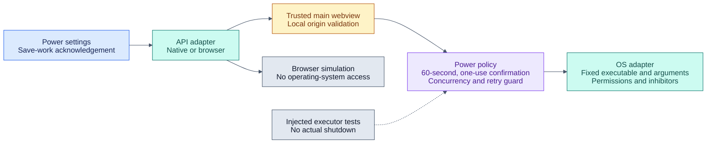

</details>

### Scheduled local actions

The scheduler is a desktop application service with separate queue/timing policy, stop
validation, IPC adapters and a worker. The native queue owns original reviewed plans and
fixed Power authorizations; the Svelte timing and manager components only present and request
changes. Clocks and executors are injected in tests. The public browser API reports simulated
statuses without operating-system access. CLI and MCP process operations remain immediate.
Dedicated shutdown and port scheduling entries initialize `ActionTiming.svelte` to one hour
and exclude **Now**. Immediate reviews omit timing controls. Timing presentation and delay
validation stay separate from native authorization and dispatch; a missing scheduling callback
fails closed.
Schedules require Holdmap to remain open, including in its tray, with the computer awake.


<details>
<summary>Mermaid source</summary>

```mermaid
---
config:
  theme: base
  look: classic
  htmlLabels: false
  themeVariables:
    darkMode: false
    background: "#ffffff"
    primaryColor: "#DBEAFE"
    primaryTextColor: "#172554"
    primaryBorderColor: "#2563EB"
    secondaryColor: "#CCFBF1"
    tertiaryColor: "#ffffff"
    textColor: "#0F172A"
    lineColor: "#475569"
    edgeLabelBackground: "#ffffff"
    clusterBkg: "#ffffff"
    clusterBorder: "#94A3B8"
  flowchart:
    wrappingWidth: 240
---
flowchart LR
  accTitle: Scheduled local actions and retained authorization
  accDescr: The local desktop consumes reviewed handles into a bounded native queue. Cancellation remains available before atomic dispatch. Clock and target checks precede retained stop plans or a fixed local shutdown request. Browser mode simulates status only.
  UI["Desktop timing controls<br/>Delay or local date/time"] --> CLAIM["Trusted IPC adapter<br/>Consume one-use preview"]
  CLAIM --> Q["Native session queue<br/>32 active · 64 finished<br/>Reviewed intent + deadline"]
  Q --> CANCEL["Cancel before dispatch<br/>Release power reservation"]
  Q --> CLOCK["Independent worker<br/>Wall + monotonic clocks<br/>Missed time requires review"]
  CLOCK --> VERIFY["Fresh authorization<br/>Exact plans + process identities<br/>Agent ownership + protection"]
  VERIFY --> GATE["Atomic dispatch gate<br/>Cancellation ends here"]
  GATE --> STOP["Core executor<br/>Retained stop plan<br/>History + verified result"]
  GATE --> POWER["Power adapter<br/>Fixed local OS request<br/>Permission + inhibitor checks"]
  UI -.-> DEMO["Browser simulation<br/>No OS or process access"]
  classDef surface fill:#DBEAFE,stroke:#2563EB,color:#172554,stroke-width:1.5px
  classDef domain fill:#EDE9FE,stroke:#7C3AED,color:#2E1065,stroke-width:1.5px
  classDef safety fill:#FEF3C7,stroke:#D97706,color:#451A03,stroke-width:1.5px
  classDef data fill:#CCFBF1,stroke:#0F766E,color:#134E4A,stroke-width:1.5px
  classDef web fill:#F1F5F9,stroke:#64748B,color:#0F172A,stroke-width:1.5px
  class UI,CLAIM surface
  class Q,CLOCK domain
  class VERIFY,GATE,POWER safety
  class STOP,CANCEL data
  class DEMO web
```

</details>

- Creation consumes expiring preview handles, validates the entire batch, and pins agent root
  identity and reviewed protocol-specific listeners. Delayed force/protection overrides and
  unguarded supervisor commands and network container runtimes are refused. Process and
  supervisor effects require current-account ownership at creation and dispatch.
- The worker validates clock continuity and every fresh plan before dispatching the retained
  effects. Cancellation can win during checking, until the atomic transition to running.
- Only one shutdown reservation can exist. Cancellation or preflight refusal releases it;
  accepted or uncertain OS requests preserve the Power retry latch.
- Delays are one minute through 24 hours, with 32 active jobs and 64 terminal records. The
  in-memory queue is cleared on full app quit. Missed times over 60 seconds or clock divergence
  over 30 seconds require review. Jobs never retry automatically.

## 14. Website and repository layout

The Astro site lives in `site/`. Its guides use Markdown content under `site/src/content/docs`,
the CLI reference comes from `docs/cli.md`, and screenshots come from `docs/screenshots`.
`site/scripts/build-demo.mjs` builds `apps/desktop` into the ignored `site/public/demo` output.
`npm run dev` reads this machine through the holdmap CLI (`/__holdmap` on the Vite server). The
public website demo and Playwright select `lib/mock.ts`, so demo actions affect sample state and
never scan or stop host processes. `?demo=1` forces that sample in vite. Pages validates pull-request builds and deploys the main
branch; editing source does not itself publish a site.

Guide routes render Markdown through Astro's content component and pass it into the shared
documentation layout. This resolves optimized image assets while preserving headings and alt
text. The CLI reference keeps its repository-link HTML adapter through the layout's fallback.
Build checks reject unresolved image placeholders, missing sources and missing alt attributes;
browser checks load guide screenshots at desktop and mobile widths and check for overflow.
The current guide captures show the rendered images at
[desktop width](screenshots/site-guide-images-light.png) and
[mobile width](screenshots/site-guide-images-mobile-light.png).

The folder layout and what is committed are in
[CONTRIBUTING.md](../CONTRIBUTING.md#repository-layout).

## 15. Verification

The CLI integration suite starts the built `holdmap mcp` binary as an actual stdio client.
It checks discovery, rendered prompts, typed read results, version compatibility and rejected
stop controls with isolated state and local listeners. Desktop browser tests exercise the
production UI using deterministic demo data; native cache and core ownership/protection
regressions use fixtures. CI runs the Rust and native tests on Linux, macOS and Windows, and
the browser suite on Linux. `scripts/check-all.sh` reproduces the full checks on a developer's
host with its native desktop dependencies installed.

Use Rust 1.95+ and Node.js 22.12+ (`nvm use`), with the native dependencies listed in
[CONTRIBUTING.md](../CONTRIBUTING.md). `cargo test --locked` checks core, CLI/TUI, MCP and activity
default workspace members. Desktop `npm run check`, `npm test` and `npm run test:e2e` check
types, pure view logic and production UI flows. Site checks build the shared demo and verify
guides, links and asset budgets; site `npm run test:demo` launches a preview and checks the
embedded app's navigation, agent tools and simulated stop flow. `scripts/check-all.sh` combines
these with formatting, clippy, rustdoc, a native desktop build, workflow validation and dependency
audits at all npm severities for both lockfiles, plus cargo-deny.

Security regressions cover changed confirmation owners, PID reuse, newly protected processes,
preview expiry/replay/options, bulk previews, linked files, credential forms, terminal controls
and bounded MCP input. Gitleaks scans full Git history and current source, including new source
files while excluding ignored build caches. CI uses immutable action SHAs and least-privilege
tokens; CodeQL covers JavaScript/TypeScript, Rust, Swift, Python and Actions. Swift analysis
compiles the native capture adapter on macOS without opening a picker. Dependabot vulnerability
alerts/security updates are enabled, and a daily dependency workflow checks new advisories
without waiting for a source change. These gates supplement review and the platform limits in
[SECURITY.md](../SECURITY.md).
