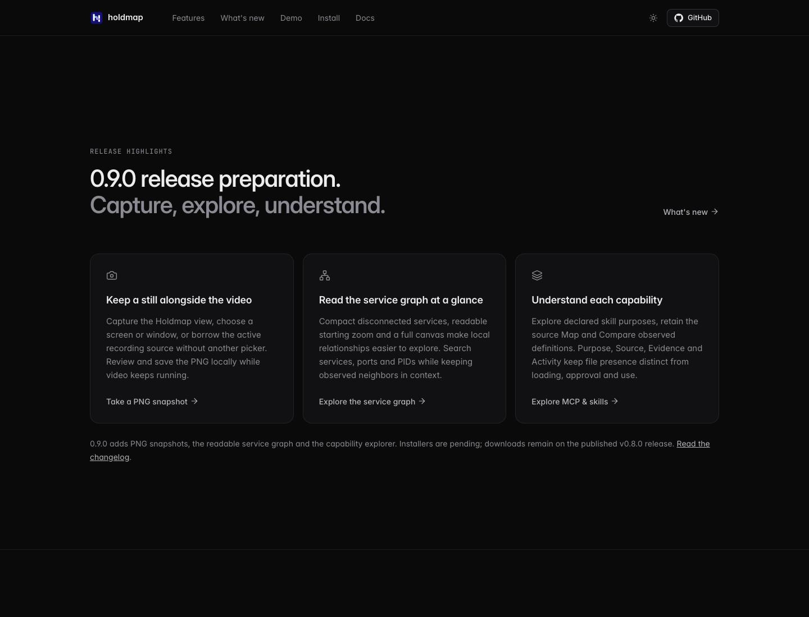
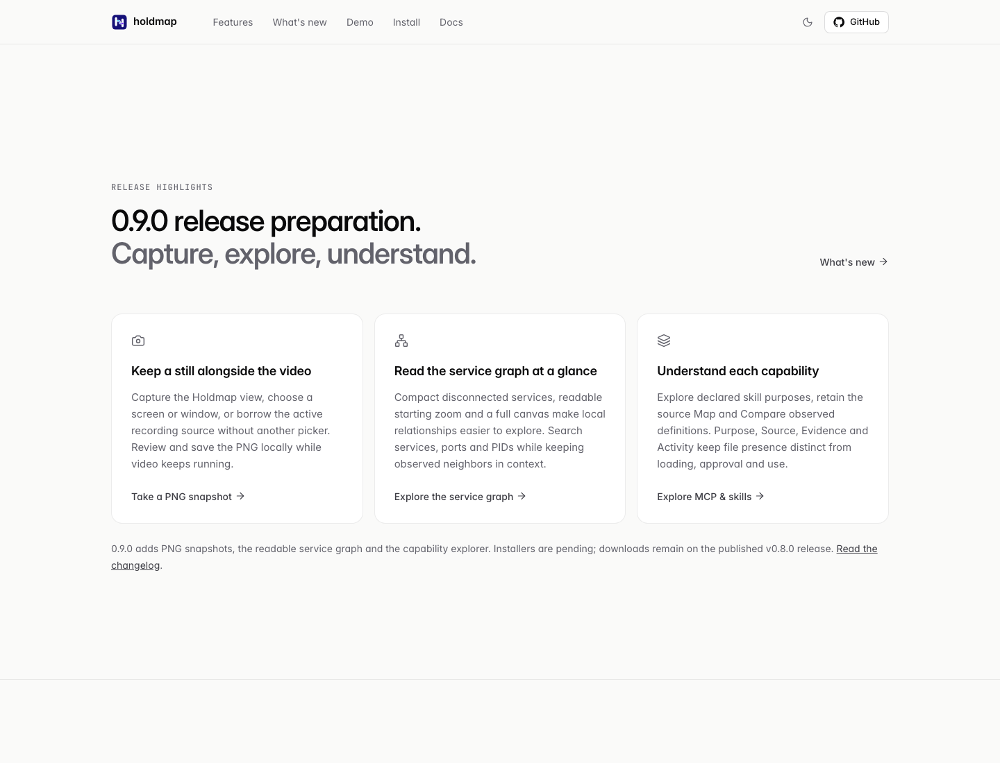
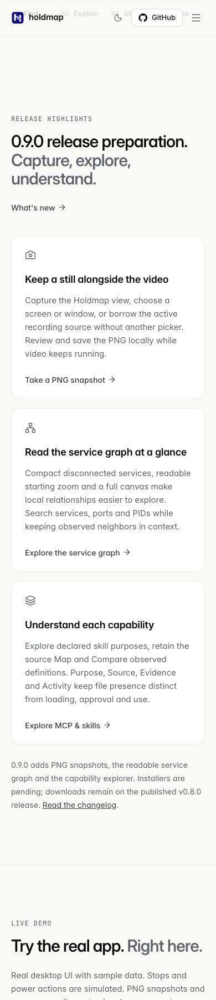
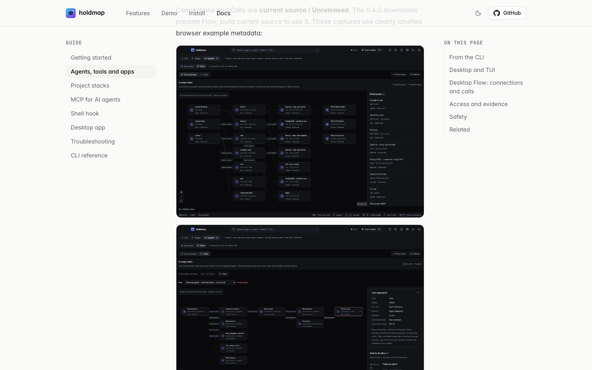
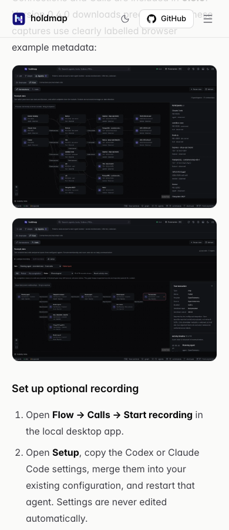

# Public website

The Astro site is published at <https://santoshshinde2012.github.io/holdmap/>.
Canonical URLs, social image URLs and structured-data identities retain the `/holdmap/`
base. The homepage describes the software; guide pages have their own titles and summaries
and a visible breadcrumb trail. Public titles and descriptions name holdmap, stay unique,
and stay in the search snippet range. Public pages permit large search image previews.
JSON-LD escapes HTML delimiters before insertion into a script.
The schema describes the software without inventing ratings, reviews or release capabilities;
it does not promise a Google software-app rich result.

The sitemap lists the homepage and guide pages. The sample-data demo and 404 page use
`noindex` and are omitted. Crawlers need to fetch these pages to see their `noindex` tags.
GitHub Pages project sites cannot publish the host-root `robots.txt`: a file at
`/holdmap/robots.txt` would not control crawling. The account-level site can advertise
`Sitemap: https://santoshshinde2012.github.io/holdmap/sitemap.xml` in its own `/robots.txt`,
or the sitemap can be submitted directly in Search Console. Search Console submission and
indexing status are separate from this repository's build and deployment.

With Node.js 22.12 or newer, install both the desktop and site dependencies, then run:

```sh
cd apps/desktop
npm ci
npx playwright install chromium
cd ../../site
npm ci
npm run check
HOLDMAP_SITE_OFFLINE=1 npm run build
npm test
npm run test:demo
npm audit --audit-level=low
```

Publishing builds set `HOLDMAP_SITE_REQUIRE_RELEASE=1`: GitHub's latest release must be a
published stable `vX.Y.Z` tag with a matching release URL, or the build fails. An older
published release stays the download target while a newer source version is assembling.
Local builds can set `HOLDMAP_SITE_OFFLINE=1` for a deterministic `version.txt` fallback;
combining offline and required-release modes fails. `npm run test:release` checks this policy.

To review the actual publication state, build with the same release requirement as Pages:

```sh
env -u HOLDMAP_SITE_OFFLINE HOLDMAP_SITE_REQUIRE_RELEASE=1 npm run build
npm test
npm run test:demo
node scripts/capture-screenshots.mjs
```

This resolves published downloads independently of the checked-out source. While a new
version is being prepared, it shows the previous published downloads, pending highlights,
preview wording in metadata and the published feature set in structured data. Offline builds
instead use the source version for downloads and availability, so they can show a release as
published before its installers exist; use the required-release build for publication-state
evidence and public-site captures.

`npm test` checks the release policy, built links, asset budgets and SEO. `npm run check:seo` checks the static
HTML without executing page scripts: unique metadata, canonical/social URLs, real social
image dimensions, page and breadcrumb schemas, sitemap coverage, noindex exclusions and a
hostile-text JSON-LD regression. It reuses the desktop's locked DOM-parser dependency.
The existing Pages workflow runs `npm test` on pull requests; publishing follows its deployment
policy. Building a pull request does not publish it. Only `main` pushes and authorized
`main`-context workflow dispatches can deploy; the release dispatch separately validates
its published `source_tag`. Updating a release PR leaves the public site in place until merge.

## Release information

The homepage's release highlights and `src/content/docs/whats-new.md` describe the named
release, with links to its complete notes. Update those together when preparing a new feature
release; do not substitute the latest download version into older feature descriptions.
Download labels and commands resolve the published stable release independently of source.

Website-only edits published after a release deploy through the normal `main` push workflow,
and `build-info.json` records their actual source commit. Dispatching with `source_tag` instead
builds that release tag's website source and intentionally excludes later website edits.
Pages writes `build-info.json` after the build; a local `npm run build` does not generate
deployment identity or publish files.

## Website snapshots

These captures show a production-mode website build at 1440×900, with a 390×900 mobile guide
view. Release highlights use 1440×1100 desktop and 390×1800 mobile captures so all three cards
and the publication note fit in one image. The release captures were taken while 0.9.0 was
being prepared, so they show its pending status. The homepage's sample-data recording is paused on its first frame; no machine is scanned.
After building the site, refresh them with `node scripts/capture-screenshots.mjs` from `site/`.
The script manages its own preview server and Chromium, waits for content and fonts, and checks
themes, page errors, overflow and a 600 KB budget for each PNG.
Focused release captures also assert that the whole highlights section fits in the viewport.

Homepage, dark:


Homepage, light:


Release highlights and publication status, dark:



Release highlights and publication status, light:



Mobile release highlights, light:



Guide and breadcrumb navigation, dark:


Guide and breadcrumb navigation, light:


Mobile guide and breadcrumb navigation, light:


Guide image layout, light:



Guide image layout on mobile, light:



Implementation references: [Google titles](https://developers.google.com/search/docs/appearance/title-link),
[descriptions](https://developers.google.com/search/docs/appearance/snippet),
[canonicals](https://developers.google.com/search/docs/crawling-indexing/consolidate-duplicate-urls),
[breadcrumbs](https://developers.google.com/search/docs/appearance/structured-data/breadcrumb),
[robots.txt location](https://developers.google.com/crawling/docs/robots-txt/create-robots-txt),
[robots metadata](https://developers.google.com/search/docs/crawling-indexing/robots-meta-tag),
and [Astro HTML injection](https://docs.astro.build/en/reference/directives-reference/#sethtml).
