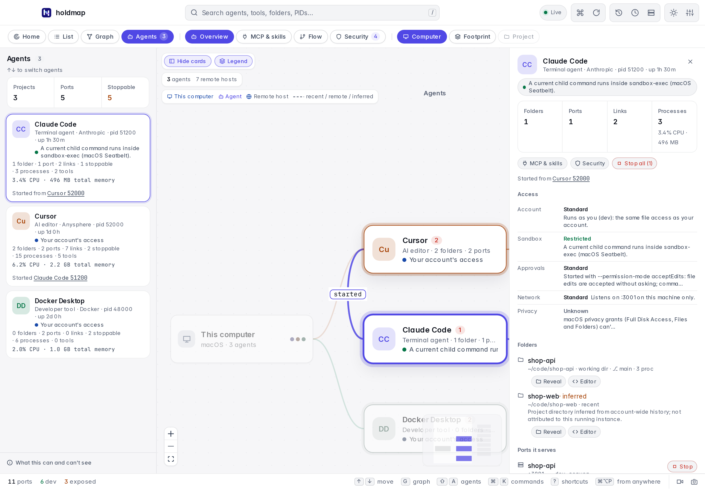
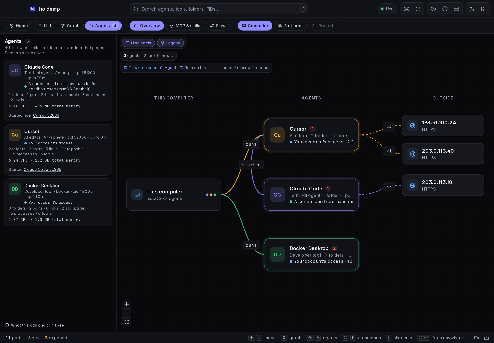
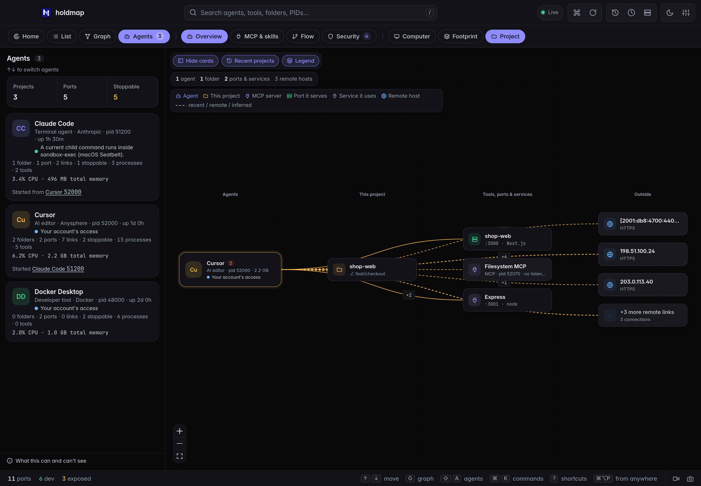
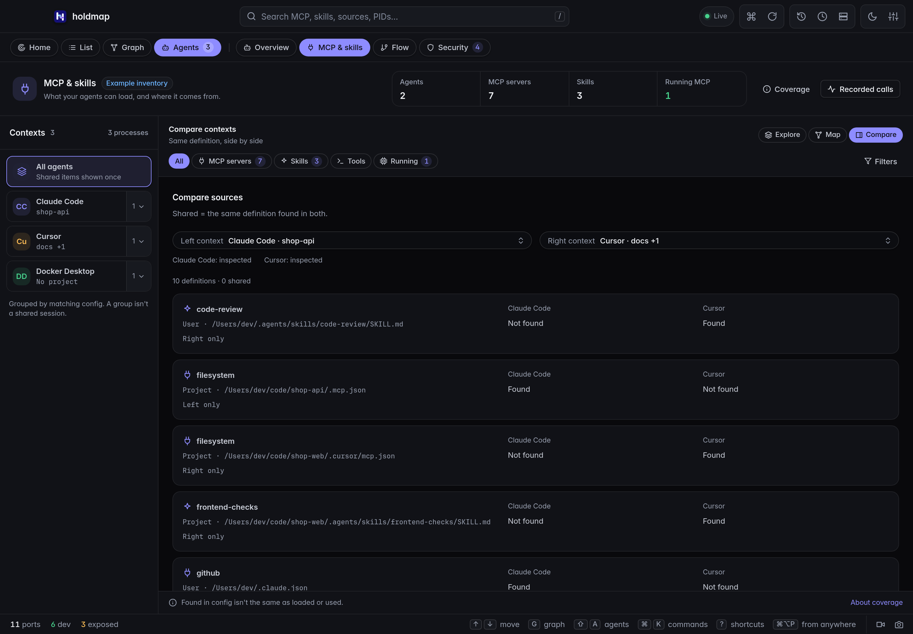
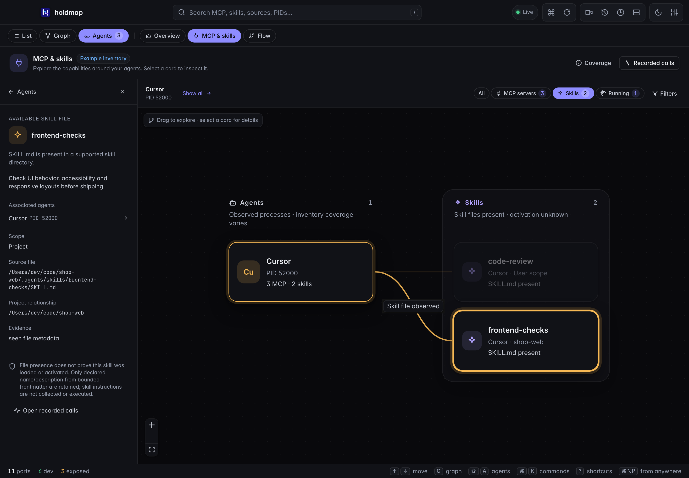
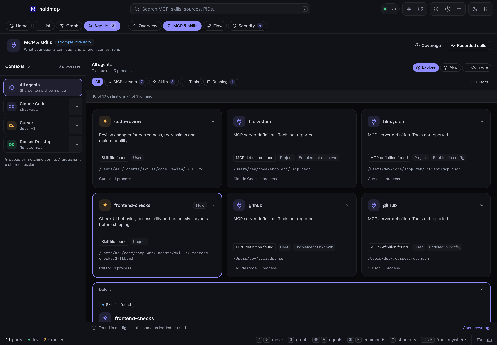
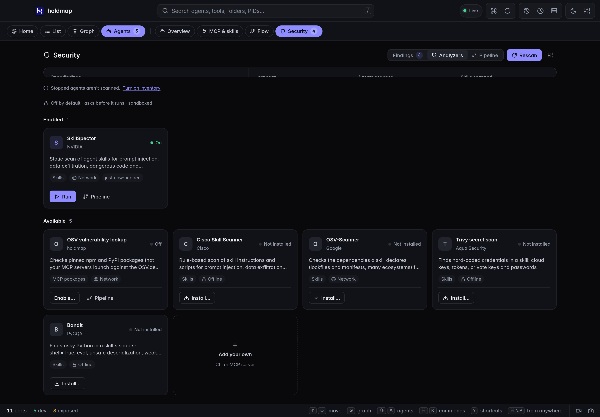
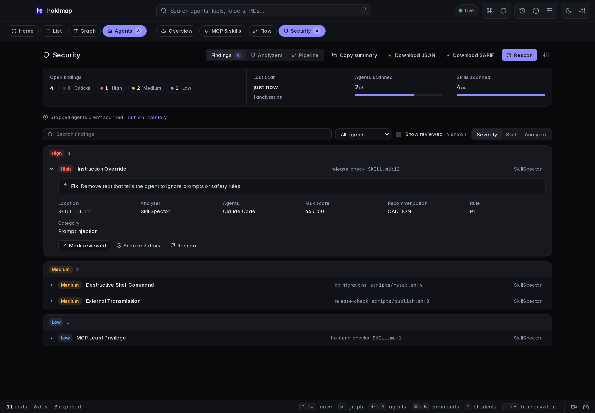
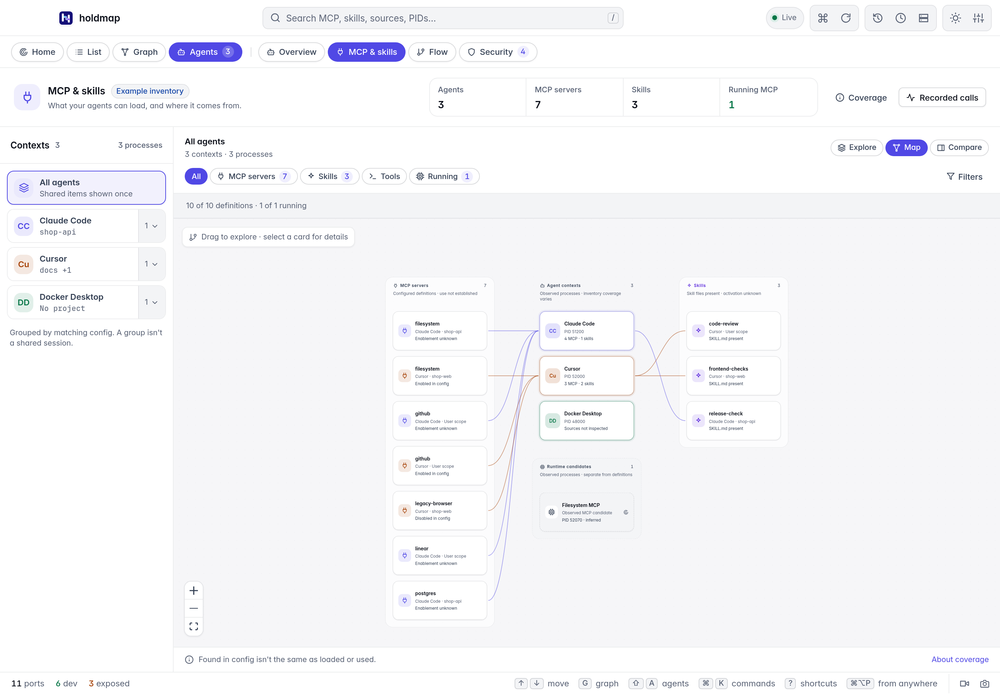
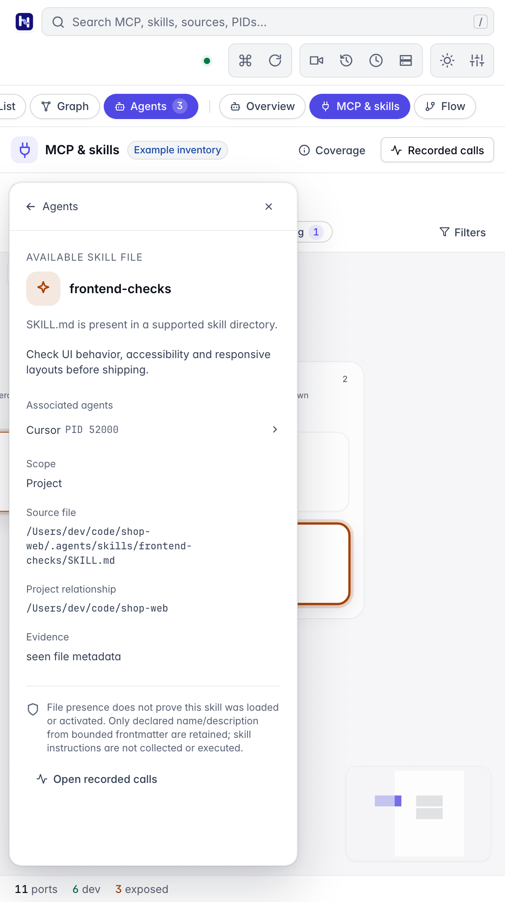

holdmap finds the **AI coding agents** and **developer tools** on your machine and shows, for
each one, the folders it works in, the ports and apps it started, the services and hosts it talks
to, and what the OS says about its access. Every process fact is marked seen, inferred or unknown.
Default scans do not inspect chats, agent settings or credential stores. Recognized credentials
in observed process arguments are redacted for display; redaction is heuristic. Optional recording
accepts a separate, strictly limited metadata projection from integrations you configure.

Recognized products include Claude Code, Codex, Cursor, Copilot, Gemini CLI, Windsurf, Aider,
Cline, Goose, Docker Desktop, OrbStack, Podman Desktop and others.

The live demo uses the same interface with sample data.

## From the CLI

```sh
holdmap agents                         # compact overview
holdmap agents claude                  # matching agents with detailed footprints
holdmap agents codex --wide             # include redacted process commands
holdmap agents claude --stop-ports --dry-run   # plan only
holdmap agents claude --stop-ports --yes       # stop unprotected ports that agent started
holdmap agents --json                  # machine-readable report
```

`holdmap agents --capabilities --json` adds explicitly requested configuration and skill
metadata. Ordinary `agents` scans keep that inspection off.

Each entry shows memory, CPU, process count, how many ports are stoppable, the parent process,
child processes grouped as tools & apps it started, folder source labels (working dir / child cwd /
recent), ports with roles, connections, and access facts.

Child tools include likely MCP servers even when they have no listening port. The report
includes evidence and omitted counts; an executable signature does not establish which tools
an agent called. Recent folders are current-account history, attached only to agents with a
matching known account, and do not establish current work by a particular running instance.

## Desktop and TUI

- **Desktop:** `⇧A` opens the Agents map. Expand a card to reveal a folder, open it in your editor,
  or stop the unprotected ports that agent started. Paths are verified against the current report
  before anything opens.
  Search by agent, folder, tool, exact PID (`pid:51200`) or explicit port (`port:3001`). A port
  search includes both the listener owner and agents connected to it.
  Choosing **Agents** reveals **Overview**, **MCP & skills** and **Flow** as action pills on the same toolbar row.
  **Overview** then reveals **Computer**, **Footprint** and **Project**; **Flow** reveals
  **Connections** and **Calls**. The **MCP & skills** workspace uses the
  explicit inspection described below. Computer is this machine, the agents running on it, and observed
  outside systems, with parent `started` edges. **Footprint** shows folders, tools, ports and hosts
  across every agent. Click a folder to zoom into **Project** — only agents, ports, tools and hosts
  observed for that source tree — never sample or invented peers. **Hide cards** and **Legend** give the map the full width; both persist.
  The installed app and `npm run dev` read the live process table; the website demo uses labelled sample data.
- **TUI:** start `holdmap`, then press **Shift+Tab** to open Agents directly. **Tab** cycles
  Ports → Graph → Agents. Use **↑/↓** to select an agent, **/** to search, and **PgUp/PgDn** to
  scroll its details. **c** toggles local MCP/skill inspection
  for the current account. While enabled, Agents refreshes that inventory; pressing **c** again
  or leaving Agents turns it off and clears retained inventory. Ordinary refreshes stay on the
  process table. Wide windows show both panes side by side; small windows stack them.
  Mouse-wheel scrolling follows the hovered pane. **p** pauses,
  **r** refreshes and **?** opens help. Selection follows the same agent across refreshes.
  Failed scans clearly mark cached data.
- **Review a service stop:** press **x** to review every affected service and its exact TCP/UDP
  protocol. Scroll the full plan with **PgUp/PgDn**. **Enter**, **n** or **Esc** cancels; only
  **y** confirms. The batch is freshly checked before any action. Changed targets require a new
  review; failures stop remaining plans and show what completed. Agent sessions stay running.

Select an agent from the list, a map node, the Home map, **↑/↓** or search and its details open
beside the map; the selection stays across tabs, pictures, reloads (`#agent=` link) and restarts.
**Esc**, **✕** or a click on empty canvas clears it.



These browser captures show **Computer** and one selected **Project** using sample data:





`--json` keeps the structured report format. No terminal shell attachment or private conversation content is
needed to inspect the observed processes.

These terminal captures use isolated local fixtures:


## MCP and skills

Open **Agents → MCP & skills** to explicitly
inspect supported local configuration for the running current-account agents. The CLI equivalent
is `holdmap agents --capabilities`, optionally with `--json`; the terminal Agents pane uses
**c**; MCP clients can call `list_agents` with `include_capabilities: true`. Ordinary scans do
not inspect those files.

The **Explore / Map / Compare** capability explorer has an inspector with **Purpose**,
**Source**, **Evidence** and **Activity** sections. It uses the same opt-in
inventory: it does not add supported discovery locations, client adapters or tool catalogs.

### Four kinds of evidence

| Evidence | Where to look | What it establishes | What stays unknown |
| --- | --- | --- | --- |
| **Configured MCP server** | MCP & skills | A server alias was found in a supported config file, with declared transport, scope, source path and any explicit enabled flag. | Whether this running client loaded it, approved it, connected to it or called a tool. |
| **Skill file** | MCP & skills | A `SKILL.md` file exists in a supported skill directory. Its source, scope, project relationship and folder name preserve the observed identity; optional declared name and purpose describe the file. | Whether the skill is valid, trusted, enabled, offered to the model or activated. |
| **Running child tool** | Overview / Connections | The OS observed a process and its parent. A known executable signature can suggest an MCP server. | Its configured alias, negotiated transport and individual calls. |
| **Recorded usage** | Flow → Calls | A configured integration explicitly reported a tool event, MCP alias or Claude skill activation. | Uninstrumented usage, authenticated process ownership and completion of an activated skill. |

Nothing is launched, connected, installed or enabled by inventory inspection. Calls never joins
an alias or skill name to an inventory row or process automatically. Matching names across two
sources are insufficient evidence of ownership or use.

These browser captures use labelled sample definitions and
process observations:

| Explore declared purposes | Compare exact source observations |
| --- | --- |
|  |  |

| MCP and skills map | Selected skill details |
| --- | --- |
|  |  |

| Details open inline | Security: analyzers |
| --- | --- |
|  |  |



The Security tab opens with a summary: open findings by severity (click one to filter), the last
scan, and how many agents and skills a scan has covered. Findings group by **Severity**, **Skill**
or **Analyzer**, filter by search and agent, and expand in place. **Rescan** runs every analyzer
you turned on, one at a time, with progress. **Analyzers** shows each one as a card with a single
action: **Run** when it's on, otherwise **Enable…**, **Install…** or **Review…**, which open its
permissions sheet in Settings. **Pipeline** draws which analyzer covers which agent.

| Light theme | Narrow window |
| --- | --- |
|  |  |

<a id="inspect-supported-definitions"></a>

### Explore, map and compare definitions

- **Explore:** read skill cards by name and declared purpose, with source scope and evidence
  visible. A missing or rejected description stays **Purpose not reported**. An MCP alias
  does not supply a server description or a list of tools.
- **Map:** follow relationships between observed agent contexts and their inspected definitions.
  MCP definitions and skill files remain separate from running MCP candidates. A source edge
  means a definition was observed in that context's source layout; it does not mean it was
  loaded, trusted, connected to or used.
- **Compare:** compare exact observed definitions across contexts. Definitions with the same
  name but different source paths, scopes or project relationships remain separate. An item
  reported for one context is not proof that it is absent from another, especially when that
  context was not inspected or its inventory is partial.

Matching process contexts group when their client identity and account, observed folder-source
context, exact inventory and coverage agree. **Process details** reveals the original agent
roots and PIDs. The group is
not a verified conversation, session or effective-policy identity. Shared definitions count
once in the combined inventory only when their source identity and projected metadata match.
Counts describe observed definitions and agent roots, not active skills or callable tools.

Choose a context to scope **Explore** and **Map** to its matching process observations.
**Process details** lets you inspect one original PID instead; **Show all** clears that scope.
**Compare** has its own **Left context** and **Right context** selectors over all observed
contexts, even when Explore or Map was scoped to one context. Search, type and definition
filters still narrow the comparison; selecting a row opens the same exact-source inspector.

Select a card to open its inspector:

| Section | What it explains |
| --- | --- |
| **Purpose** | Retained author-declared skill metadata, or why no purpose is reported. A configured MCP alias alone cannot establish a server's purpose. |
| **Source** | Exact file, scope, folder identity, project relationship and associated observed contexts. |
| **Evidence** | What file/configuration or process observation establishes, and what loading, approval or use remains unknown. |
| **Activity** | The boundary between inventory and separately recorded Calls. A matching name is not an authenticated association. |

The **Tools** view shows **Catalog not reported**. File inventory does not call `tools/list`
or obtain a client's built-in tool catalog. This is unknown, not an empty catalog or zero
tools. Holdmap does not launch a server, contact its endpoint or invent a tool description
to fill the view. The existing **Recorded calls** route opens the separate Flow workspace;
it does not join inventory definitions to events by matching names.

Search includes names, retained purposes, source paths and reported PIDs. Scope and MCP
configuration-state filters describe definitions; they do not change runtime process evidence.
Keyboard users can activate a focused card with **Enter** or **Space**. **Esc** or the close
control dismisses its details and returns focus. Fit and zoom remain available in Map;
on narrow windows, details remain dismissible without losing the selected context.

**Coverage** explains inspection limits and unsupported or uninspected contexts. Map rendering
is also bounded to **24 context cards**, **64 inventory definitions** and **24 runtime candidates**,
with omitted nodes and relationships reported. Rendering limits do not expand filesystem
inspection or establish that unshown capabilities are absent. An empty inspected list, an
uninspected context and a missing tool catalog represent different kinds of missing evidence.

### Read source metadata

Source paths identify where each definition was found.
An explicit enabled/disabled value is a declaration; a missing value stays **Unknown**. Client
precedence, project trust, approval policy and effective loading are not resolved. Repeated
aliases from different files remain separate definitions; Holdmap does not choose a winner.

The skill folder name stays part of its source identity even when the optional YAML header
declares another name.
Inspection reads a bounded prefix of `SKILL.md` to project only a sanitized declared name and
one-line purpose, up to 300 characters. Missing, malformed or unsafe metadata is omitted; file
presence can still be shown. The purpose is author-supplied text, not an instruction for Holdmap
or proof that the skill behaves as described. Instruction bodies are not retained or executed.
Only the scalar YAML `name` and `description` fields are projected as `declared_name` and
`description`; other header fields are discarded. A strict opening/closing `---` header is
required. Unsupported complex values for these two fields, duplicate keys, aliases, anchors,
tags, malformed YAML or parser limits leave header metadata absent. Inspection neither expands
aliases nor resolves includes. It does not validate the whole skill package.

These are the supported default locations; `~` means the current account's home. Project paths
mean observed working folders and known project roots, not arbitrary parent folders or recent
folder history.

| Client | MCP definitions | Skill directories |
| --- | --- | --- |
| Codex / Codex desktop | `~/.codex/config.toml` and `<project>/.codex/config.toml` | `.agents/skills` and `.codex/skills` under home and observed projects |
| Claude Code | `~/.claude.json` user entries and matching private project entries; `<project>/.mcp.json` | `.claude/skills` under home and observed projects |
| Cursor / Cursor agent | `.cursor/mcp.json` under home and observed projects | `.cursor/skills`, `.agents/skills`, `.claude/skills` and `.codex/skills` under those locations |
| Claude Desktop | Manual `Claude/claude_desktop_config.json` under `~/Library/Application Support` on macOS or `%APPDATA%` on Windows | Not inspected |
| Windsurf (legacy layout) | `~/.codeium/windsurf/mcp_config.json` only; newer Devin homes are not inspected | Not inspected |
| Gemini CLI | `~/.gemini/settings.json` and `<project>/.gemini/settings.json` (`mcpServers` only) | Not inspected |
| GitHub Copilot (VS Code) | Observed-project `.vscode/mcp.json` (`servers`) and `.mcp.json` | Not inspected |
| Copilot CLI | `~/.copilot/mcp-config.json`, observed-project `.mcp.json` and `.github/mcp.json`; project maps can be bare or wrapped in `mcpServers` | Not inspected |
| Cline | `~/.cline/data/settings/cline_mcp_settings.json` | `.cline/skills` under home and observed projects |

Skill directories are shallow, with one extra category or `.system` level. Custom config homes
(`GEMINI_CLI_HOME`, `COPILOT_HOME`, `CLINE_DIR`, `CLINE_MCP_SETTINGS_PATH`, Aider
`--mcp-servers-file`), VS Code profile `mcp.json`, editor `globalStorage`, other ancestor
directories, managed settings, plugins, desktop extensions, connectors and cloud inventories
are not inspected. Codex `.codex/skills` is a compatibility inspection root; current local
loading also supports ancestor, admin, bundled and symlinked skills beyond this inventory.
Cline compatibility roots outside `.cline/skills` are not inspected. Gemini `mcp.allowed` /
`mcp.excluded`, `mcp-server-enablement.json` and Copilot `disabledMcpServers` are separate
client policy, not projected enablement. Gemini/Copilot enablement stays unknown. Unsupported products/platforms, other accounts, symbolic links,
reparse points and macOS privacy-protected locations are skipped. File, byte, entry, project,
context and time limits bound inspection; the report preserves omissions and coverage limits.
An empty list does not prove that no capabilities exist.

### Launch, run state and permissions

With the inventory turned on (first run, **Read MCP config** on Home, or `--capabilities`), each MCP server
also shows how it starts (`npx`, `uvx`, `docker`, script or binary, with the package and whether
its version is pinned), the remote host for HTTP servers, and the **names** of its environment
variables and headers. **Running** means the package was seen in that agent's own processes;
**Not running** means it wasn't; remote and disabled servers stay **Unknown**. Holdmap never
starts or connects to a server.

Agents also list permission rules (allowed, asks first, denied) and safety settings from
`~/.claude/settings.json`, `<project>/.claude/settings*.json`, `~/.cursor/cli-config.json`,
Gemini `settings.json` and Codex `config.toml` (`approval_policy`, `sandbox_mode`), plus rules,
commands, prompts and memory files (`CLAUDE.md`, `AGENTS.md`, `GEMINI.md`, `.cursor/rules`,
`.claude/commands`, `~/.codex/prompts`, `.github/prompts` and similar) by name and description
only. Built-in tool names are documented lists, not observations. Secret values, prompts and
file bodies are never read into the report.

Parsing follows each source format: VS Code JSONC accepts comments and trailing commas;
Gemini settings accept comments but reject trailing commas. Other supported JSON files remain
strict JSON. URL-only Cursor, legacy Windsurf and Gemini definitions do not establish HTTP
versus SSE; their transport stays **Unknown**. Explicit supported type fields and dedicated
HTTP fields can establish the declaration. Configuration precedence, effective trust and
negotiated runtime transport remain unresolved.

The current collection bounds are explicit:

| Bound | Scope and behavior |
| --- | --- |
| **16 agent contexts** | Per report; repeated matching contexts share their inventory, and additional contexts remain unknown. |
| **8 observed projects** | Per context, alongside the account's supported default locations. |
| **24 existing sources** | Per context, counting attempted reads of existing configuration/header files and skill directories. Missing default paths do not consume this allowance. |
| **1 MiB total bytes** | Per context across configuration files and skill-header prefixes. |
| **256 candidate entries** | Per context across MCP definitions and skill-directory entries; additional entries may remain unexamined. |
| **64 MCP definitions and 64 skills retained** | Per context, with explicit omitted counts for additional definitions that were observed. Those counts do not estimate unexamined locations. |
| **256 KiB per config; 8 KiB per skill prefix** | Oversized configs are skipped. Only a complete header within the skill prefix can contribute optional metadata. |
| **256 YAML parser events; depth 8** | A more complex header contributes no metadata; the skill file can still appear. |
| **100 ms cooperative deadline** | Per context, checked between filesystem/parser operations. It is not a hard OS timeout and cannot interrupt a blocked filesystem call. |

The total-byte budget includes the bounded prefix read, even though bytes beyond its YAML
delimiter are not parsed or retained. No background scan expands these limits or searches
additional locations on your behalf.

Inspection parses bounded JSON/TOML files, which may contain credential bytes, then projects
only the allowed metadata. Command strings, arguments, URLs and environment/header values are
excluded from the returned inventory. The skill prefix can contain additional text, but only
allowed YAML-header metadata is retained. Source paths remain visible for manual inspection.
This inventory does not audit a server or skill for safety or authorize its command to run.

The same explicit inspection is available without the desktop:

```sh
holdmap agents --capabilities             # detailed current-account inventory
holdmap agents claude --capabilities --json
holdmap                                 # then Agents tab, press c
```

For MCP, send a `tools/call` request:

```json
{"name":"list_agents","arguments":{"include_capabilities":true}}
```

The default `include_capabilities` is false. Inventory does not run in ordinary scans, and
`--capabilities` cannot be combined with `--flow` or `--stop-ports`.

### Understand explicit usage

The built-in hook/OTLP adapters report sanitized MCP server aliases from explicit Claude hook
metadata or an unambiguous `mcp__server__tool` label. Explicit normalized integrations can
also supply the optional `ActivitySpan.mcp_server` field on tool records through the authenticated
`/v1/activity` route; the collector sanitizes that identifier and validates the record. These
are unverified source labels, never an automatic inventory/process join or action authority.
The standard MCP protocol does not require this naming convention. Claude skill activation
logs are separate from tool-call counts. Provider-redacted
custom skill names stay **name not reported**, and activation never establishes completion or
success. See the [recording contract and optional log-only setup](https://github.com/santoshshinde2012/holdmap/blob/main/docs/agent-flow.md#record-skill-activations).

Use matching CLI/desktop and collector builds to read these usage fields. An older collector
cannot report this skill event; absent records do not prove that no skill was used.

### Troubleshoot missing capabilities or usage

- **Not inspected:** open MCP & skills or pass the explicit CLI/MCP option. Only confirmed
  current-account agents are eligible; process visibility alone does not grant config access.
- **Empty or partial inventory:** read the displayed limits and check the supported paths
  above. Custom homes, inherited/plugin definitions, unreadable or linked files and bounded
  scans can omit definitions. Check the client's own config without changing file permissions
  or enabling an unknown server just to make it appear.
- **Unknown enablement or purpose:** the file may omit an explicit switch or a safe, supported
  YAML header. Holdmap does not resolve client policy or validate skill packages.
- **Catalog not reported:** expected for file inventory, even when an MCP definition is
  present. It does not enumerate tools, establish an empty server or diagnose a connection
  failure. The Tools view explains this boundary; no catalog adapter is included.
- **Configured server with no Calls:** inventory is independent of recording. Configure a
  supported producer, start a fresh recording and restart that producer with its new endpoint
  and token. Keep private setup credentials out of bug reports.
- **Skill name not reported or no activation:** producer versions and telemetry policies vary;
  default custom names can be redacted. Use the documented log-only option if needed, without
  enabling detailed tool logging. Do not infer absence or a successful workflow from silence.

The boundaries follow the [MCP tools specification](https://modelcontextprotocol.io/specification/2025-11-25/server/tools),
[Agent Skills specification](https://agentskills.io/specification) and
[Claude skill telemetry](https://code.claude.com/docs/en/monitoring-usage#skill-activated-event).
Local inventory and observed activation answer different questions.

## Open an agent folder

Click a folder on the map or its name/path in an
expanded card. The first click on Footprint zooms into that source tree;
click the folder again (or **Enter** / **Space** on Project) for **Folder actions**. **Enter** or **Space** activates a focused folder. **Folder actions** shows the full path and
offers **Open in Finder** on macOS, **Open in Explorer** on Windows, or **Open in file manager**,
plus **Open in editor** and **Copy path**. **Esc** or **Close** returns focus to the folder.
Copying uses the original path, even when a card shortens its display.

The editor preference is `HOLDMAP_EDITOR`. Use an installed executable name or absolute path, without shell arguments. Without a
preference, Holdmap finds a known installed editor. A missing explicit preference shows an
error instead of silently opening another app.

The chosen agent and exact path are rechecked against the current report and a fresh native
scan before opening. If that folder disappears, open buttons become unavailable while the
path remains copyable. Recent folders describe account history; they do not prove that the
agent is currently working there. Browser file-manager/editor actions are labelled simulations;
copying uses the displayed sample path.

Existing card **Reveal** and **Editor** shortcuts remain available.

## Desktop Flow: connections and calls

In **Agents**, choose **Flow**. The two data sources answer different questions:

| View | What it shows | What it cannot establish |
| --- | --- | --- |
| **Connections** | Observed parent processes, listener ownership and live TCP socket relationships, including the source process IDs. Tool roles may be inferred. | Individual tool invocations, messages, data direction or transferred bytes. |
| **Calls** | Tool, model, agent, handoff and execution-step metadata supplied by a configured integration, with status, timing and reported parent spans. Explicit skill activations appear separately. | Uninstrumented activity, private message content or verified OS process ownership. |

The graph has zoom, fit and a minimap. Participants, relationships and the activity timeline
provide keyboard-accessible ways to inspect the same evidence. **Hide inspector**, **Hide
limits** and **Hide recording** put those chrome sections away so the graph can stay in
focus; **Show** brings each back. **Pause view** stops automatic
updates; **Refresh** still fetches an explicit update. It does not stop recording or an agent.
The selected run and record remain stable during refreshes. Small windows stack the readable
timeline below the graph. Choices persist.

Use **All**, **Failed** or **No completion** to find the records you need. Search matches
individual metadata records, and **Order** switches between chronological order and longest
reported duration. Records without a duration stay last in duration order. The graph retains
matching records, the inspected record and their reported parents; filtering does not change
the recorded run. A finished record with an unknown outcome is not treated as missing completion.
The shown/total count and **Reset activity view** make active filters easy to see and clear.

These captures use clearly labelled browser example metadata:


### Set up optional recording

This records tool-call metadata from configured agents. Pixel capture of a display is a
separate [screen recording](../desktop/#record-the-screen) that downloads MP4 and GIF locally.

1. Open **Flow → Calls → Start recording** in the local desktop app.
2. Open **Setup**, copy the Codex or Claude Code settings, merge them into your existing
   configuration, and restart that agent. Settings are never edited automatically.
3. Run a task in the configured agent, then inspect the received metadata in Calls.

Recording status is checked before controls become available. If its status cannot be read,
the view says so; use **Refresh** to check again. An unavailable status does not mean recording
has stopped.

The copied configuration contains a private local bearer token. The collector binds to loopback,
requires that token, rejects browser-origin requests and retains metadata in memory on this
computer. **Stop recording** ends collection and keeps the current snapshot. **Clear records**
removes it from memory; fully quitting Holdmap also discards it. When the tray or menu bar is
available, closing the desktop window keeps Holdmap and any active recording running there.
Recording does not survive a full quit.

Every new recording session creates a fresh token and an OS-assigned loopback endpoint.
After stopping and starting recording again, copy the new provider settings, merge them into
your configuration and restart its producers. Settings from the previous session will no
longer send activity to the new collector.

The default setup uses Codex telemetry logs and Claude Code telemetry traces; Claude Code
tracing is a beta capability. Standard OpenTelemetry JSON traces and explicit hook or MCP
integrations can also supply metadata. Choose one recording integration per provider to avoid
duplicate counts. Recording requires instrumentation and only includes subsequently reported
activity; a running agent alone does not expose its internal calls.

Payload, prompt, tool-argument, result, error-message, URL and path fields are excluded by
the metadata projection. Source labels are sanitized and may be redacted. Sanitization cannot
prove that a custom integration has not embedded sensitive information in a valid identifier.
Reported process IDs are labelled unverified and never authorize stop or file actions.

### Read the evidence correctly

- A **Requested** hook record may arrive before permission or execution. An absent completion
  stays incomplete; stopping recording marks pending requests unknown.
- Completed telemetry spans usually arrive after export. A tool wrapper with **Status unknown**
  stays unknown even when a separate execution step reports a failure.
- A **Recorded trace** draws parent links only from the parent span IDs the integration supplied.
  A **Recorded session** groups hook or log events without inventing a call hierarchy. Event order
  and session membership are not proof that two tools communicated.
- **Serialized input/output** sizes are optional reported payload sizes. They describe neither
  network traffic nor the contents of a message. Unknown differs from a reported zero-byte size.
- At most **1,000 spans** are retained. Large runs show up to **128 spans** in the graph, with an
  explicit count; all retained records stay available in the timeline. Selecting a later record
  shows it and its reported parent context. Sampling, export delays, collector limits and missing
  instrumentation can leave the view incomplete.

## Access and evidence

Access covers the account the process runs as, sandbox and approval flags, network listeners, and
(on macOS) protected folders. Each fact carries evidence: **seen**, **inferred** or **unknown**.
Unknown is labelled on cards so you never mistake a guess for a measurement.

Access facts come from the live process table, command line and sockets. Default scans do not
read agent settings, so YOLO or sandbox modes that exist only there stay **unknown**. The
separate, explicit [MCP & skills inventory](#mcp-and-skills) does not interpret
those files as permission grants, change process protection or replace a dedicated security audit.

Network facts name well-known debug and model-server ports (Node inspector, Chrome DevTools,
Ollama). Names taken from the port number are **inferred**; names taken from a detected
framework are **seen**. A loopback debugger is still this machine only; the same port on every
interface is elevated. MCP children started with unpinned `npx` (no numeric version) are
labelled on the tool, not treated as a completed tool call.

Editor-extension services that inherit the open workspace as their working directory are labelled
as that editor's extension, protected, and skipped as stoppable dev servers. They are not given
the project's framework (a database tools process in a Next.js folder is not Next.js).

## Safety

Stopping from the Agents surface only targets unprotected ports the agent started (dev servers and
services). The agent’s own IDE and auth listeners (`PortRole::Agent`) are skipped. Protected
processes with hard protection are never stopped. The CLI's `--allow-protected` flag can authorize
soft-protected targets only; MCP refuses all protected targets.

## Related

- [Desktop app](../desktop/): shortcuts and the Agents map.
- [MCP for AI agents](../mcp/): `list_agents` and `stop_agent_ports`.
- [CLI reference](../cli/): every flag for `holdmap agents`.
