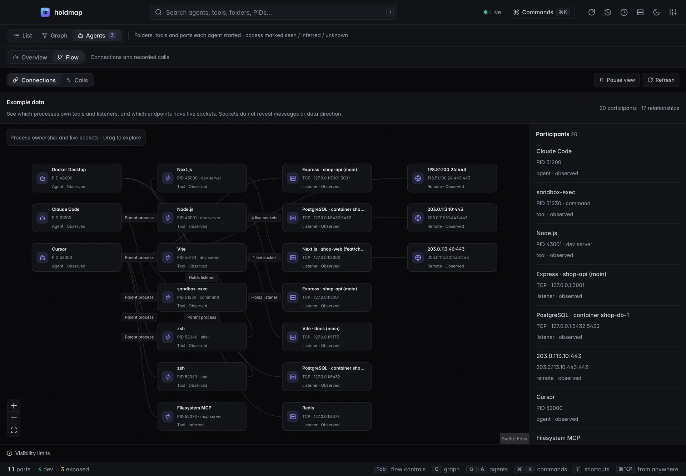
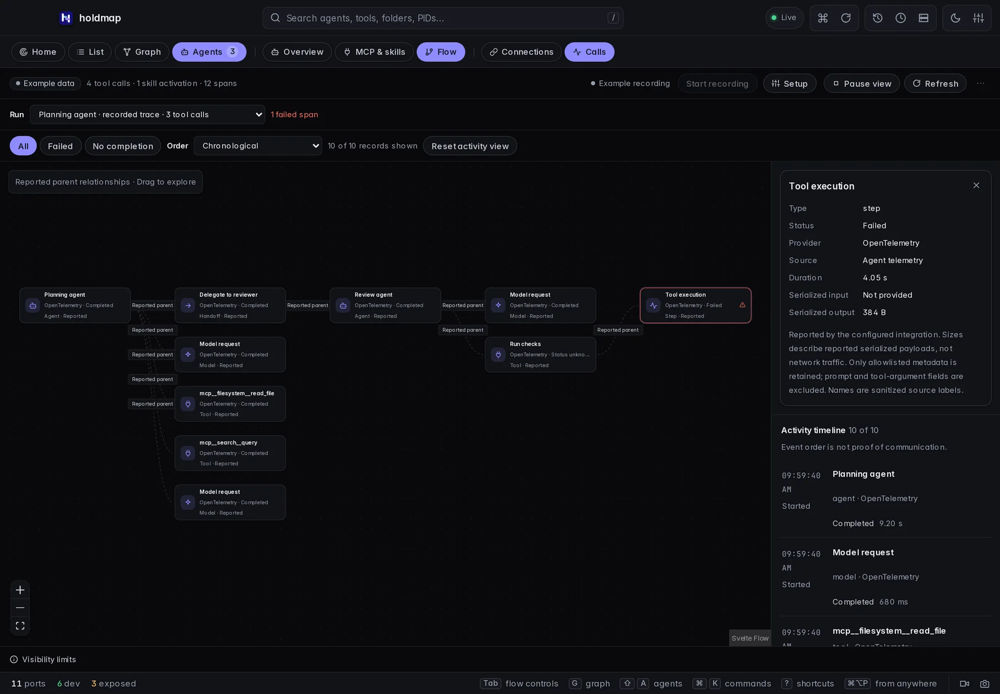

holdmap finds the **AI coding agents** and **developer tools** on your machine and shows, for
each one, the folders it works in, the ports and apps it started, the services and hosts it talks
to, and what the OS says about its access. Every process fact is marked seen, inferred or unknown.
The process scan does not read chats, settings or tokens. Optional recording accepts a separate,
strictly limited metadata projection from integrations you configure.

Recognized products include Claude Code, Codex, Cursor, Copilot, Gemini CLI, Windsurf, Aider,
Cline, Goose, Docker Desktop, OrbStack, Podman Desktop and others.

Version 0.5.0 includes Flow, folder actions and the updated CLI and terminal navigation
described here. Child-tool classifications, expanded metadata and desktop agent search were
introduced in 0.4.0. The live demo uses the same interface with sample data.

## From the CLI

```sh
holdmap agents                         # compact overview
holdmap agents claude                  # matching agents with detailed footprints
holdmap agents codex --wide             # include redacted process commands
holdmap agents claude --stop-ports --dry-run   # plan only
holdmap agents claude --stop-ports --yes       # stop unprotected ports that agent started
holdmap agents --json                  # machine-readable report
```

Each entry shows memory, CPU, process count, how many ports are stoppable, the parent process,
child processes grouped as tools & apps it started, folder source labels (working dir / child cwd /
recent), ports with roles, connections, and access facts.

Child tools include likely MCP servers even when they have no listening port. The report
includes evidence and omitted counts; an executable signature does not establish which tools
an agent called. Recent folders are current-account history, attached only to agents with a
matching known account, and do not establish current work by a particular running instance.

## Desktop and TUI

- **Desktop:** `⇧A` opens the Agents map. Expand a card to reveal a folder, open it in your editor,
  or stop the unprotected ports that agent started. Paths are verified against the current report
  before anything opens.
  Search by agent, folder, tool, exact PID (`pid:51200`) or explicit port (`port:3001`). A port
  search includes both the listener owner and agents connected to it.
  **Hide cards** and **Legend** give the map the full width; both persist.
- **TUI:** start `holdmap`, then press **Shift+Tab** to open Agents directly. **Tab** cycles
  Ports → Graph → Agents. Use **↑/↓** to select an agent, **/** to search, and **PgUp/PgDn** to
  scroll its details. Wide windows show both panes side by side; small windows stack them.
  Mouse-wheel scrolling follows the hovered pane. **p** pauses, **r** refreshes and **?** opens
  help. Selection follows the same agent across refreshes. Failed scans clearly mark cached data.
- **Review a service stop:** press **x** to review every affected service and its exact TCP/UDP
  protocol. Scroll the full plan with **PgUp/PgDn**. **Enter**, **n** or **Esc** cancels; only
  **y** confirms. The batch is freshly checked before any action. Changed targets require a new
  review; failures stop remaining plans and show what completed. Agent sessions stay running.

The compact CLI overview and updated terminal navigation are included in **0.5.0**;
version 0.4.0 downloads predate these changes. `--json` retains
its structured report format. No terminal shell attachment or private conversation content is
needed to inspect the observed processes.

These terminal captures use isolated local fixtures:


## Open an agent folder

In 0.5.0, click a folder on the map or its name/path in an expanded card.
**Enter** or **Space** activates a focused folder. **Folder actions** shows the full path and
offers **Open in Finder** on macOS, **Open in Explorer** on Windows, or **Open in file manager**,
plus **Open in editor** and **Copy path**. **Esc** or **Close** returns focus to the folder.
Copying uses the original path, even when a card shortens its display.

The editor preference is `HOLDMAP_EDITOR`. Use an installed executable name or absolute path, without shell arguments. Without a
preference, Holdmap finds a known installed editor. A missing explicit preference shows an
error instead of silently opening another app.

The chosen agent and exact path are rechecked against the current report and a fresh native
scan before opening. If that folder disappears, open buttons become unavailable while the
path remains copyable. Recent folders describe account history; they do not prove that the
agent is currently working there. Browser file-manager/editor actions are labelled simulations;
copying uses the displayed sample path.

This chooser is included in **0.5.0**. Version 0.4.0 downloads predate it.
Existing card **Reveal** and **Editor** shortcuts remain available.

## Desktop Flow: connections and calls

In **Agents**, choose **Flow**. The two data sources answer different questions:

| View | What it shows | What it cannot establish |
| --- | --- | --- |
| **Connections** | Observed parent processes, listener ownership and live TCP socket relationships, including the source process IDs. Tool roles may be inferred. | Individual tool invocations, messages, data direction or transferred bytes. |
| **Calls** | Tool, model, agent, handoff and execution-step metadata supplied by a configured integration, with status, timing and reported parent spans. | Uninstrumented activity, private message content or verified OS process ownership. |

The graph has zoom, fit and a minimap. Participants, relationships and the activity timeline
provide keyboard-accessible ways to inspect the same evidence. **Hide inspector** gives the
graph the full width; **Show inspector** brings the details back. **Pause view** stops automatic
updates; **Refresh** still fetches an explicit update. It does not stop recording or an agent.
The selected run and record remain stable during refreshes. Small windows stack the readable
timeline below the graph. Choices persist.

Use **All**, **Failed** or **No completion** to find the records you need. Search matches
individual metadata records, and **Order** switches between chronological order and longest
reported duration. Records without a duration stay last in duration order. The graph retains
matching records, the inspected record and their reported parents; filtering does not change
the recorded run. A finished record with an unknown outcome is not treated as missing completion.
The shown/total count and **Reset activity view** make active filters easy to see and clear.

Connections and Calls are included in **0.5.0**. Version 0.4.0 downloads predate Flow.
These captures use clearly labelled browser example metadata:





### Set up optional recording

1. Open **Flow → Calls → Start recording** in the local desktop app.
2. Open **Setup**, copy the Codex or Claude Code settings, merge them into your existing
   configuration, and restart that agent. Settings are never edited automatically.
3. Run a task in the configured agent, then inspect the received metadata in Calls.

Recording status is checked before controls become available. If its status cannot be read,
the view says so; use **Refresh** to check again. An unavailable status does not mean recording
has stopped.

The copied configuration contains a private local bearer token. The collector binds to loopback,
requires that token, rejects browser-origin requests and retains metadata in memory on this
computer. **Stop recording** ends collection and keeps the current snapshot. **Clear records**
removes it from memory; fully quitting Holdmap also discards it. When the tray or menu bar is
available, closing the desktop window keeps Holdmap and any active recording running there.
Recording does not survive a full quit.

The default setup uses Codex telemetry logs and Claude Code telemetry traces; Claude Code
tracing is a beta capability. Standard OpenTelemetry JSON traces and explicit hook or MCP
integrations can also supply metadata. Choose one recording integration per provider to avoid
duplicate counts. Recording requires instrumentation and only includes subsequently reported
activity; a running agent alone does not expose its internal calls.

Payload, prompt, tool-argument, result, error-message, URL and path fields are excluded by
the metadata projection. Source labels are sanitized and may be redacted. Sanitization cannot
prove that a custom integration has not embedded sensitive information in a valid identifier.
Reported process IDs are labelled unverified and never authorize stop or file actions.

### Read the evidence correctly

- A **Requested** hook record may arrive before permission or execution. An absent completion
  stays incomplete; stopping recording marks pending requests unknown.
- Completed telemetry spans usually arrive after export. A tool wrapper with **Status unknown**
  stays unknown even when a separate execution step reports a failure.
- A **Recorded trace** draws parent links only from the parent span IDs the integration supplied.
  A **Recorded session** groups hook or log events without inventing a call hierarchy. Event order
  and session membership are not proof that two tools communicated.
- **Serialized input/output** sizes are optional reported payload sizes. They describe neither
  network traffic nor the contents of a message. Unknown differs from a reported zero-byte size.
- At most **1,000 spans** are retained. Large runs show up to **128 spans** in the graph, with an
  explicit count; all retained records stay available in the timeline. Selecting a later record
  shows it and its reported parent context. Sampling, export delays, collector limits and missing
  instrumentation can leave the view incomplete.

## Access and evidence

Access covers the account the process runs as, sandbox and approval flags, network listeners, and
(on macOS) protected folders. Each fact carries evidence: **seen**, **inferred** or **unknown**.
Unknown is labelled on cards so you never mistake a guess for a measurement.

Facts come from the live process table, command line and sockets. Holdmap does **not** read
agent settings (`~/.claude.json`, `~/.codex/config.toml`, `.cursor/mcp.json` and similar), so
YOLO or sandbox modes that exist only in those files stay **unknown**. Dedicated scanners such
as [mcp-scan](https://www.npmjs.com/package/owasp-mcp-scan) cover installed MCP configs; Holdmap
covers what is running now.

Network facts name well-known debug and model-server ports (Node inspector, Chrome DevTools,
Ollama). Names taken from the port number are **inferred**; names taken from a detected
framework are **seen**. A loopback debugger is still this machine only; the same port on every
interface is elevated. MCP children started with unpinned `npx` (no numeric version) are
labelled on the tool, not treated as a completed tool call.

Editor-extension services that inherit the open workspace as their working directory are labelled
as that editor's extension, protected, and skipped as stoppable dev servers. They are not given
the project's framework (a database tools process in a Next.js folder is not Next.js).

## Safety

Stopping from the Agents surface only targets unprotected ports the agent started (dev servers and
services). The agent’s own IDE and auth listeners (`PortRole::Agent`) are skipped. Protected
processes with hard protection are never stopped. The CLI's `--allow-protected` flag can authorize
soft-protected targets only; MCP refuses all protected targets.

## Related

- [Desktop app](../desktop/): shortcuts and the Agents map.
- [MCP for AI agents](../mcp/): `list_agents` and `stop_agent_ports`.
- [CLI reference](../cli/): every flag for `holdmap agents`.
