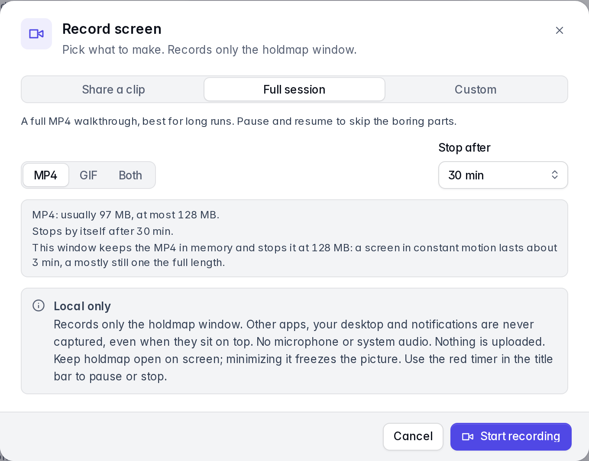

A tray and menu-bar app with the port list, details, the service graph, the agents map, pins, history with
one-click restart, remote hosts over SSH and a command palette. It runs on the same core as the
CLI, so process identity checks and process protections are shared. The CLI's project-specific
`.holdmap.toml` settings apply to CLI and terminal UI actions.
[Try it in the browser](../../#demo).

**Version 0.8.0** adds the MCP and skills map, reported usage labels, clearer desktop
update help and recording startup and cleanup fixes. It retains native screen recording on
macOS 14 or later when the desktop window lacks browser screen sharing, introduced in
**0.7.1**, and the recorder, Computer / Footprint / Project map zoom and live `npm run dev`
scans introduced in **0.7.0**. Check the
[latest published release](https://github.com/santoshshinde2012/holdmap/releases/latest) for
current installers.

Version **0.6.0** added editor-extension identity on the graph, hideable details and Flow
inspector, grouped title-bar actions, schedules started from the empty manager, and a
macOS fullscreen close that returns to the previous app. See the
[0.6.0 changes](https://github.com/santoshshinde2012/holdmap/blob/main/CHANGELOG.md#060---2026-10-14).

## Close, reopen and quit

When the menu-bar or tray icon is available, closing the desktop window keeps Holdmap
running, including active schedules and recording. Click the icon to reopen the window,
or use your configured global shortcut. Choose **Quit holdmap** from the icon's menu to
exit completely. If the tray is unavailable, closing the window quits the app.

Closing from fullscreen returns to the previous app without leaving an empty black Space,
and clicking the Dock icon reopens the same window. Use **0.6.0 or newer**.

## Service graph and cluster grouping

Choose **Graph** to see connections between services, or choose **Cluster** in the list's
sort menu to group ports by their Compose project or workspace. Both views refresh as
services change. **Layered** arranges dependencies from left to right. **Force** groups
tightly connected services and is available for up to 100 services; larger graphs use
Layered to keep navigation responsive, including when Force was previously selected.

The graph starts with your dev servers and anything they talk to. **All services** adds
databases, apps and other services on this computer. Editor-extension listeners keep the
extension name, not the inherited project — the same identity as the [list and Agents
view](../agents/). A card's location is a layout choice; only the displayed links represent
observed connections.

**Current source (Unreleased):** the graph opens with the full canvas and compact service
and link counts. Disconnected services and separate clusters are packed into compact
groups in both layouts. The published **0.8.0** installers retain the previous graph
toolbar, automatic fit and summary pane.

The new **Search services** field searches displayed names, projects, ports and PIDs.
Use `port:3000` or `:3000` for an exact port, and `pid:43000` for an exact PID. Multiple
terms must all match. Results include each match's immediate observed neighbors, so a
service's connections keep their context; neighbors are not additional search matches.
Graph search is separate from the List's search, protocol, ownership and dev-server
filters. Searching never reads process command lines or creates links.

The canvas starts at a readable size. Pan or zoom to explore larger graphs; **Fit all
services in view** deliberately zooms out to the whole map, and the percentage control,
**Reset to readable size**, restores a readable view. On wider canvases, a minimap appears
when part of the graph is outside the viewport.

Click a service card, or focus it and press **Enter** or **Space**, to inspect that service.
Details appear beside the canvas when there is enough room, or in a dismissible drawer
in smaller windows. Close or hide details, or press **Esc**, to return to the full map and
restore focus to the service card. The graph does not open a summary pane automatically.

Open **Options** for the secondary display controls. **External** shows outbound remote
hosts and is unavailable when there are none. **Traffic** animates observed connections;
it stays off when reduced motion is enabled. **Legend** toggles the connection key while
the compact counts stay visible. Disconnected services have no invented edges; a short
message explains when no connections are present.

## Record the screen

Screen recording requires **0.7.0 or newer**, or the browser demo. Version **0.6.0**
installers do not include it.
To add it to an existing 0.6.0 installation, download and install the new desktop build.

The camera icon in the title bar, **Record screen…** in the command palette, or `⇧V`
starts a local capture. Holdmap explains that recordings stay on this computer, then the
operating system asks which display or window to share. Microphone and system audio are
not captured. A timer in the title bar and **Stop screen recording** replace the dialog so
this window can be part of the capture.
Recording continues while Holdmap is hidden or minimized. Reopen the window to stop it;
the two-minute limit still applies.

When the recording stops (or after two minutes), preview and download **MP4** and **GIF**.
The desktop app opens a native save dialog and reports the saved location after writing the
file. Cancelling the save dialog or a failed write keeps the recording available for retry.
The browser uses its own download manager. **Close**, `Esc` and clicking outside the preview
keep the latest recording for this session. Use the camera icon, **Review recording** in the
command palette, or `⇧V` to reopen it. **Discard recording** removes it and lets you record again.
Save a file before reloading or quitting; the preview is kept only in memory.

MP4 uses H.264 when an encoder is available. GIF uses a smaller picture and reduces its
frame rate during longer recordings to cover the whole capture while keeping memory bounded.
Exports are limited to 128 MiB per file; if a format cannot be encoded, the other available
format can still be saved. Preparing files can be cancelled with **Discard recording**.

Nothing is uploaded. Each recording asks which screen or window to share. macOS may ask for
Screen Recording permission in System Settings; if capture is blocked, allow this app or browser
there and retry. Unsupported windows explain that capture is unavailable. This is separate
from [Agents → Flow recording](../agents/#set-up-optional-recording), which collects optional
tool-call metadata rather than pixels.

From **0.7.1**, the macOS desktop app uses Apple's native screen picker on **macOS 14 or
later** when its window does not offer browser screen capture. Install the matching desktop
download from [Install](../../#install), then reopen the app; a CLI update does not replace it.
Native capture encodes MP4 and GIF in a private temporary folder, then removes those files
after copying the exports into the preview or discarding the recording, once pending native
operations finish. Version **0.8.0** also fixes cancellation while native capture starts.
The two-minute
limit is enforced by the native app even while its window is hidden. Older macOS versions
can record only when their webview provides screen sharing; otherwise use a supporting
browser or the system screen recorder.

Linux desktop capture needs PipeWire and a working ScreenCast portal for your desktop
environment. Its system picker still asks which screen or window to share each time.
If that service is unavailable, try a browser with screen sharing or the system recorder.

Review local capture limits before choosing a screen or window:



## Shut down this computer

Open **Settings → Power → Shut down now…**, separately from **Schedule shutdown…**; its review
has no timing controls. Local shutdown was introduced in 0.4.0. Check the computer
name, save your work and acknowledge that all apps, agents and local services will stop.
The confirmation expires after 60 seconds; it does not schedule shutdown. Cancel or Escape
closes the review before submission. After submission, follow any OS permission prompts;
closing the dialog does not cancel the request. If the OS cancels later, quit holdmap
completely and reopen it before trying again.

macOS uses System Events and may ask for Automation permission. Windows requests shutdown
without forced termination. Linux requires systemd 248 or newer with explicit inhibitor
checks. OS policy or permissions may refuse the action. The browser demo only simulates
shutdown and cannot power off a computer. Version 0.3.0 binaries predate this feature.

## Schedule shutdown or a service stop

Scheduling is available from **0.5.0**. The empty manager can start reviews from **0.6.0**.
Version 0.4.0 downloads
include immediate shutdown and stop confirmations, but predate scheduling.

1. For this computer, open **Settings → Power → Schedule shutdown…**, or start from the
   empty **Scheduled actions** dialog (clock control). The review is titled
   **Schedule computer shutdown?**. For a local port, use **Schedule stop…** in its details
   instead of **Stop…**, or pick a service from that empty dialog. For an agent's services,
   open its card and choose **Stop all** or a service's **Stop**.
2. Dedicated schedule reviews start at **In 1 hour** and exclude **Now**. Choose another preset,
   **Custom delay**, or **At a time**. Delays range from
   one minute to 24 hours. The preview shows the local date, time and timezone.
3. Read the reviewed effects. For shutdown, acknowledge that all apps and unsaved work are
   affected, then choose **Schedule shutdown**. For services, choose **Schedule stop**.
4. Open the clock control, the active schedule banner, or **Settings → Power → View scheduled
   actions** to check the countdown and cancel. The empty Scheduled actions dialog can start
   a shutdown or a reviewed service stop. Cancellation succeeds only before execution
   starts; the UI waits for the backend's acknowledgement.

Keep Holdmap running, including in its tray, and keep this computer awake. Completely quitting
Holdmap or restarting the computer clears every schedule; the app does not wake the machine.
A deadline missed by more than one minute, or a wall/monotonic clock discrepancy greater than
30 seconds, requires a fresh review. Jobs run once and never retry automatically.

The backend retains the reviewed services and process identities. If a process restarts, a port
changes owner, agent ownership changes, or current protections block the action, Holdmap
refuses the scheduled stop instead of targeting a replacement. An agent schedule stops its
reviewed services and ports; it leaves the agent application running. Stop plans retain normal
grace periods and any escalation displayed during review. Force-stop requests and protected
process overrides cannot be scheduled.

Power controls always target the local desktop computer, including when viewing remote hosts.
Scheduling does not expose an SSH, CLI or MCP shutdown endpoint. Browser schedules simulate
status changes only; they cannot shut down a machine or stop a process. Browser Power entries
are **Simulate shutdown now…** and **Schedule simulation…**; the scheduled dialog is titled
**Schedule shutdown simulation?**.

These current UI screenshots show the browser simulation:


## First open

**Linux desktop 0.3.0:** published AppImage, Debian and RPM downloads predate the GLib
security fixes. Use version **0.4.0 or newer**, or build the desktop from current source.
This Linux GTK dependency issue does not affect the CLI, TUI or
MCP server, or the macOS and Windows desktop builds. See the
[security policy](https://github.com/santoshshinde2012/holdmap/blob/main/SECURITY.md#linux-glib-dependency-backports).

The **0.8.0** macOS app is ad-hoc signed and sealed, without Developer-ID signing or
notarisation. Its Windows installers are unsigned. First verify the download using the
checksums and build provenance linked from [Install](../../#install), then open it:

- **macOS:** if blocked, use **System Settings › Privacy & Security › Open Anyway** after
  trying to open the verified app. See [Apple's instructions](https://support.apple.com/en-us/102445).
- **Windows:** if offered, choose **More info → Run anyway** in SmartScreen. Organization
  policy or Smart App Control may block unsigned installers; see
  [Microsoft's Smart App Control FAQ](https://support.microsoft.com/en-us/windows/security/threat-malware-protection/smart-app-control-frequently-asked-questions).
- **Linux:** `chmod +x` the AppImage, or install the .deb or .rpm.

To update an existing desktop installation, download the latest installer that matches
your operating system and architecture from [Install](../../#install). Releases without
a configured signed updater require manual installation. Update the CLI by running its
installer again.

Quit Holdmap before replacing it, then reopen the installed copy. Check **Settings → About**
in that app to confirm its version; `holdmap --version` checks the separate CLI. A copy
opened from a downloaded disk image or another folder can still be an older version.

From **0.8.0**, About also shows the running app's location and architecture, with desktop
download and installation-guide actions. The command palette can open desktop downloads too.
This release has no configured signed updater feed; follow the manual quit/install/reopen
steps above. Browser About identifies the web preview and omits desktop app locations.

## Develop with local data

From **0.7.0**, the browser development server reads live ports, agents, map relationships
and Flow connections from a local Holdmap CLI. Follow the
[development setup](https://github.com/santoshshinde2012/holdmap/blob/main/CONTRIBUTING.md#setup)
for required toolchains and native packages. From the repository root:

```sh
cargo build -p holdmap
cd apps/desktop
npm ci
npm run dev
```

The development server uses `target/debug/holdmap`, then `target/release/holdmap`, then
`holdmap` on your `PATH`. Set `HOLDMAP` to use a different CLI executable. The live collector
is read-only: use `npm run tauri dev` from `apps/desktop`, or the installed desktop app, for
real process stops, restarts and operating-system actions.

Add `?demo=1` to the development URL for sample data. The public website demo and production
browser builds always use sample data; they do not scan or stop processes on your computer.
Screen sharing is separate and always requires your explicit screen or window selection.

## Keyboard

`⌘⌥P` (`Ctrl+Alt+P`) brings the app up from anywhere; change it in Settings. Inside the app
(`Ctrl` instead of `⌘` on Windows and Linux):

| Keys | Action |
|---|---|
| `⌘K` | Command palette |
| `/` or `⌘F` | Search ports, projects and processes |
| `↑` `↓` or `j` `k` | Move through the list |
| `Esc` | Clear the search, the filters or the selection |
| `⌫` | Stop the selected port (`⇧⌫` to force) |
| `o` · `c` | Open in the browser · copy its URL |
| `p` | Pin or unpin the port |
| `g` | Switch between the list and the service graph |
| `⇧A` | Agents, tools and apps: folders, ports they started, connections and access |
| `B` | Hide or show the details pane (list and graph) |
| `h` | Recently stopped, with one-click restart |
| `d` · `m` · `e` · `t` | Filter: dev servers · mine · exposed · TCP/UDP |
| `⌘R` | Rescan now |
| `⇧V` | Record the screen, stop capture or review the latest recording |
| `⇧L` | Cycle the theme |
| `⌘,` | Settings |
| `?` | Every shortcut |

In 0.5.0, **Settings → General → Single-key shortcuts** lets you disable
letter and symbol shortcuts, including `/` and `j`/`k`. Arrow navigation and `⌘`/`Ctrl` shortcuts
remain available. This is useful with speech input or when you want to reserve letter keys.
Shortcuts respect text composition and native controls. In current source (**Unreleased**),
port-filter shortcuts apply only in List; Graph keeps its own search and selection. In Graph,
`B` acts on a selected listener's details instead of opening a summary pane.
The command palette keeps its active result valid as running services change.

## Agents map

**Agents** (`⇧A`) shows each AI coding agent and developer tool that is running (Claude Code,
Codex, Cursor, Copilot, Gemini CLI, Windsurf, Aider, Docker Desktop, OrbStack and others). Cards
skim memory, CPU, process count, stoppable ports and parent; expand for folders (with source
labels), ports and apps it started, child processes as tools & apps, connections, and access: the
account it runs as, sandbox and approval flags, network listeners, and macOS-protected folders.
Each fact is marked seen, inferred or unknown. From a card you can reveal a folder, open it in your
editor, or stop the unprotected ports that agent started. From **0.7.0**, the map zooms
Computer → Footprint → Project from the same observed processes, sockets and folders; it does not invent communication
between agents. Recent projects come from folder names
only. Default scans do not inspect chats, agent settings or credential stores. From **0.8.0**,
explicit [MCP & skills inspection](../agents/#mcp-and-skills) separately parses
bounded configuration metadata and lists skill locations with optional sanitized YAML-header
names/purposes; it excludes credential values and skill instruction bodies from its results.
Recognized credentials in
observed process arguments are redacted for display; redaction is heuristic. Remote hosts show as IP addresses. Click a port to
open its details. `↑` `↓` switch agents. See [Agents, tools and apps](../agents/) for the full guide.
`holdmap agents` and `holdmap agents AGENT --stop-ports` do the same in a terminal.

Version **0.8.0** gives **MCP & skills** an Overview-style graphical map. Agent cards sit
between declared MCP definitions and skill files; running MCP candidates remain separate below.
Select a card with a click, **Enter** or **Space** to open its source, purpose and evidence in
the left inspector. Close it or press **Esc** to return to the agent rail without losing the
agent scope. No inspector opens automatically. **Filters** reveals scope/state controls and
**Coverage** reveals grouped collection notes only on request. A narrow window uses a
dismissible **Browse agents** drawer. See the [capability guide](../agents/#mcp-and-skills)
for supported provider locations and collection limits. Configuration presence does not
establish that the client loaded a definition or used a skill.

In **Flow → Calls**, approved activity metadata can label a reported MCP server alias or
explicit Claude skill activation. These labels are separate from configuration inventory;
matching names do not prove use by a particular process. Set up
[optional recording](../agents/#set-up-optional-recording) to collect supported metadata.

Version 0.4.0 also lets you search by agent, child tool, folder, exact PID or
`port:3000`. Likely MCP server children appear even without a listening socket; expanded cards
show their evidence, resource use and redacted commands. Omitted counts and collection warnings
show where visibility is incomplete. Version 0.3.0 predates these additions;
the browser demo runs the current UI with sample data.

## From the details pane

**Open**, **Restart** and **More actions** share one footer with **Schedule stop…** and
**Stop…**. Stopping a port keeps the computer running. Tabs stay on one scrolling row;
content remains readable in a 340-pixel pane.
The Sort menu keeps its choices and descriptions within the right edge of the window.

Folder opening uses `HOLDMAP_EDITOR`, then a known installed editor. The file manager and URL, `curl` and command-copy actions remain available
through **More actions**.


