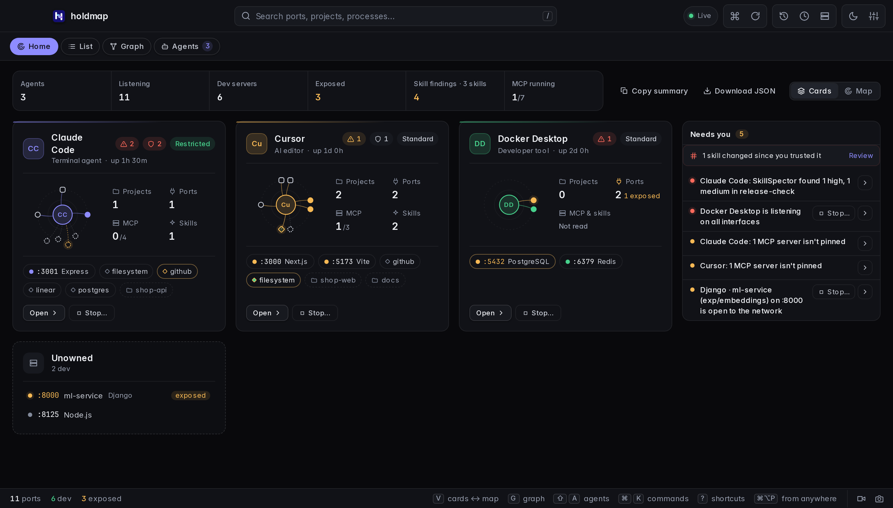
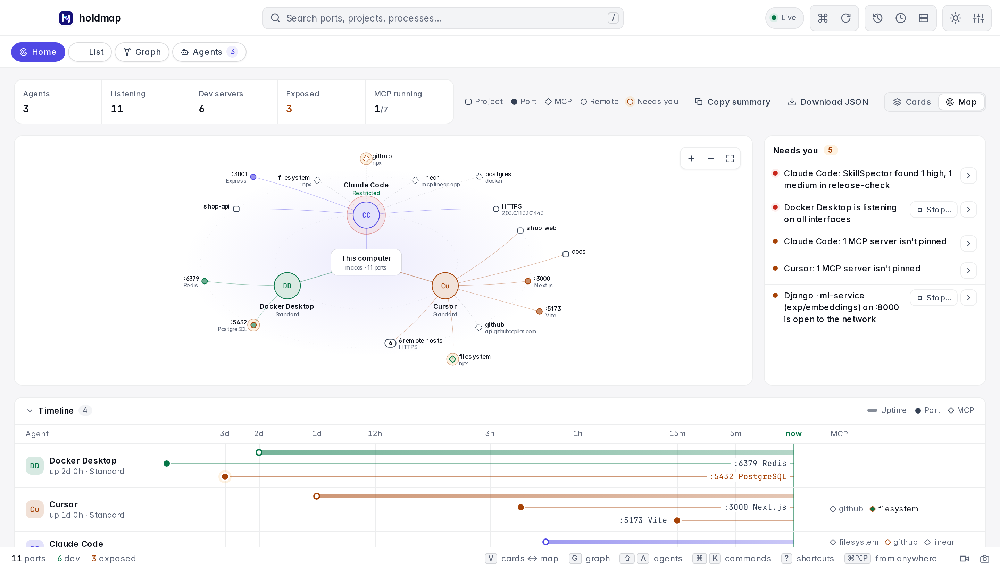
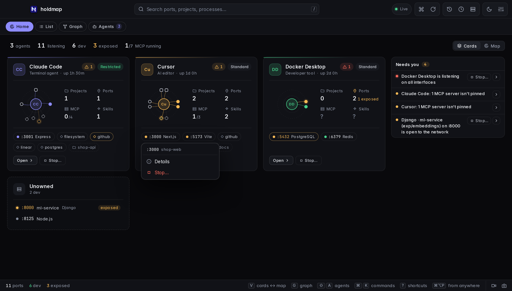
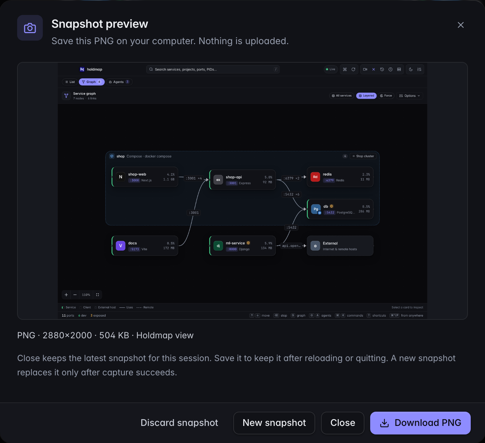
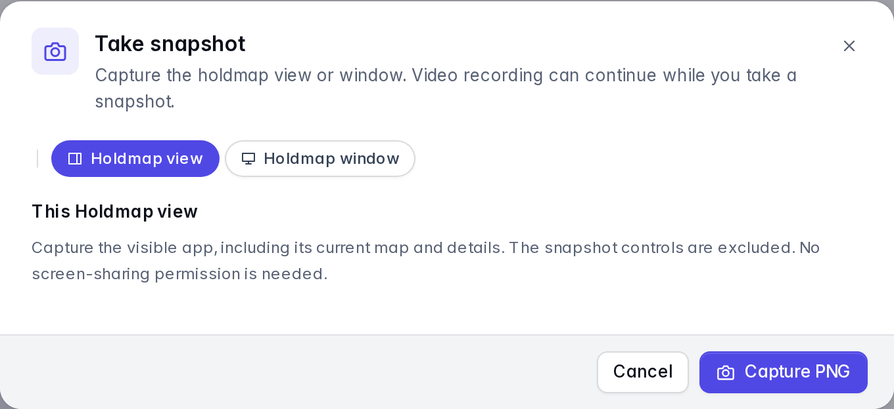

A tray and menu-bar app with the port list, details, the service graph, the agents map, pins, history with
one-click restart, remote hosts over SSH and a command palette. It runs on the same core as the
CLI, so process identity checks and process protections are shared. The CLI's project-specific
`.holdmap.toml` settings apply to CLI and terminal UI actions.
[Try it in the browser](../../#demo).

Release-by-release changes are in [What's new](../whats-new/) and the
[changelog](https://github.com/santoshshinde2012/holdmap/blob/main/CHANGELOG.md).

## Home and first open

**Home** shows agents, listening ports, dev
servers, exposed listeners and running MCP servers, as **Cards** or a **Map** (toggle at the
top right or press `V`; the choice is remembered). Cards list each agent's projects, ports,
MCP servers and skills; Map draws the same footprint around this computer with a collapsible
**Timeline**. **Needs you** lists agents on all interfaces, root or elevated access, risky
safety settings, unpinned MCP servers and exposed dev servers. Click any port (a card chip, a
map node or a timeline pin) for **Details** or **Stop…**; every **Stop…** opens the stop plan
first. Select an agent once to highlight it everywhere; select it again to open it on
Agents. Counts read **…** until the first scan. On a narrow window the Map becomes a list
of agents, each with its ports and the same **Details** / **Stop…** menu.

**Copy summary** puts the overview and **Needs you** on the clipboard as plain text for a
ticket or chat; **Download JSON** saves the same facts as a file. Neither starts a scan, and
neither includes command lines, environment values, prompts or folder paths.







The first open asks where to start and shows notifications, launch at login and single-key
shortcuts with their current settings. **Skip** changes nothing.

## Close, reopen and quit

When the menu-bar or tray icon is available, closing the desktop window keeps Holdmap
running, including active schedules and recording. Click the icon to reopen the window,
or use your configured global shortcut. Choose **Quit holdmap** from the icon's menu to
exit completely. If the tray is unavailable, closing the window quits the app.

Closing from fullscreen returns to the previous app without leaving an empty black Space,
and clicking the Dock icon reopens the same window.

## Service graph and cluster grouping

Choose **Graph** to see connections between services, or choose **Cluster** in the list's
sort menu to group ports by their Compose project or workspace. Both views refresh as
services change. **Layered** arranges dependencies from left to right. **Force** groups
tightly connected services and is available for up to 100 services; larger graphs use
Layered to keep navigation responsive, including when Force was previously selected.

The graph starts with your dev servers and anything they talk to. **All services** adds
databases, apps and other services on this computer. Editor-extension listeners keep the
extension name, not the inherited project — the same identity as the [list and Agents
view](../agents/). A card's location is a layout choice; only the displayed links represent
observed connections.

The graph opens with the full canvas under summary tiles: services, links, groups and
remote (outbound) connections. Disconnected services and separate clusters are packed into compact
groups in both layouts.

The new **Search services** field searches displayed names, projects, ports and PIDs.
Use `port:3000` or `:3000` for an exact port, and `pid:43000` for an exact PID. Multiple
terms must all match. Results include each match's immediate observed neighbors, so a
service's connections keep their context; neighbors are not additional search matches.
Graph search is separate from the List's search, protocol, ownership and dev-server
filters. Searching never reads process command lines or creates links.

The canvas starts at a readable size. Pan or zoom to explore larger graphs; **Fit all
services in view** deliberately zooms out to the whole map, and the percentage control,
**Reset to readable size**, restores a readable view. On wider canvases, a minimap appears
when part of the graph is outside the viewport.

Click a service card, or focus it and press **Enter** or **Space**, to inspect that service.
Details appear beside the canvas when there is enough room, or in a dismissible drawer
in smaller windows. Close or hide details, or press **Esc**, to return to the full map and
restore focus to the service card. The graph does not open a summary pane automatically.

Open **Options** for the secondary display controls. **External** shows outbound remote
hosts and is unavailable when there are none. Press **Esc** to close Options and keep the
selected service. **Traffic** animates observed connections;
it stays off when reduced motion is enabled. **Legend** toggles the connection key while
the compact counts stay visible. Disconnected services have no invented edges; a short
message explains when no connections are present.

## Record the screen

The video icon in the status bar, **Record screen…** in the command palette, or `⇧V` opens
the recorder. Pick what to make and start. **Holdmap records only its own window.** Other apps,
your desktop and notifications are never captured, even when they sit on top, and there is never audio.
Nothing is uploaded. The macOS app needs no picker: it records its own window directly. A browser or
other desktop webview asks you to share the holdmap tab or window, then checks the choice and refuses
anything wider, such as a whole screen or another window, without recording a frame.

| Preset | Makes | Stops by itself after | Size |
| --- | --- | --- | --- |
| **Share a clip** | GIF, 10 frames a second, up to 800 px wide | 15 seconds | at most 10 MB |
| **Full session** | MP4 (H.264) | 30 minutes | about 4 MB a minute for a mostly still screen, up to about 22 MB a minute with constant motion |
| **Custom** | MP4, GIF or both | 15 seconds to 1 hour | live estimate in the dialog |

The dialog shows the expected size and when recording will stop before you choose a screen.
A timer in the title bar replaces the dialog so this window can be part of the capture. It
shows the time left in the last seconds, then stops by itself and tells you why. A small indicator
says it is recording the holdmap window only. **Pause**
leaves a stretch out of the files (the browser pipeline and Windows/Linux; the macOS native
recorder cannot pause yet). **Stop screen recording** or `⇧V` ends it. Keep holdmap open on screen:
minimizing or hiding it freezes the picture. If the app freezes for a moment, that moment is skipped
rather than replayed, so a long recording cannot run out of memory.

When it ends, **Download recording** previews and saves the files. The desktop app opens a
native save dialog and then shows the saved path with **Copy** and **Show in folder**. A cancelled save
or a failed write keeps the recording for another try. The browser uses its own download
manager. **Close**, `Esc` and clicking outside keep the latest recording for this session; use
the video icon, **Review recording**, or `⇧V` to reopen it. **Discard recording** removes it.

A GIF is a short, silent loop, so it is capped by size rather than only by time: a still
screen costs almost nothing, and when motion pushes it toward the size limit Holdmap spaces the frames
further apart (never dropping the timeline) and stops with a note if it would still go over.
For anything longer than a minute or two choose MP4.

Memory and disk: the macOS native recorder writes the MP4 straight to a private file, and a
long MP4 is copied to the place you choose without passing through the window, up to 2 GiB. The
browser pipeline (Windows, Linux, browsers) keeps the MP4 in memory, so it stops by itself
at about 128 MiB and saves what it has. Use **Full session** on macOS for hour-long recordings.

MP4 uses the system's H.264 encoder through WebCodecs, or the browser's MediaRecorder when that is
missing. No third-party encoder is bundled, so installers do not grow. Builds from this project
are unsigned.

macOS may ask for Screen Recording permission in System Settings; if capture is blocked, allow this
app or browser there and retry. This is separate from
[Agents → Flow recording](../agents/#set-up-optional-recording), which collects optional tool-call
metadata rather than pixels.

The macOS desktop app captures its own window through ScreenCaptureKit on **macOS 14 or later** when its
window does not offer browser screen capture; if that window is not on screen it stops with a clear message instead of
recording anything wider. Native capture writes to a private temporary folder, and removes those files
once you save or discard. The limits are enforced by the native app.
Older macOS versions can record only when their webview provides screen sharing; otherwise use a
supporting browser or the system screen recorder.

Linux desktop capture needs PipeWire and a working ScreenCast portal for your desktop
environment. Its portal picker may offer whole screens, so Holdmap refuses any choice it cannot confirm
is its own window; if it can't, use the macOS app, a Chromium browser tab or the system recorder.
If that service is unavailable, try a browser with screen sharing or the system recorder.

Choose the preset and see the estimate before you start:


## Take a PNG snapshot

PNG snapshots are separate from video recording. Open the camera button, choose
**Take snapshot…** in the command palette, or press `⇧S` with single-key shortcuts enabled.

- **Holdmap view** captures the visible app, its current map and details without
  screen-sharing permission. The snapshot chooser is excluded.
- **Holdmap window** captures only the holdmap window through the system, with the same own-window
  rule as recording. Sharing ends after the PNG is captured, and no audio is requested. Browser
  screen-sharing support and the platform requirements above apply; the native macOS path requires
  **macOS 14 or later**. An unsupported source does not disable Holdmap-view snapshots.
- During video recording, **Recording window** replaces the new-source choice. It takes
  a still from the window being recorded without stopping the video. The
  command palette also offers **Snapshot recording window** while that is available.

Review the PNG before saving. Images preserve their aspect ratio within **3840×2160** and
**32 MiB**. **Download PNG** opens a native save dialog in the desktop app; the browser
starts a download without claiming the file was written. Nothing is uploaded.

**Close**, `Esc` or clicking outside keeps the latest PNG for this session. Reopen it with
the camera button, **Review snapshot** or `⇧S`. Cancelled saves and write failures keep it
available to retry. **New snapshot** replaces it only after the new capture succeeds;
**Discard snapshot** removes the retained image without stopping a video. Reloading or
quitting clears the preview, so save it first to keep it.

These screenshots use browser sample data:





## Shut down this computer

Open **Settings → Power → Shut down now…**, separately from **Schedule shutdown…**; its review
has no timing controls. Check the computer
name, save your work and acknowledge that all apps, agents and local services will stop.
The confirmation expires after 60 seconds; it does not schedule shutdown. Cancel or Escape
closes the review before submission. After submission, follow any OS permission prompts;
closing the dialog does not cancel the request. If the OS cancels later, quit holdmap
completely and reopen it before trying again.

macOS uses System Events and may ask for Automation permission. Windows requests shutdown
without forced termination. Linux requires systemd 248 or newer with explicit inhibitor
checks. OS policy or permissions may refuse the action. The browser demo only simulates
shutdown and cannot power off a computer.

## Schedule shutdown or a service stop

1. For this computer, open **Settings → Power → Schedule shutdown…**, or start from the
   empty **Scheduled actions** dialog (clock control). The review is titled
   **Schedule computer shutdown?**. For a local port, use **Schedule stop…** in its details
   instead of **Stop…**, or pick a service from that empty dialog. For an agent's services,
   open its card and choose **Stop all** or a service's **Stop**.
2. Dedicated schedule reviews start at **In 1 hour** and exclude **Now**. Choose another preset,
   **Custom delay**, or **At a time**. Delays range from
   one minute to 24 hours. The preview shows the local date, time and timezone.
3. Read the reviewed effects. For shutdown, acknowledge that all apps and unsaved work are
   affected, then choose **Schedule shutdown**. For services, choose **Schedule stop**.
4. Open the clock control, the active schedule banner, or **Settings → Power → View scheduled
   actions** to check the countdown and cancel. The empty Scheduled actions dialog can start
   a shutdown or a reviewed service stop. Cancellation succeeds only before execution
   starts; the UI waits for the backend's acknowledgement.

Keep Holdmap running, including in its tray, and keep this computer awake. Completely quitting
Holdmap or restarting the computer clears every schedule; the app does not wake the machine.
A deadline missed by more than one minute, or a wall/monotonic clock discrepancy greater than
30 seconds, requires a fresh review. Jobs run once and never retry automatically.

The backend retains the reviewed services and process identities. If a process restarts, a port
changes owner, agent ownership changes, or current protections block the action, Holdmap
refuses the scheduled stop instead of targeting a replacement. An agent schedule stops its
reviewed services and ports; it leaves the agent application running. Stop plans retain normal
grace periods and any escalation displayed during review. Force-stop requests and protected
process overrides cannot be scheduled.

Power controls always target the local desktop computer, including when viewing remote hosts.
Scheduling does not expose an SSH, CLI or MCP shutdown endpoint. Browser schedules simulate
status changes only; they cannot shut down a machine or stop a process. Browser Power entries
are **Simulate shutdown now…** and **Schedule simulation…**; the scheduled dialog is titled
**Schedule shutdown simulation?**.

These current UI screenshots show the browser simulation:


## First open

Download the latest installer: macOS [Apple silicon](https://github.com/santoshshinde2012/holdmap/releases/latest/download/holdmap-macos-arm64.dmg) or
[Intel](https://github.com/santoshshinde2012/holdmap/releases/latest/download/holdmap-macos-x64.dmg) `.dmg`; Windows [`.msi`](https://github.com/santoshshinde2012/holdmap/releases/latest/download/holdmap-windows-x64.msi) or
[setup `.exe`](https://github.com/santoshshinde2012/holdmap/releases/latest/download/holdmap-windows-x64-setup.exe); Linux [`.AppImage`](https://github.com/santoshshinde2012/holdmap/releases/latest/download/holdmap-linux-x64.AppImage),
[`.deb`](https://github.com/santoshshinde2012/holdmap/releases/latest/download/holdmap-linux-x64.deb) or [`.rpm`](https://github.com/santoshshinde2012/holdmap/releases/latest/download/holdmap-linux-x64.rpm).

The published macOS app is ad-hoc signed and sealed, without Developer-ID signing or
notarisation. Its Windows installers are unsigned. First verify the download using the
checksums and build provenance linked from [Install](../../#install), then open it:

- **macOS:** if blocked, use **System Settings › Privacy & Security › Open Anyway** after
  trying to open the verified app. See [Apple's instructions](https://support.apple.com/en-us/102445).
- **Windows:** if offered, choose **More info → Run anyway** in SmartScreen. Organization
  policy or Smart App Control may block unsigned installers; see
  [Microsoft's Smart App Control FAQ](https://support.microsoft.com/en-us/windows/security/threat-malware-protection/smart-app-control-frequently-asked-questions).
- **Linux:** `chmod +x` the AppImage, or install the .deb or .rpm.

To update an existing desktop installation, download the latest installer that matches
your operating system and architecture from [Install](../../#install). Releases without
a configured signed updater require manual installation. Update the CLI by running its
installer again.

Quit Holdmap before replacing it, then reopen the installed copy. Check **Settings → About**
in that app to confirm its version; `holdmap --version` checks the separate CLI. A copy
opened from a downloaded disk image or another folder can still be an older version.

About also shows the running app's location and architecture, with desktop
download and installation-guide actions. The command palette can open desktop downloads too.
Follow the manual quit/install/reopen steps above for releases without a signed updater
feed. Check the published release's signing
and updater notes before installing. Browser About identifies the web preview and omits desktop app locations.

## Develop with local data

The browser development server reads live ports, agents, map relationships
and Flow connections from a local Holdmap CLI. Follow the
[development setup](https://github.com/santoshshinde2012/holdmap/blob/main/CONTRIBUTING.md#setup)
for required toolchains and native packages. From the repository root:

```sh
cargo build -p holdmap
cd apps/desktop
npm ci
npm run dev
```

The development server uses `target/debug/holdmap`, then `target/release/holdmap`, then
`holdmap` on your `PATH`. Set `HOLDMAP` to use a different CLI executable. The live collector
is read-only: use `npm run tauri dev` from `apps/desktop`, or the installed desktop app, for
real process stops, restarts and operating-system actions.

Add `?demo=1` to the development URL for sample data. The public website demo and production
browser builds always use sample data; they do not scan or stop processes on your computer.
Screen sharing is separate and always requires your explicit screen or window selection.

## Keyboard

`⌘⌥P` (`Ctrl+Alt+P`) brings the app up from anywhere; change it in Settings. Inside the app
(`Ctrl` instead of `⌘` on Windows and Linux):

| Keys | Action |
|---|---|
| `⌘K` | Command palette |
| `/` or `⌘F` | Search ports, projects and processes |
| `↑` `↓` or `j` `k` | Move through the list |
| `Esc` | Clear the search, the filters or the selection |
| `⌫` | Stop the selected port (`⇧⌫` to force) |
| `o` · `c` | Open in the browser · copy its URL |
| `p` | Pin or unpin the port |
| `g` | Switch between the list and the service graph |
| `⇧A` | Agents, tools and apps: folders, ports they started, connections and access |
| `B` | Hide or show the details pane (list and graph) |
| `h` | Recently stopped, with one-click restart |
| `d` · `m` · `e` · `t` | Filter: dev servers · mine · exposed · TCP/UDP |
| `⌘R` | Rescan now |
| `⇧V` | Record the screen, stop capture or review the latest recording |
| `⇧S` | Take or review a PNG snapshot |
| `⇧L` | Cycle the theme |
| `⌘,` | Settings |
| `?` | Every shortcut |

**Settings → General → Single-key shortcuts** lets you disable
letter and symbol shortcuts, including `/` and `j`/`k`. Arrow navigation and `⌘`/`Ctrl` shortcuts
remain available. This is useful with speech input or when you want to reserve letter keys.
Shortcuts respect text composition and native controls. Port-filter shortcuts apply only in List; Graph keeps its own search and selection. In Graph,
`B` acts on a selected listener's details instead of opening a summary pane.
The command palette keeps its active result valid as running services change.

## Agents map

**Agents** (`⇧A`) shows each AI coding agent and developer tool that is running (Claude Code,
Codex, Cursor, Copilot, Gemini CLI, Windsurf, Aider, Docker Desktop, OrbStack and others). Cards
skim memory, CPU, process count, stoppable ports and parent; expand for folders (with source
labels), ports and apps it started, child processes as tools & apps, connections, and access: the
account it runs as, sandbox and approval flags, network listeners, and macOS-protected folders.
Each fact is marked seen, inferred or unknown. From a card you can reveal a folder, open it in your
editor, or stop the unprotected ports that agent started. The map zooms
Computer → Footprint → Project from the same observed processes, sockets and folders; it does not invent communication
between agents. Recent projects come from folder names
only. Default scans do not inspect chats, agent settings or credential stores.
Explicit [MCP & skills inspection](../agents/#mcp-and-skills) separately parses
bounded configuration metadata and lists skill locations with optional sanitized YAML-header
names/purposes; it excludes credential values and skill instruction bodies from its results.
Recognized credentials in
observed process arguments are redacted for display; redaction is heuristic. Remote hosts show as IP addresses. Click a port to
open its details. `↑` `↓` switch agents. See [Agents, tools and apps](../agents/) for the full guide.
`holdmap agents` and `holdmap agents AGENT --stop-ports` do the same in a terminal.

**MCP & skills** has **Explore**, **Map** and **Compare** views over the opt-in
inventory. Explore leads with declared skill purposes; Map retains observed
source relationships; Compare keeps exact definitions and their contexts separate. Matching
process observations group without becoming a verified session. Select a card with a click,
**Enter** or **Space** for **Purpose**, **Source**, **Evidence** and **Activity**. Close or press
**Esc** to return focus without changing the selected context. Nothing is selected automatically.
**Tools** explains **Catalog not reported** rather than showing zero tools. **Filters** and
**Coverage** open on request, and narrow windows keep dismissible agent/details drawers.
See the [capability guide](../agents/#mcp-and-skills) for supported locations and limits.
File presence does not establish loading, approval or use; no new catalog or activity adapter
is introduced.

In **Flow → Calls**, approved activity metadata can label a reported MCP server alias or
explicit Claude skill activation. These labels are separate from configuration inventory;
matching names do not prove use by a particular process. Set up
[optional recording](../agents/#set-up-optional-recording) to collect supported metadata.

You can also search by agent, child tool, folder, exact PID or
`port:3000`. Likely MCP server children appear even without a listening socket; expanded cards
show their evidence, resource use and redacted commands. Omitted counts and collection warnings
show where visibility is incomplete. The browser demo runs the current UI with sample data.

## From the details pane

**Open**, **Restart** and **More actions** share one footer with **Schedule stop…** and
**Stop…**. Stopping a port keeps the computer running. Tabs stay on one scrolling row;
content remains readable in a 340-pixel pane.
The Sort menu keeps its choices and descriptions within the right edge of the window.

Folder opening uses `HOLDMAP_EDITOR`, then a known installed editor. The file manager and URL, `curl` and command-copy actions remain available
through **More actions**.


