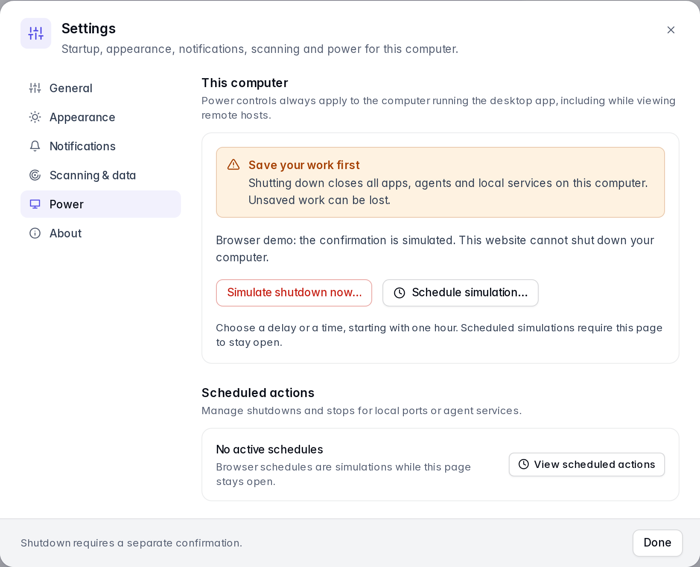
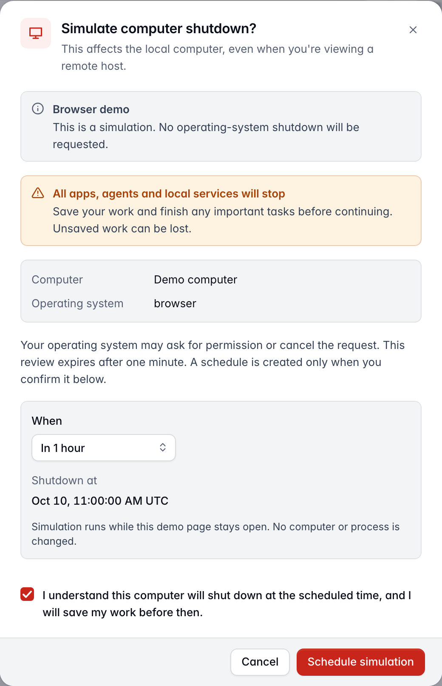
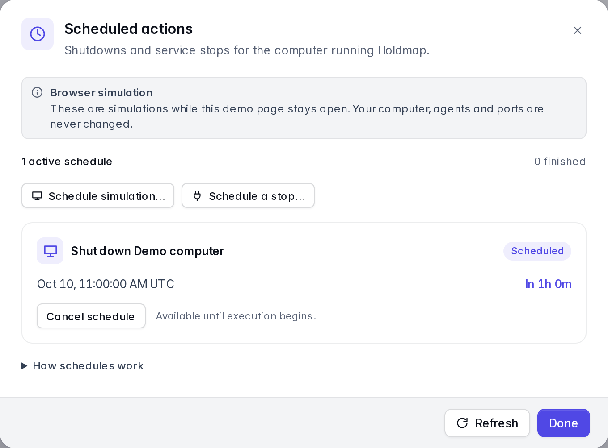
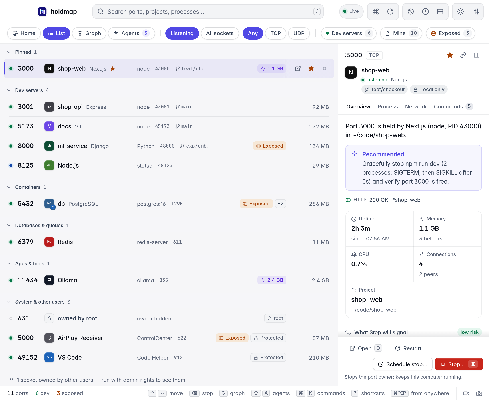
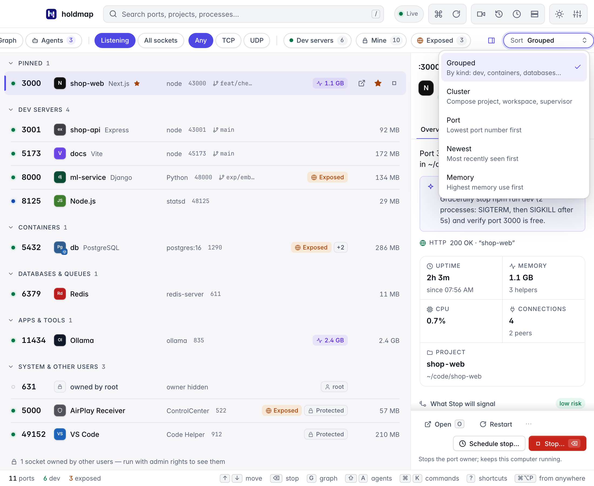

A tray and menu-bar app with the port list, details, the service graph, the agents map, pins, history with
one-click restart, remote hosts over SSH and a command palette. It runs on the same core as the
CLI, so process identity checks and process protections are shared. The CLI's project-specific
`.holdmap.toml` settings apply to CLI and terminal UI actions.
[Try it in the browser](../../#demo).

The current download is **0.6.0**: editor-extension identity on the graph, hideable details and
Flow inspector, grouped title-bar actions, schedules started from the empty manager, and a
macOS fullscreen close that returns to the previous app. See the
[0.6.0 changes](https://github.com/santoshshinde2012/holdmap/blob/main/CHANGELOG.md#060---2026-10-14).

## Close, reopen and quit

When the menu-bar or tray icon is available, closing the desktop window keeps Holdmap
running, including active schedules and recording. Click the icon to reopen the window,
or use your configured global shortcut. Choose **Quit holdmap** from the icon's menu to
exit completely. If the tray is unavailable, closing the window quits the app.

Closing from fullscreen returns to the previous app without leaving an empty black Space,
and clicking the Dock icon reopens the same window. Use **0.6.0 or newer**.

## Service graph and cluster grouping

Choose **Graph** to see connections between services, or choose **Cluster** in the list's
sort menu to group ports by their Compose project or workspace. Both views refresh as
services change. **Layered** arranges dependencies from left to right. **Force** groups
tightly connected services and is available for up to 100 services; larger graphs use
Layered to keep navigation responsive, including when Force was previously selected.

The graph starts with your dev servers and anything they talk to. **All services** adds
databases, apps and the rest of the machine. **External** shows outbound remote hosts and
stays idle when there are none. If the canvas has services but no links, it explains that
and offers All services. Editor-extension listeners keep the extension name, not the
inherited project — same identity as the [list and Agents view](../agents/).

Hide the details pane (`B`, the toolbar panel control, or the pane's own hide button) so
the graph uses the full window. **Legend** on the canvas hides the counts and key. Both
choices persist.

## Shut down this computer

Open **Settings → Power → Shut down now…**, separately from **Schedule shutdown…**; its review
has no timing controls. Local shutdown was introduced in 0.4.0. Check the computer
name, save your work and acknowledge that all apps, agents and local services will stop.
The confirmation expires after 60 seconds; it does not schedule shutdown. Cancel or Escape
closes the review before submission. After submission, follow any OS permission prompts;
closing the dialog does not cancel the request. If the OS cancels later, quit holdmap
completely and reopen it before trying again.

macOS uses System Events and may ask for Automation permission. Windows requests shutdown
without forced termination. Linux requires systemd 248 or newer with explicit inhibitor
checks. OS policy or permissions may refuse the action. The browser demo only simulates
shutdown and cannot power off a computer. Version 0.3.0 binaries predate this feature.

## Schedule shutdown or a service stop

Scheduling is in the current **0.6.0** download (it landed in 0.5.0). Version 0.4.0 downloads
include immediate shutdown and stop confirmations, but predate scheduling.

1. For this computer, open **Settings → Power → Schedule shutdown…**, or start from the
   empty **Scheduled actions** dialog (clock control). The review is titled
   **Schedule computer shutdown?**. For a local port, use **Schedule stop…** in its details
   instead of **Stop…**, or pick a service from that empty dialog. For an agent's services,
   open its card and choose **Stop all** or a service's **Stop**.
2. Dedicated schedule reviews start at **In 1 hour** and exclude **Now**. Choose another preset,
   **Custom delay**, or **At a time**. Delays range from
   one minute to 24 hours. The preview shows the local date, time and timezone.
3. Read the reviewed effects. For shutdown, acknowledge that all apps and unsaved work are
   affected, then choose **Schedule shutdown**. For services, choose **Schedule stop**.
4. Open the clock control, the active schedule banner, or **Settings → Power → View scheduled
   actions** to check the countdown and cancel. The empty Scheduled actions dialog can start
   a shutdown or a reviewed service stop. Cancellation succeeds only before execution
   starts; the UI waits for the backend's acknowledgement.

Keep Holdmap running, including in its tray, and keep this computer awake. Completely quitting
Holdmap or restarting the computer clears every schedule; the app does not wake the machine.
A deadline missed by more than one minute, or a wall/monotonic clock discrepancy greater than
30 seconds, requires a fresh review. Jobs run once and never retry automatically.

The backend retains the reviewed services and process identities. If a process restarts, a port
changes owner, agent ownership changes, or current protections block the action, Holdmap
refuses the scheduled stop instead of targeting a replacement. An agent schedule stops its
reviewed services and ports; it leaves the agent application running. Stop plans retain normal
grace periods and any escalation displayed during review. Force-stop requests and protected
process overrides cannot be scheduled.

Power controls always target the local desktop computer, including when viewing remote hosts.
Scheduling does not expose an SSH, CLI or MCP shutdown endpoint. Browser schedules simulate
status changes only; they cannot shut down a machine or stop a process. Browser Power entries
are **Simulate shutdown now…** and **Schedule simulation…**; the scheduled dialog is titled
**Schedule shutdown simulation?**.

These current UI screenshots show the browser simulation:

## First open

**Linux desktop 0.3.0:** published AppImage, Debian and RPM downloads predate the GLib
security fixes. Use version **0.4.0 or newer**, or build the desktop from current source.
This Linux GTK dependency issue does not affect the CLI, TUI or
MCP server, or the macOS and Windows desktop builds. See the
[security policy](https://github.com/santoshshinde2012/holdmap/blob/main/SECURITY.md#linux-glib-dependency-backports).

The macOS app is ad-hoc signed and sealed, but is not Developer-ID signed or notarised.
Windows installers are unsigned unless signing credentials are configured. On first launch:

- **macOS:** open it once, then go to **System Settings › Privacy & Security › Open Anyway**
  (macOS 14 and earlier: right-click the app, then **Open**). Or run
  `xattr -dr com.apple.quarantine /Applications/holdmap.app`.
- **Windows:** in "Windows protected your PC", click **More info**, then **Run anyway**.
- **Linux:** `chmod +x` the AppImage, or install the .deb or .rpm.

To update an existing desktop installation, download the latest installer that matches
your operating system and architecture from [Install](../../#install). Releases without
a configured signed updater require manual installation. Update the CLI by running its
installer again.

## Keyboard

`⌘⌥P` (`Ctrl+Alt+P`) brings the app up from anywhere; change it in Settings. Inside the app
(`Ctrl` instead of `⌘` on Windows and Linux):

| Keys | Action |
|---|---|
| `⌘K` | Command palette |
| `/` or `⌘F` | Search ports, projects and processes |
| `↑` `↓` or `j` `k` | Move through the list |
| `Esc` | Clear the search, the filters or the selection |
| `⌫` | Stop the selected port (`⇧⌫` to force) |
| `o` · `c` | Open in the browser · copy its URL |
| `p` | Pin or unpin the port |
| `g` | Switch between the list and the service graph |
| `⇧A` | Agents, tools and apps: folders, ports they started, connections and access |
| `B` | Hide or show the details pane (list and graph) |
| `h` | Recently stopped, with one-click restart |
| `d` · `m` · `e` · `t` | Filter: dev servers · mine · exposed · TCP/UDP |
| `⌘R` | Rescan now |
| `⇧L` | Cycle the theme |
| `⌘,` | Settings |
| `?` | Every shortcut |

In 0.5.0, **Settings → General → Single-key shortcuts** lets you disable
letter and symbol shortcuts, including `/` and `j`/`k`. Arrow navigation and `⌘`/`Ctrl` shortcuts
remain available. This is useful with speech input or when you want to reserve letter keys.
Shortcuts respect text composition and native controls; port filters apply only in port views.
The command palette keeps its active result valid as running services change.

## Agents map

**Agents** (`⇧A`) shows each AI coding agent and developer tool that is running (Claude Code,
Codex, Cursor, Copilot, Gemini CLI, Windsurf, Aider, Docker Desktop, OrbStack and others). Cards
skim memory, CPU, process count, stoppable ports and parent; expand for folders (with source
labels), ports and apps it started, child processes as tools & apps, connections, and access: the
account it runs as, sandbox and approval flags, network listeners, and macOS-protected folders.
Each fact is marked seen, inferred or unknown. From a card you can reveal a folder, open it in your
editor, or stop the unprotected ports that agent started. Recent projects come from folder names
only. Chats, settings and tokens are never read. Remote hosts show as IP addresses. Click a port to
open its details. `↑` `↓` switch agents. See [Agents, tools and apps](../agents/) for the full guide.
`holdmap agents` and `holdmap agents AGENT --stop-ports` do the same in a terminal.

Version 0.4.0 also lets you search by agent, child tool, folder, exact PID or
`port:3000`. Likely MCP server children appear even without a listening socket; expanded cards
show their evidence, resource use and redacted commands. Omitted counts and collection warnings
show where visibility is incomplete. Version 0.3.0 predates these additions;
the browser demo runs the current UI with sample data.

## From the details pane

In 0.5.0, **Open** and **Restart** stay beside **More actions**, which offers folder
opening and copy commands. **Stop…** and **Schedule stop…** have a separate footer labelled
with the selected port; stopping a port keeps the computer running. Tabs wrap and content
remains readable in a 340-pixel pane.
The Sort menu keeps its choices and descriptions within the right edge of the window.

Folder opening uses `HOLDMAP_EDITOR`, then a known installed editor. The file manager and URL, `curl` and command-copy actions remain available
through **More actions**.

