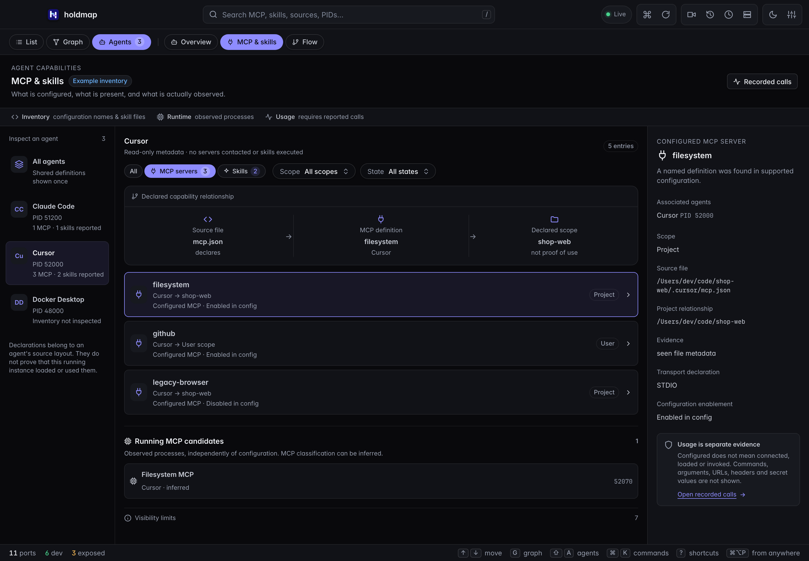

**Holdmap 0.8.0** adds a graphical map of local MCP definitions and skill files, clearer
reported-usage labels, and desktop update help. It also fixes recording startup cancellation
and native temporary-file cleanup. [Install](../../#install) always links to the latest
published release; the [changelog](https://github.com/santoshshinde2012/holdmap/blob/main/CHANGELOG.md)
records the full changes.

## New in 0.8.0: MCP and skills, mapped

Open **Agents → MCP & skills** to explicitly inspect supported local configuration for
running agents in your account. MCP definitions and skill files sit around their agent cards;
running MCP candidates occupy a separate lane. Select a card with a click, **Enter** or
**Space** to inspect its source, scope and evidence, plus optional skill-header name and purpose.
Close the inspector or press **Esc** to return to the agent rail without losing your scope.

Search and filter by kind, scope or configured state. Shared nodes represent exact discovered
source definitions, with an association to each observed owner. Matching aliases never join a
definition to a running process or recorded call. Narrow windows keep a readable map and a
**Browse agents** drawer; pan to explore, or choose **Fit all capabilities in view**.

The same opt-in is available through `holdmap agents --capabilities`, the terminal Agents
**c** toggle and MCP `list_agents(include_capabilities:true)`. Leaving the terminal Agents pane
turns inspection off and clears retained inventory. Ordinary scans do not inspect settings.

Supported default and compatibility locations cover Codex, Claude Code, Cursor, Claude Desktop,
legacy Windsurf, Gemini CLI, GitHub Copilot, Copilot CLI and Cline. Skill coverage varies by
client. Discovery is bounded and skips links, protected locations and unsupported roots;
presence does not establish loading, trust, enablement or use. Credential values and skill
instruction bodies are excluded from results. See the [full source and privacy limits](../agents/#mcp-and-skills).

## Reported usage keeps its evidence

**Agents → Flow → Calls** can label a reported MCP server alias and an explicit Claude skill
activation when the configured integration supplies approved metadata. Unreported or
provider-redacted names stay unknown. These labels are separate from configured inventory and
do not establish that a particular agent loaded a server or invoked a skill just because its
name matches. [Set up optional recording](../agents/#set-up-optional-recording).

MCP clients also gain two read tools: `inspect_port` returns the same structured inspection as
`explain_port`, and `get_agent_flow` returns observed process ancestry and live TCP relationships.
Observed connections do not establish messages or tool calls. [MCP setup and tools](../mcp/).

## Clearer updates and recording cleanup

**Settings → About** shows the running desktop app's version, architecture and location,
with desktop download and installation-guide actions. The command palette also opens desktop
downloads. This helps distinguish an installed copy from one opened from a disk image or
another folder; `holdmap --version` checks the separate CLI. Browser About identifies a web
preview and omits desktop app locations.

Cancelling while native recording starts now discards the acknowledged capture session.
Native cleanup retains temporary files until pending operations finish. These changes preserve
the existing local MP4/GIF exports, two-minute limit and explicit source chooser.

## Upgrade to 0.8.0

Run the CLI installer again, then check `holdmap --version`. The CLI installer includes the
TUI and MCP server. Download the desktop installer separately for your operating system and
architecture from [Install](../../#install). Quit Holdmap, install the matching download,
then reopen it and check **Settings → About**. This release requires manual desktop
installation; its published installers do not include a configured signed updater feed.

The macOS builds are ad-hoc signed without Developer-ID signing or notarization, and Windows
installers are unsigned. See [first-open instructions](../desktop/#first-open), the SHA-256
files, and the build-provenance verification commands in [Install](../../#install).

If you use optional agent activity recording, start a recording session and recopy its producer
configuration when starting a new session. Each session uses a fresh local endpoint and token.
[Recording setup](../agents/#set-up-optional-recording).

## Fixed in 0.7.1: native macOS recording

On **macOS 14 or later**, the desktop app opens Apple's native screen picker when its
window lacks browser screen sharing. Choose the display or window to capture; microphone
and system audio remain off. The existing browser capture path is used when available.

Native recording stops after two minutes even while the Holdmap window is hidden. It uses
private temporary files for MP4 and GIF, removes them after copying exports into the preview
or discarding the recording, and keeps the existing review and save controls.

If 0.7.0 showed **Screen capture unavailable**, install **desktop 0.7.1 or newer** and reopen
it. Updating only the CLI does not replace the desktop app. The app still runs on macOS 11
or later; macOS 11–13 need browser screen-sharing support or the system screen recorder.
[Recording requirements](../desktop/#record-the-screen).

## Features introduced in 0.7.0

The following features remain available in 0.8.0. Read the
[0.7.0 release notes](https://github.com/santoshshinde2012/holdmap/releases/tag/v0.7.0) for their
original release details.

### Record a screen or window

Choose the camera button or **Record screen** in the command palette (`⇧V`), then pick a
screen or window in the system chooser. Recordings run for up to **two minutes**, with local
**MP4** and **GIF** exports when encoding is supported. Microphone and system audio are not captured.

Stopping the recording ends screen sharing before the files are prepared. Preview and save
each available format. Closing the preview keeps the latest recording available through
**Review recording** for the session.
Cancelled saves can be retried; **Discard recording**, reload, or quitting clears the preview.

Screen recording is separate from optional agent tool-call metadata recording.
[Screen recording guide](../desktop/#record-the-screen).

### Computer, Footprint and Project

Open **Agents → Overview** to explore the same observed report at three levels:

- **Computer:** this machine, the agents running on it, and outside systems they contact.
- **Footprint:** folders, tools, ports and hosts across agents.
- **Project:** the agents and resources observed for one selected source tree.

Click a folder in Footprint to focus its project. Click it again for **Folder actions**, including
Reveal and Open in Editor. The map keeps evidence labels and uses observed relationships;
it does not infer messages from a socket connection.
[Agents map guide](../agents/#desktop-and-tui).

### Live local scans during development

Running `npm run dev` in `apps/desktop` reads local ports, agents and connections through
the Holdmap CLI. The public website demo and `?demo=1` keep their sample data. Sample browser
previews simulate stop and power actions; actual process stops need the desktop app.
[Desktop development setup](../desktop/#develop-with-local-data).

### Clearer controls and safer stops

- List, Graph and Agents use one set of view controls. Agents separates Overview from Flow;
  Flow separates observed **Connections** from reported **Calls**.
- Map cards and the legend can be hidden. Flow can hide inspector, limits and recording controls;
  visibility choices persist so the graph has room.
- Port details keep their tabs on one scrolling row and actions in one footer.
- Name-based `--no-tree` stops retain every matching process. Tree stops also check TCP and UDP
  listeners held by included descendants; supervisor and systemd stops recheck their targets.
- Composing text and modified shortcuts are preserved in desktop controls. Dialog focus stays
  within visible, enabled controls in the tab order.
- Optional MCP observers that panic are disabled without interrupting tool responses. Explicit
  final OTLP status takes precedence over a conflicting custom success field.
