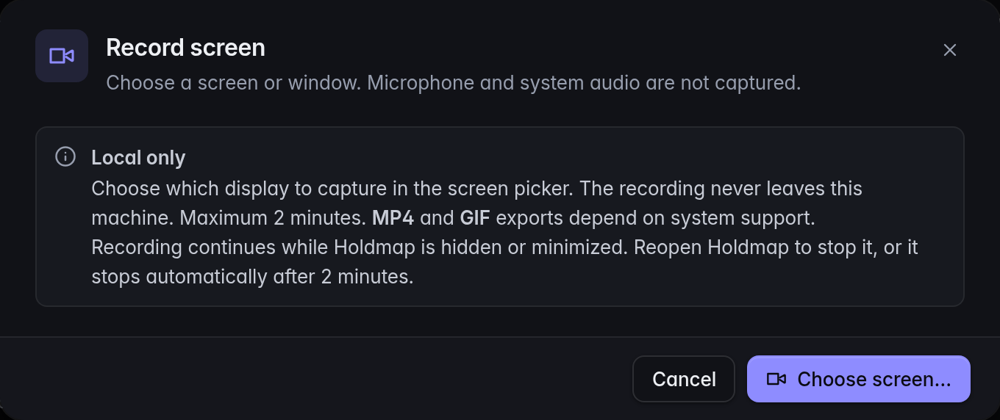

**Holdmap 0.7.1** fixes screen recording in macOS desktop windows that do not offer
browser screen sharing. It builds on the local recorder, agent-map zoom and live development
scans introduced in **0.7.0**. Download the release from [Install](../../#install), or read the
[0.7.1 release notes](https://github.com/santoshshinde2012/holdmap/releases/tag/v0.7.1).

## Fixed in 0.7.1: native macOS recording

On **macOS 14 or later**, the desktop app opens Apple's native screen picker when its
window lacks browser screen sharing. Choose the display or window to capture; microphone
and system audio remain off. The existing browser capture path is used when available.

Native recording stops after two minutes even while the Holdmap window is hidden. It uses
private temporary files for MP4 and GIF, removes them after copying exports into the preview
or discarding the recording, and keeps the existing review and save controls.

If 0.7.0 showed **Screen capture unavailable**, install the **0.7.1 desktop app** and reopen
it. Updating only the CLI does not replace the desktop app. The app still runs on macOS 11
or later; macOS 11–13 need browser screen-sharing support or the system screen recorder.
[Recording requirements](../desktop/#record-the-screen).

## Features introduced in 0.7.0

The following features remain available in 0.7.1. Read the
[0.7.0 release notes](https://github.com/santoshshinde2012/holdmap/releases/tag/v0.7.0) for their
original release details.

### Record a screen or window

Choose the camera button or **Record screen** in the command palette (`⇧V`), then pick a
screen or window in the system chooser. Recordings run for up to **two minutes**, with local
**MP4** and **GIF** exports when encoding is supported. Microphone and system audio are not captured.

Stopping the recording ends screen sharing before the files are prepared. Preview and save
each available format. Closing the preview keeps the latest recording available through
**Review recording** for the session.
Cancelled saves can be retried; **Discard recording**, reload, or quitting clears the preview.

Screen recording is separate from optional agent tool-call metadata recording.
[Screen recording guide](../desktop/#record-the-screen).

The recording setup explains local export before opening the system's source chooser:

### Computer, Footprint and Project

Open **Agents → Overview** to explore the same observed report at three levels:

- **Computer:** this machine, the agents running on it, and outside systems they contact.
- **Footprint:** folders, tools, ports and hosts across agents.
- **Project:** the agents and resources observed for one selected source tree.

Click a folder in Footprint to focus its project. Click it again for **Folder actions**, including
Reveal and Open in Editor. The map keeps evidence labels and uses observed relationships;
it does not infer messages from a socket connection.
[Agents map guide](../agents/#desktop-and-tui).

### Live local scans during development

Running `npm run dev` in `apps/desktop` reads local ports, agents and connections through
the Holdmap CLI. The public website demo and `?demo=1` keep their sample data. Sample browser
previews simulate stop and power actions; actual process stops need the desktop app.
[Desktop development setup](../desktop/#develop-with-local-data).

### Clearer controls and safer stops

- List, Graph and Agents use one set of view controls. Agents separates Overview from Flow;
  Flow separates observed **Connections** from reported **Calls**.
- Map cards and the legend can be hidden. Flow can hide inspector, limits and recording controls;
  visibility choices persist so the graph has room.
- Port details keep their tabs on one scrolling row and actions in one footer.
- Name-based `--no-tree` stops retain every matching process. Tree stops also check TCP and UDP
  listeners held by included descendants; supervisor and systemd stops recheck their targets.
- Composing text and modified shortcuts are preserved in desktop controls. Dialog focus stays
  within visible, enabled controls in the tab order.
- Optional MCP observers that panic are disabled without interrupting tool responses. Explicit
  final OTLP status takes precedence over a conflicting custom success field.

## Upgrade to 0.7.1

Run the CLI installer again, then check `holdmap --version`. The CLI installer includes the
TUI and MCP server; download the desktop installer separately for your operating system and
architecture from [Install](../../#install). This release requires manual desktop installation;
automatic updates are not configured for its published installers.

The macOS builds are ad-hoc signed without notarization, and Windows installers are unsigned.
See [first-open instructions](../desktop/#first-open), the SHA-256 files, and the build-provenance
verification commands in [Install](../../#install).

If you use optional agent activity recording, start a recording session and recopy its producer
configuration when starting a new session. Each session uses a fresh local endpoint and token.
[Recording setup](../agents/#set-up-optional-recording).
