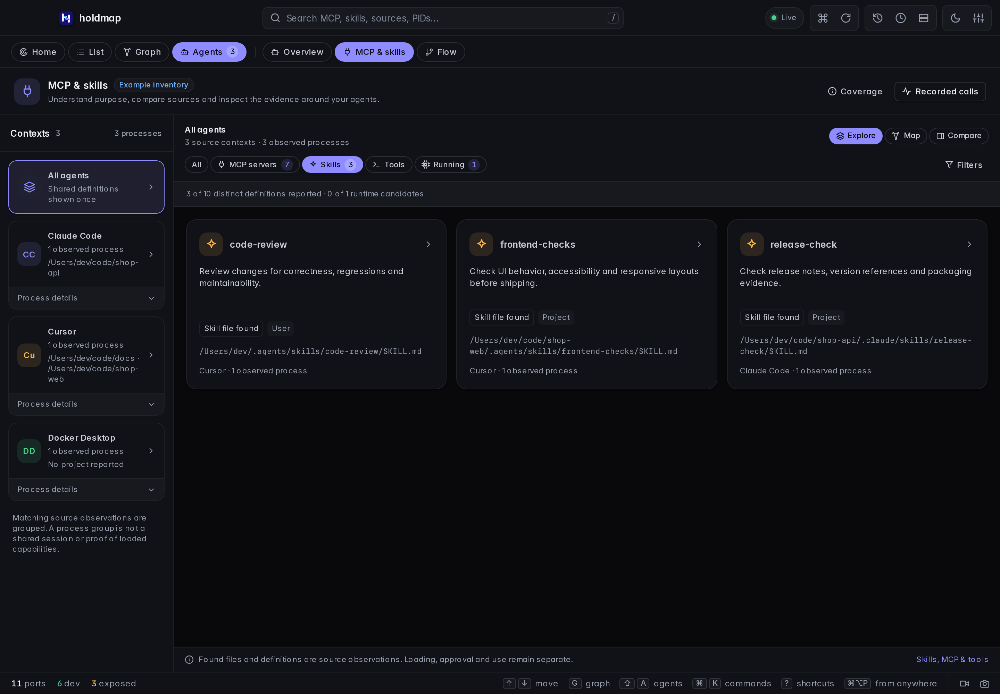

## On main: Home, agent inventory and port stops

Not in a published release yet; [Install](../../#install) follows the latest published release.

- **Home** shows every agent as **Cards** or a **Map** with a **Timeline** of uptime, ports
  and MCP, plus a **Needs you** list. Press `V` to switch. [Home](../desktop/#home-and-first-open).
- **Agent inventory** adds how each MCP server launches (runner, package, pinned or not), its
  remote host, env/header **names**, whether it runs now, permission rules, safety settings,
  instruction files and built-in tools: `holdmap agents --capabilities`, MCP `list_agents`
  with `include_capabilities`, and the desktop cards. Values, prompts and file bodies are never
  read. [Launch, run state and permissions](../agents/#launch-run-state-and-permissions).
- **Stop a port from Home:** click a card chip, map node or timeline pin for **Details** or
  **Stop…**; the stop plan opens first. Narrow windows list each agent's ports with the same menu.

## 0.9.0

**Holdmap 0.9.0** brings PNG snapshots, a readable service graph and the
**Explore / Map / Compare** capability explorer. During release preparation, a source version
does not imply installer availability. The download section follows the latest published
release; **0.8.0** installers predate these additions. Check [Install](../../#install) before upgrading; the
[changelog](https://github.com/santoshshinde2012/holdmap/blob/main/CHANGELOG.md) records the full changes.

### PNG snapshots alongside video

Use the camera button, **Take snapshot…** or `⇧S` to choose what to capture:

- **Holdmap view:** the visible app viewport, without screen-sharing permission.
- **Screen or window:** an explicit system picker chooses the source, then sharing ends
  after the still is captured.
- **Recording source:** while video is active, take a still from its existing source without
  another picker or stopping the video.

Review and save the PNG locally. Images preserve their aspect ratio within **3840×2160**
and **32 MiB**. Closing the preview or cancelling a save retains it for retry; a new capture
replaces it only on success. **Discard snapshot**, reload or quit clears the retained image.
The desktop opens a native save dialog; the browser starts a download. Nothing is uploaded.

App-view snapshots work separately from display-capture support. The native selected-source
fallback requires **macOS 14 or later**; other platforms use browser screen-sharing support
and their system picker. [Snapshot sources and limits](../desktop/#take-a-png-snapshot).
Video recording retains its two-minute, no-audio MP4/GIF workflow and now uses the video icon.

### A readable service graph

Graph opens with a full canvas until you select a service. Both layouts pack disconnected
services and separate clusters compactly. Cards start at a readable size; **Fit all services
in view** offers an overview and **Reset to readable size** restores readable cards.

Search names, projects, exact `port:3000` / `:3000` or `pid:43000`, with every query term
required to match. Immediate observed neighbors keep connection context without becoming
extra matches. List filters stay separate. **Options** holds Traffic, External and Legend;
keyboard activation and focus return work through the selected service's details.
Layout proximity never invents a connection. [Service graph guide](../desktop/#service-graph-and-cluster-grouping).

### Explore, map and compare capabilities

Open **Agents → MCP & skills** to explicitly inspect the existing supported local sources.
**Explore** leads with declared skill purposes, **Map** retains source relationships, and
**Compare** shows exact observed definitions across two contexts. Matching process observations
group while retaining their original PIDs; a group is not a verified conversation or session.

Select a card for **Purpose**, **Source**, **Evidence** and **Activity**. File presence does not
establish loading, approval or use. **Tools** explains **Catalog not reported** instead of
claiming zero tools. No new client catalog, recording adapter or name-based activity join is
introduced; coverage and privacy limits remain the same as 0.8.0.

The workspace loads only after explicit navigation. Search, scope/state filters, comparison
selectors and dismissible narrow-window details support the same observed inventory.
[Capability explorer, supported sources and limits](../agents/#mcp-and-skills).

## Upgrade to 0.9.0

Install 0.9.0 after its release assets are published, or use a checked-out source build with the
[development prerequisites](https://github.com/santoshshinde2012/holdmap/blob/main/CONTRIBUTING.md#setup).

Update the CLI and desktop separately:

1. Run the current CLI installer from [Install](../../#install), then check `holdmap --version`.
   This updates the CLI, TUI and MCP server.
2. Download the published desktop installer for your OS and architecture. Quit Holdmap,
   install it, reopen the installed copy and check **Settings → About**, including its
   running-app location. Updating the CLI does not replace the desktop app.

Use manual desktop installation for releases without a signed updater feed. Published 0.8.0
installers have no configured signed updater feed; their macOS apps are ad-hoc signed without
Developer-ID signing or notarization, and Windows installers are unsigned. Check the final
release's signing/updater notes, SHA-256 checksums and build provenance before opening a
new download. [First open](../desktop/#first-open) explains the platform controls.

Optional activity recording keeps the 0.8.0 metadata contract: use 0.8.0 or newer clients and
collectors for reported MCP aliases and skill activations. Version 0.7.1 decoders reject those
fields. Every fresh recording session uses a new local endpoint and token; recopy its producer
settings and restart the producer. [Recording setup](../agents/#set-up-optional-recording).

## Retained from 0.8.0

### Opt-in MCP and skill inventory

Supported default and compatibility locations cover Codex, Claude Code, Cursor, Claude Desktop,
legacy Windsurf, Gemini CLI, GitHub Copilot, Copilot CLI and Cline. Skill coverage varies by
client. Discovery is bounded and skips links, protected locations and unsupported roots.
Credential values and skill instruction bodies are excluded from results; presence is not use.
The CLI uses `holdmap agents --capabilities`, the terminal Agents pane uses **c**, and MCP
uses `list_agents(include_capabilities:true)`. Ordinary scans do not inspect settings.

### Reported usage and MCP tools

**Agents → Flow → Calls** labels a reported MCP alias or explicit Claude skill activation
when a configured integration supplies it. Provider-redacted names remain unknown; aliases
are not verified inventory/process associations. MCP `inspect_port` matches `explain_port`,
and `get_agent_flow` reports observed process ancestry and live TCP relationships, not messages
or tool invocations. [MCP setup and tools](../mcp/).

### Desktop identity and capture cleanup

**Settings → About** identifies the running app's version, architecture and location, with
desktop download and installation-guide actions. Browser About identifies the web preview.
Cancelling while native recording starts releases the acknowledged capture session, and
cleanup waits for pending operations before removing temporary files.

## Fixed in 0.7.1: native macOS recording

On **macOS 14 or later**, the desktop app opens Apple's native screen picker when its
window lacks browser screen sharing. Choose the display or window to capture; microphone
and system audio remain off. The existing browser capture path is used when available.

Native recording stops after two minutes even while the Holdmap window is hidden. It uses
private temporary files for MP4 and GIF, removes them after copying exports into the preview
or discarding the recording, and keeps the existing review and save controls.

If 0.7.0 showed **Screen capture unavailable**, install **desktop 0.7.1 or newer** and reopen
it. Updating only the CLI does not replace the desktop app. The app still runs on macOS 11
or later; macOS 11–13 need browser screen-sharing support or the system screen recorder.
[Recording requirements](../desktop/#record-the-screen).

## Features introduced in 0.7.0

The following features remain available in 0.9.0. Read the
[0.7.0 release notes](https://github.com/santoshshinde2012/holdmap/releases/tag/v0.7.0) for their
original release details.

### Record a screen or window

Choose the video button in 0.9.0 (the camera button in 0.8.0), or **Record screen** in the command palette (`⇧V`), then pick a
screen or window in the system chooser. Recordings run for up to **two minutes**, with local
**MP4** and **GIF** exports when encoding is supported. Microphone and system audio are not captured.

Stopping the recording ends screen sharing before the files are prepared. Preview and save
each available format. Closing the preview keeps the latest recording available through
**Review recording** for the session.
Cancelled saves can be retried; **Discard recording**, reload, or quitting clears the preview.

Screen recording is separate from optional agent tool-call metadata recording.
[Screen recording guide](../desktop/#record-the-screen).

### Computer, Footprint and Project

Open **Agents → Overview** to explore the same observed report at three levels:

- **Computer:** this machine, the agents running on it, and outside systems they contact.
- **Footprint:** folders, tools, ports and hosts across agents.
- **Project:** the agents and resources observed for one selected source tree.

Click a folder in Footprint to focus its project. Click it again for **Folder actions**, including
Reveal and Open in Editor. The map keeps evidence labels and uses observed relationships;
it does not infer messages from a socket connection.
[Agents map guide](../agents/#desktop-and-tui).

### Live local scans during development

Running `npm run dev` in `apps/desktop` reads local ports, agents and connections through
the Holdmap CLI. The public website demo and `?demo=1` keep their sample data. Sample browser
previews simulate stop and power actions; actual process stops need the desktop app.
[Desktop development setup](../desktop/#develop-with-local-data).

### Clearer controls and safer stops

- List, Graph and Agents use one set of view controls. Agents separates Overview from Flow;
  Flow separates observed **Connections** from reported **Calls**.
- Map cards and the legend can be hidden. Flow can hide inspector, limits and recording controls;
  visibility choices persist so the graph has room.
- Port details keep their tabs on one scrolling row and actions in one footer.
- Name-based `--no-tree` stops retain every matching process. Tree stops also check TCP and UDP
  listeners held by included descendants; supervisor and systemd stops recheck their targets.
- Composing text and modified shortcuts are preserved in desktop controls. Dialog focus stays
  within visible, enabled controls in the tab order.
- Optional MCP observers that panic are disabled without interrupting tool responses. Explicit
  final OTLP status takes precedence over a conflicting custom success field.
